# Praktikum Minggu 02 — Komunikasi Antarproses pada Sistem Terdistribusi

**Nama:** Arsenius Kelvin Jemudin  
**NIM:** 255410015  
**Kelas:** IF-1  
**Program Studi:** Informatika  
**Universitas:** Universitas Teknologi Digital Indonesia (UTDI)

**Mata Kuliah:** Praktikum Sistem Terdistribusi dan Terdesentralisasi  
**Topik:** Komunikasi Antarproses pada Sistem Terdistribusi

---

## 1. Tujuan Praktikum

1. Memahami konsep proses pada sistem operasi dan cara sistem operasi mengelola proses pada satu node.
2. Menampilkan daftar proses yang berjalan pada Windows melalui Task Manager dan Command Prompt.
3. Mempraktikkan perintah CMD untuk mencari, menghentikan, dan menjalankan kembali proses aplikasi.
4. Memahami komunikasi antarproses pada sistem terdistribusi dengan membuat server GraphQL menggunakan Python dan Strawberry serta client yang berkomunikasi dengan server.

## 2. Dasar Teori

### 2.1 Proses

Proses merupakan hasil dari eksekusi program atau aplikasi yang dapat dijalankan oleh sistem operasi. Proses terdiri atas kode program, data, sumber daya, serta informasi mengenai keadaan proses. Setiap aplikasi yang dijalankan akan dikelola oleh sistem operasi agar dapat berjalan dengan baik.

### 2.2 Proses pada Satu Node

Pada satu node, sistem operasi bertanggung jawab mengelola seluruh proses, mulai dari menjalankan program, mengalokasikan sumber daya, hingga mengatur keadaan proses. Pengelolaan tersebut berlangsung di latar belakang sehingga pengguna dapat menjalankan aplikasi tanpa harus mengatur proses secara langsung. Proses juga dapat berkomunikasi melalui mekanisme yang disediakan oleh sistem operasi.

### 2.3 Komunikasi Antarproses pada Sistem Terdistribusi

Dalam sistem terdistribusi, proses dapat berjalan pada node yang berbeda. Setiap node memiliki memori dan pengelolaan sistemnya sendiri, sehingga komunikasi tidak dapat dilakukan dengan menggunakan shared memory secara langsung seperti pada satu node. Oleh karena itu, diperlukan mekanisme komunikasi antarproses melalui jaringan.

Salah satu mekanisme yang dapat digunakan adalah GraphQL. GraphQL memungkinkan client meminta data kepada server menggunakan query. Pada praktikum ini, server dibuat menggunakan Python dan pustaka Strawberry, sedangkan client digunakan untuk mengirim permintaan dan menerima data dari server.

## 3. Implementasi

### 3.1 Manajemen Proses Windows

Praktik pertama dilakukan dengan mengamati proses yang berjalan melalui Task Manager dan Command Prompt. Perintah `tasklist` digunakan untuk menampilkan daftar proses, sedangkan `findstr` digunakan untuk mencari proses tertentu. Selanjutnya, `taskkill` digunakan untuk menghentikan proses Notepad dan `start notepad` digunakan untuk menjalankan kembali aplikasi tersebut.

**Task Manager Windows**

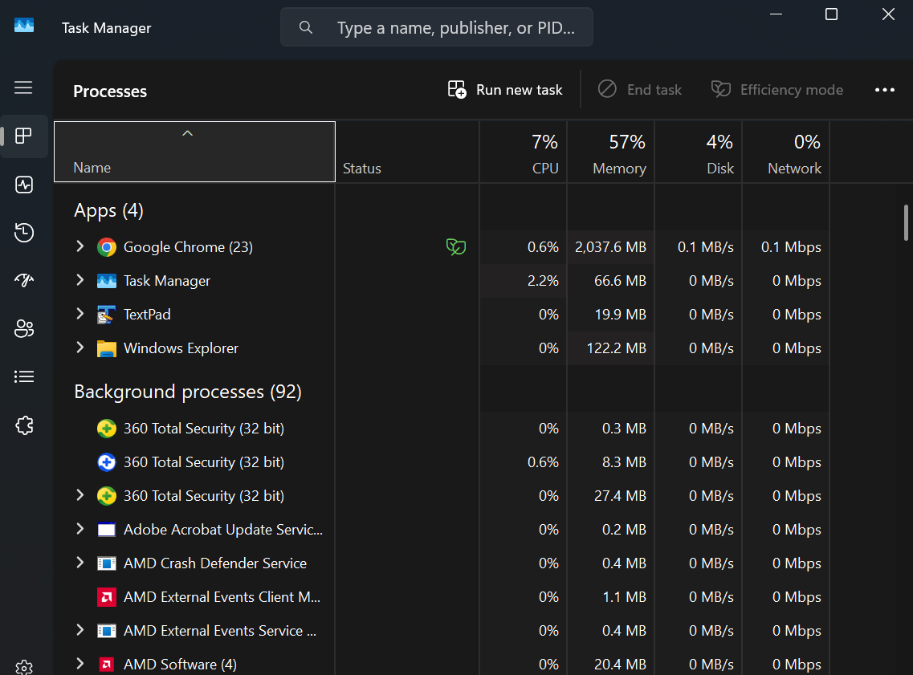

**Menampilkan daftar proses dengan tasklist**

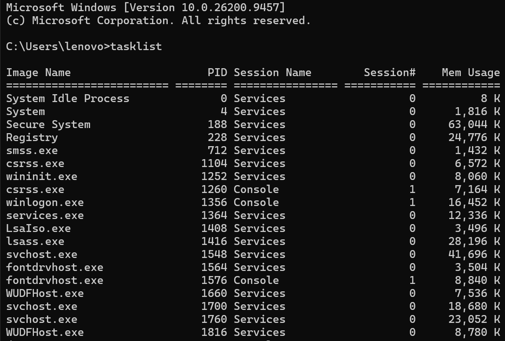

**Mencari proses Chrome**

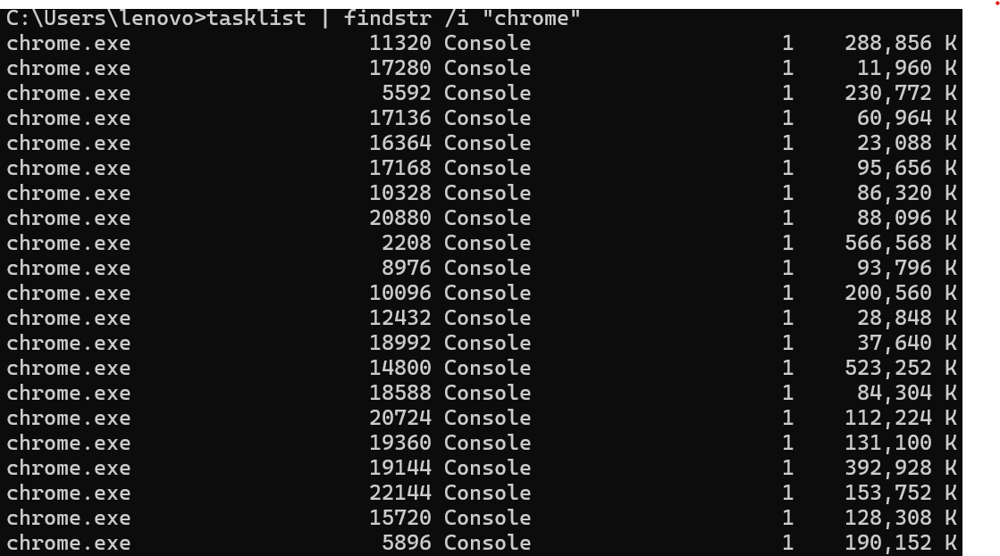

**Mencari proses Notepad**

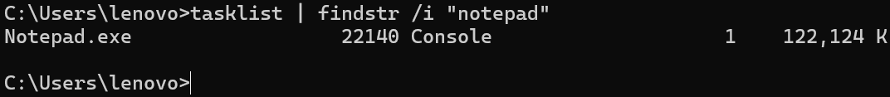

**Menghentikan proses Notepad**

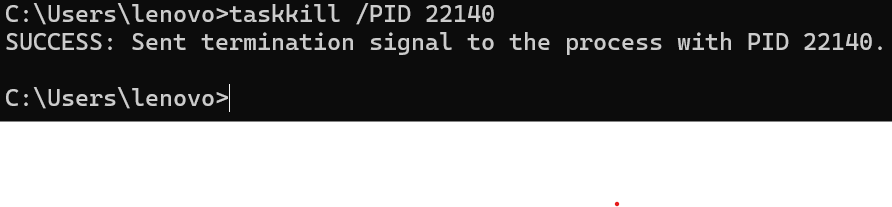

**Menjalankan kembali Notepad**

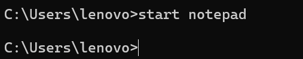

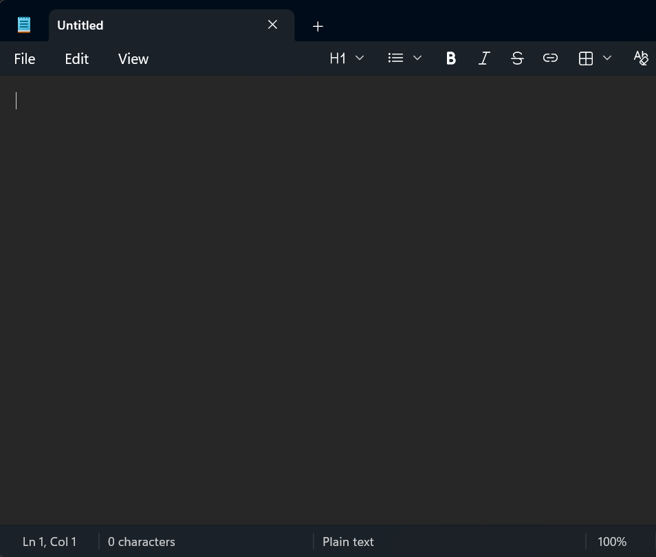

### 3.2 Persiapan Lingkungan Python

Lingkungan Python diperiksa menggunakan perintah `python --version` dan `uv --version`. Hasil pemeriksaan menunjukkan Python versi 3.14.0 dan uv versi 0.12.23. Perintah `uv pip list` digunakan untuk melihat paket yang tersedia pada lingkungan proyek.

**Pemeriksaan versi Python, uv, dan daftar paket**

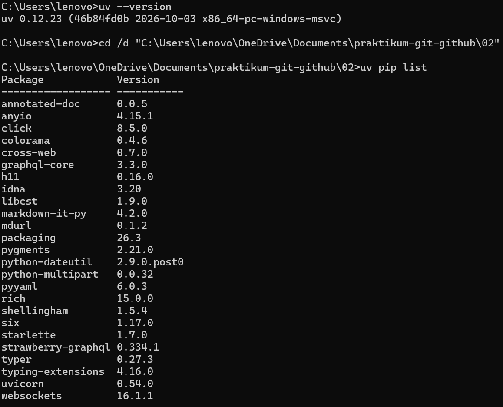

### 3.3 Pembuatan dan Pengujian Server GraphQL

Server GraphQL dibuat menggunakan Strawberry untuk menyediakan data buku. Data yang disediakan terdiri dari tiga buku, yaitu Laskar Pelangi karya Andrea Hirata, Bumi karya Tere Liye, dan Negeri 5 Menara karya Ahmad Fuadi.

Server berhasil dijalankan pada port 8001. Pengujian dilakukan melalui browser dengan membuka GraphiQL dan menjalankan query untuk meminta judul serta penulis buku.

**Server GraphQL berjalan**

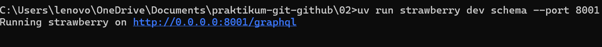

**Pengujian query melalui GraphiQL**

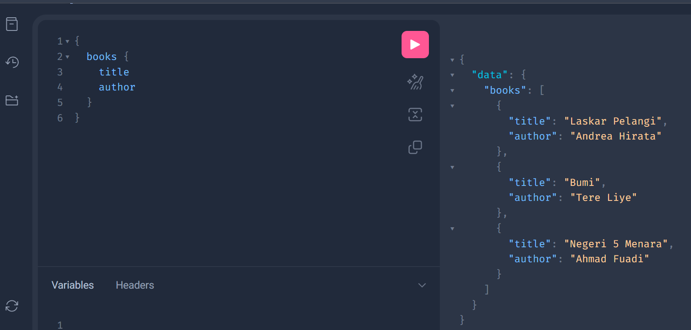

### 3.4 Pembuatan dan Pengujian Client GraphQL

Client Python digunakan untuk mengirim query ke server GraphQL melalui alamat `http://localhost:8001/graphql`. Setelah permintaan dikirim, server mengembalikan data buku dalam format JSON. Hasil pengujian menunjukkan bahwa client berhasil menerima data dari server.

**Hasil menjalankan client Python**

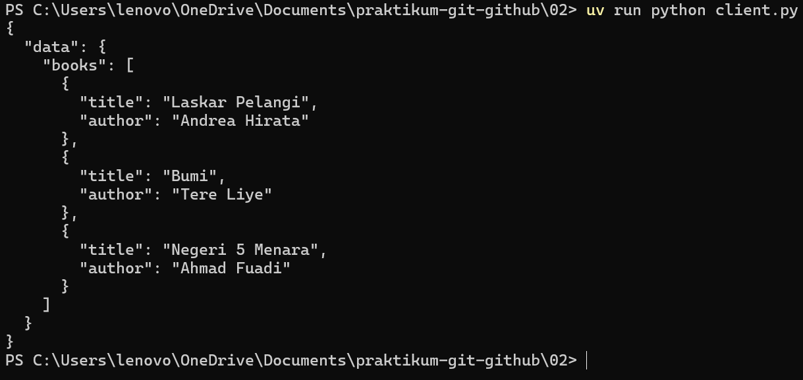

## 4. Hasil dan Pembahasan

### 4.1 Manajemen Proses Windows

Berdasarkan praktik yang dilakukan, Task Manager dapat digunakan untuk melihat proses yang sedang berjalan pada Windows. Perintah `tasklist` menampilkan daftar proses dalam bentuk teks, sedangkan `findstr` membantu mencari proses berdasarkan nama. Pada praktik ini, proses Notepad berhasil dihentikan menggunakan `taskkill` dan dijalankan kembali menggunakan `start notepad`. Dengan demikian, praktik ini membantu memahami cara sistem operasi mengelola proses aplikasi.

### 4.2 Persiapan Lingkungan Python

Pemeriksaan lingkungan menunjukkan bahwa Python versi 3.14.0 dan uv versi 0.12.23 tersedia. Perintah `uv pip list` menampilkan berbagai paket yang diperlukan, termasuk Strawberry GraphQL dan dependensinya. Pemeriksaan ini membantu memastikan lingkungan yang digunakan sudah memiliki paket untuk menjalankan praktik GraphQL.

### 4.3 Komunikasi Client-Server dengan GraphQL

Server GraphQL berhasil dijalankan pada port 8001 dan dapat diuji melalui GraphiQL di browser. Query yang meminta field `books`, `title`, dan `author` berhasil menghasilkan tiga data buku. Client Python juga berhasil menerima respons JSON dari server. Hasil ini menunjukkan bahwa client dapat mengirim permintaan dan server dapat mengembalikan data sesuai query yang diberikan.

## 5. Kesimpulan

Praktikum Modul 02 memberikan pemahaman mengenai manajemen proses Windows dan komunikasi client-server menggunakan GraphQL. Perintah Command Prompt dapat digunakan untuk melihat, mencari, menghentikan, dan menjalankan kembali proses aplikasi. Selain itu, lingkungan Python berhasil digunakan untuk menjalankan server GraphQL dan client. Pengujian menunjukkan bahwa client berhasil memperoleh tiga data buku dari server, sehingga komunikasi antara keduanya berjalan sesuai harapan.

## 6. Referensi

1. Dokumentasi Python: https://docs.python.org/3/
2. Dokumentasi Strawberry GraphQL: https://strawberry.rocks/
3. Dokumentasi uv: https://docs.astral.sh/uv/
4. Dokumentasi GraphQL: https://graphql.org/
