# Praktikum Minggu 04 — Konsistensi dan Replikasi pada Sistem Terdistribusi

**Nama:** Arsenius Kelvin Jemudin  
**NIM:** 255410015  
**Kelas:** IF-1  
**Program Studi:** Informatika  
**Universitas:** Universitas Teknologi Digital Indonesia  
**Sistem Operasi:** Windows 11 (Docker Desktop dengan WSL 2)

## 1. Tujuan Praktikum

1. Memahami konsep replikasi data untuk menjaga konsistensi dan ketersediaan pada sistem terdistribusi.
2. Mengonfigurasi *streaming replication* PostgreSQL 18 dengan satu primary dan satu replica menggunakan Docker Compose.
3. Membuktikan bahwa perubahan data di primary direplikasi ke replica, dan bahwa replica hanya dapat dibaca.
4. Mempraktikkan *High Availability* dengan mempromosikan replica menjadi primary ketika primary mati.
5. Memahami replikasi *master-master* menggunakan cluster Apache Ignite 3 dengan tiga node.

## 2. Struktur Folder

```
04/
├── README.md
├── images/                      (screenshot hasil praktikum, 01 sampai 29)
├── streaming-replication/
│   ├── 00_init.sql
│   ├── docker-compose.yaml
│   └── env.ps1
└── ignite/
    ├── docker-compose.yml
    ├── sql.zip
    └── sql/
        ├── schema.sql
        ├── current_catalog.sql
        ├── media_and_genre.sql
        ├── tracks.sql
        ├── ee_and_cust.sql
        └── invoices.sql
```

## 3. Dasar Teori

### 3.1 Replikasi Data

Replikasi adalah proses menyalin data dari satu server ke server lain sehingga beberapa salinan data tersimpan di node yang berbeda. Tujuannya adalah meningkatkan ketersediaan (*availability*), menyebarkan beban baca, dan menjaga data tetap ada ketika salah satu node gagal. Konsekuensinya, sistem harus menjaga konsistensi antarsalinan data.

### 3.2 Streaming Replication pada PostgreSQL

PostgreSQL mencatat setiap perubahan data ke dalam *Write-Ahead Log* (WAL). Pada *streaming replication*, server **primary** mengalirkan catatan WAL tersebut secara terus-menerus ke server **replica** (*standby*). Replica memutar ulang WAL sehingga datanya sama dengan primary. Replica berjalan dalam mode *recovery* sehingga hanya melayani akses baca (*read-only*). Penerapan yang dipakai di praktikum ini bersifat **asinkron** (`sync_state = async`): primary tidak menunggu konfirmasi replica sebelum menyelesaikan transaksi.

*Replication slot* adalah mekanisme agar primary menyimpan WAL yang belum diterima replica, sehingga replica tidak ketinggalan walaupun sempat terputus.

### 3.3 High Availability

Model primary dan replica dapat dipakai untuk *High Availability* (HA). Jika primary mati, salah satu replica dapat **dipromosikan** (`pg_promote()`) menjadi primary baru sehingga layanan baca dan tulis tetap berjalan.

### 3.4 Replikasi Master-Master dan Apache Ignite

Pada replikasi master-master, semua node dapat menerima operasi baca dan tulis. Apache Ignite 3 membentuk *cluster* dari beberapa node sehingga perubahan yang dilakukan pada satu node dapat dilihat dari node lain dalam cluster yang sama.

## 4. Implementasi dan Hasil Pengujian

### 4.0 Persiapan Lingkungan

Praktikum dikerjakan di Windows, sehingga petunjuk Linux pada modul disesuaikan: Docker dijalankan melalui Docker Desktop yang memakai WSL 2.

1. **Cek virtualisasi.** Task Manager menunjukkan *Virtualization: Enabled*.
2. **Pasang WSL 2** dengan `wsl --install` di PowerShell Administrator, lalu restart.
3. **Pasang Docker Desktop**, lalu pastikan status *Engine running*.
4. **Cek instalasi** dengan `docker --version`, `docker compose version`, dan `docker run hello-world`.

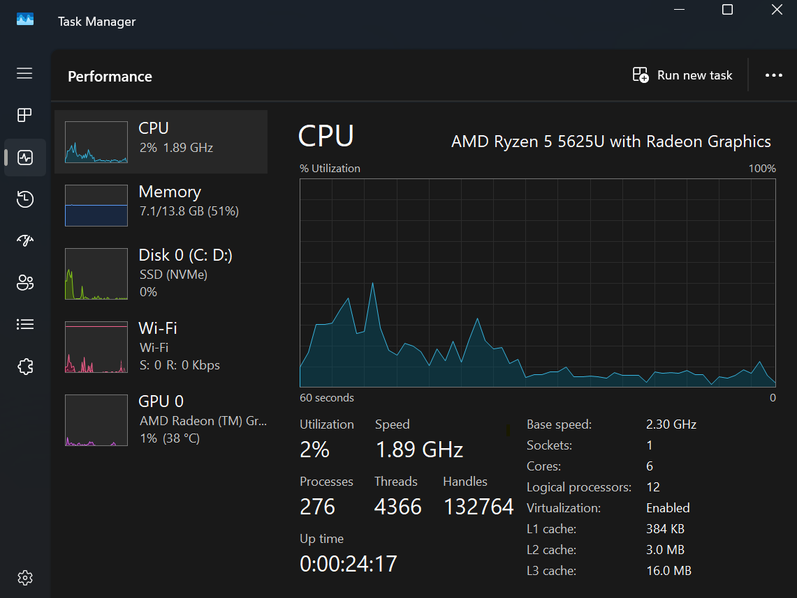

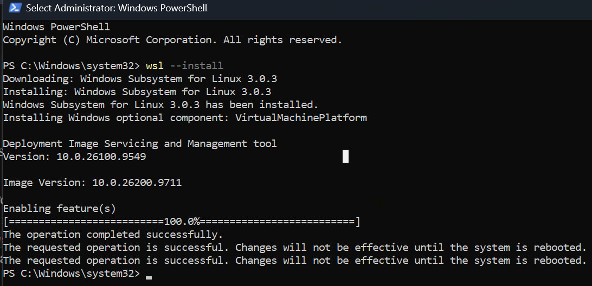

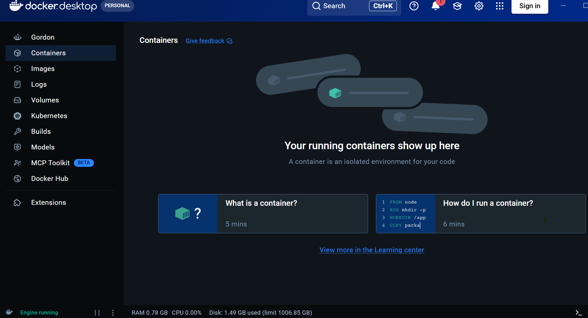

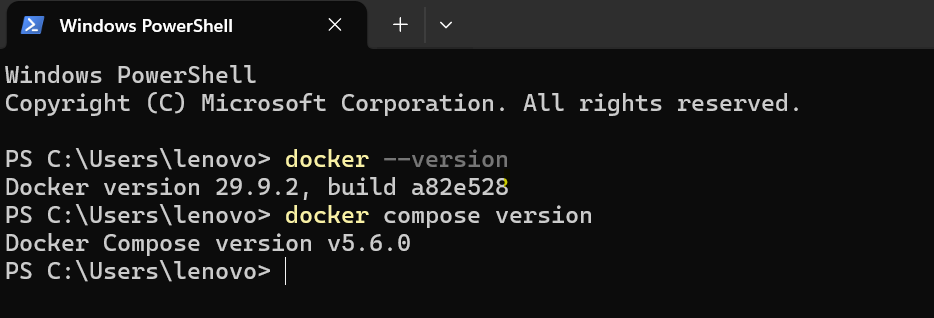

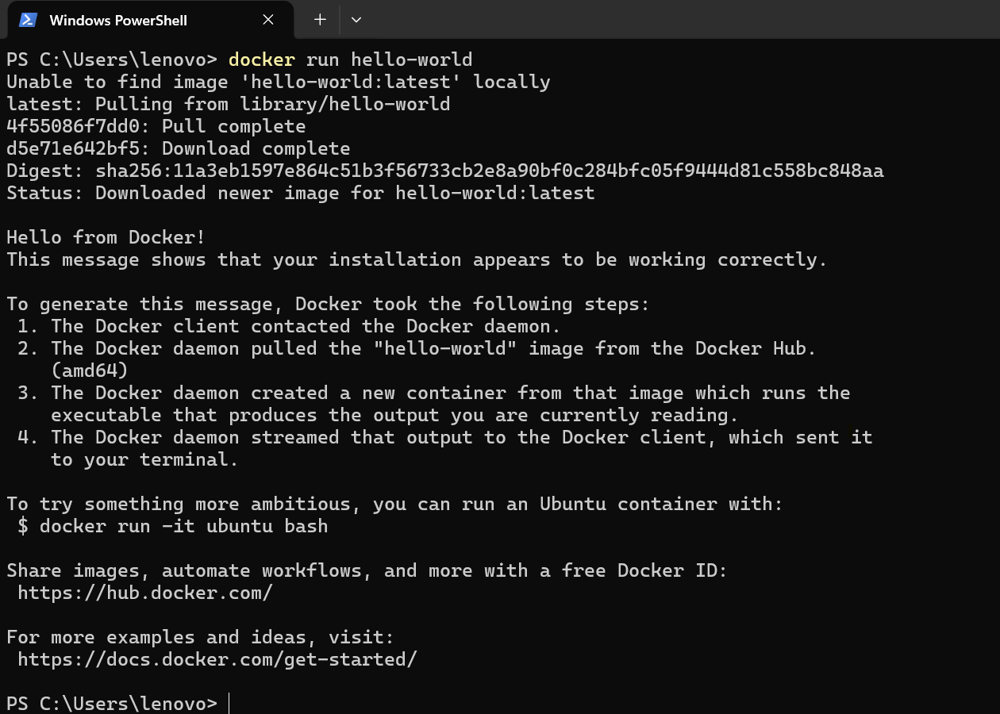

Hasil `hello-world` menampilkan pesan "Hello from Docker!", yang menandakan Docker daemon aktif dan dapat menjalankan container.

### 4.1 Streaming Replication PostgreSQL 18

#### 4.1.1 File Konfigurasi

Semua file dibuat di folder `C:\dev\streaming-replication` (di luar OneDrive agar *bind-mount* Docker tidak bermasalah).

**`00_init.sql`** membuat user `replicator` dan slot replikasi `replication_slot` ketika primary pertama kali diinisialisasi:

```sql
CREATE USER replicator WITH REPLICATION ENCRYPTED PASSWORD 'replicator_password';
SELECT pg_create_physical_replication_slot('replication_slot');
```

**`docker-compose.yaml`** mendefinisikan dua service: `postgres_primary` (port 5432) dan `postgres_replica` (port 5433). Primary dijalankan dengan `wal_level=replica`, `hot_standby=on`, `max_wal_senders=10`, `max_replication_slots=10`, dan `hot_standby_feedback=on`. Replica menyalin data primary dengan `pg_basebackup` lalu berjalan sebagai standby. Berikut versi akhir yang dipakai (perubahan pada bagian replica dijelaskan di bagian *Kendala dan Solusi*):

```yaml
x-postgres-common:
  &postgres-common
  image: postgres:18.3-alpine3.23
  user: postgres
  restart: always
  healthcheck:
    test: 'pg_isready -U zuser --dbname=zdb'
    interval: 10s
    timeout: 5s
    retries: 5

services:
  postgres_primary:
    <<: *postgres-common
    ports:
      - 5432:5432
    environment:
      POSTGRES_USER: zuser
      POSTGRES_DB: zdb
      POSTGRES_PASSWORD: zpass
      POSTGRES_HOST_AUTH_METHOD: "scram-sha-256\nhost replication replicator 0.0.0.0/0 md5"
      POSTGRES_INITDB_ARGS: "--auth-host=scram-sha-256"
    command: |
      postgres
      -c wal_level=replica
      -c hot_standby=on
      -c max_wal_senders=10
      -c max_replication_slots=10
      -c hot_standby_feedback=on
    volumes:
      - ./00_init.sql:/docker-entrypoint-initdb.d/00_init.sql

  postgres_replica:
    <<: *postgres-common
    ports:
      - 5433:5432
    environment:
      PGUSER: replicator
      PGPASSWORD: replicator_password
      PGDATA: /var/lib/postgresql/18/docker
    command: |
      bash -c "
      if [ ! -s /var/lib/postgresql/18/docker/PG_VERSION ]; then
        until pg_basebackup --pgdata=/var/lib/postgresql/18/docker -R --slot=replication_slot --host=postgres_primary --port=5432 -X stream; do
          echo 'pg_basebackup failed. Retrying in 5 seconds ...'
          sleep 5
        done
        echo 'Backup done, starting replica...'
        chmod 0700 /var/lib/postgresql/18/docker
      else
        echo 'Data directory already exists, skipping pg_basebackup...'
      fi
      postgres
      "
    depends_on:
      - postgres_primary
```

**`env.ps1`** adalah versi PowerShell dari `env.sh` pada modul (Windows tidak memakai `sudo`). File ini mendefinisikan fungsi singkat: `dcu` (`docker compose up -d`), `dcd` (`docker compose down`), `dps` (`docker ps`), `dlr` dan `dlp` (log replica dan primary), serta `der` dan `dep` (masuk ke container).

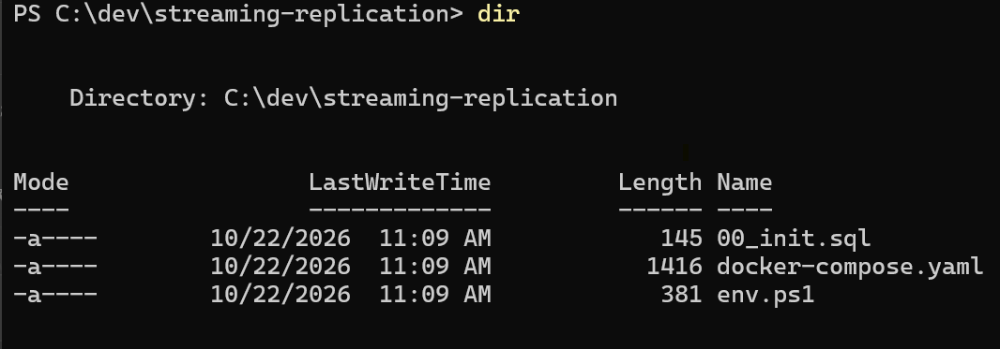

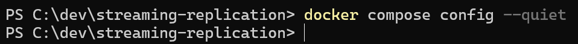

`docker compose config --quiet` tidak menampilkan apa pun, artinya sintaks `docker-compose.yaml` valid.

#### 4.1.2 Menjalankan Primary dan Replica

Setelah alias diaktifkan (`. .\env.ps1`), kedua server dijalankan dengan `dcu`. Pada pertama kali, image `postgres:18.3-alpine3.23` diunduh, lalu network dan dua container dibuat. Status container dicek dengan `dps`, dan kedua container berstatus **healthy**.

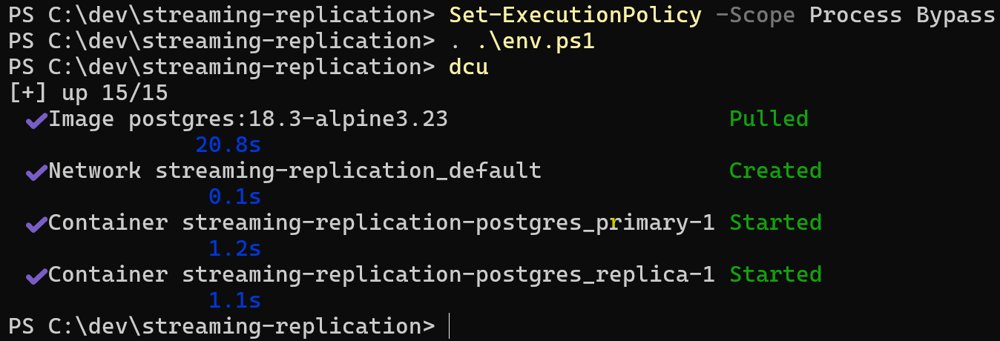

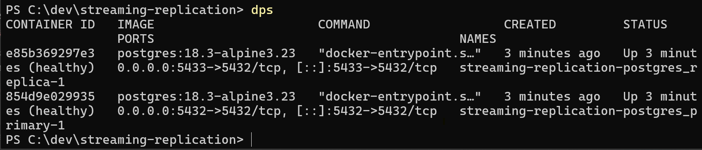

Log replica (`dlr`) menunjukkan replica menunggu primary siap, lalu `pg_basebackup` berhasil, replica masuk mode standby, dan mulai menerima WAL dari primary. Beberapa baris `pg_basebackup failed. Retrying in 5 seconds` di awal wajar karena replica menunggu primary selesai dinyalakan.

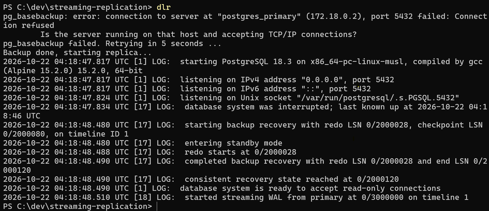

#### 4.1.3 Pengujian Replikasi

**Status replikasi di primary.** Query `SELECT * FROM pg_stat_replication;` menampilkan satu koneksi dari user `replicator` (`application_name = walreceiver`) dengan `client_addr` **[isi, mis. 172.18.0.3]**, yaitu container replica. Kolom `state` bernilai `streaming`, dan nilai `sent_lsn`, `write_lsn`, `flush_lsn`, serta `replay_lsn` sama (**[isi, mis. 0/304B538]**), sehingga replica tidak tertinggal dari primary. Nilai `sync_state = async` menunjukkan replikasi asinkron.

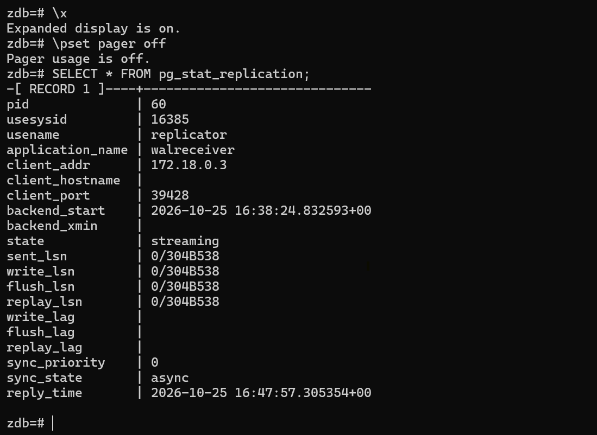

**Slot replikasi.** Query `SELECT * FROM pg_replication_slots;` menampilkan slot fisik `replication_slot` dengan `active = t`. Nilai `active_pid` sama dengan `pid` walreceiver pada `pg_stat_replication`, sehingga slot ini sedang dipakai replica. `wal_status = reserved` berarti WAL yang dibutuhkan masih tersimpan di primary.

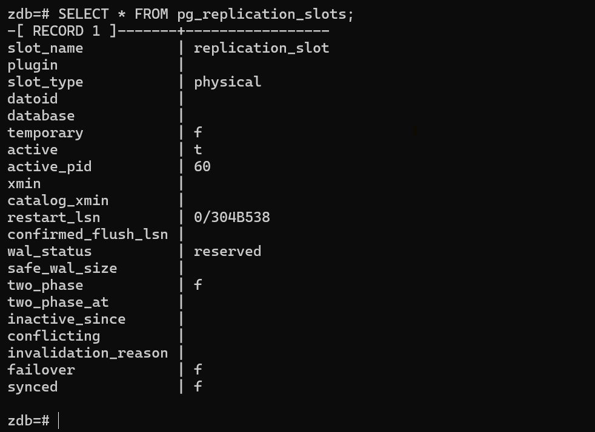

**Status replica.** Query `SELECT pg_is_in_recovery();` pada replica bernilai `t` (true). Artinya server ini berjalan dalam mode standby yang hanya menerima data dari primary dan melayani akses baca.

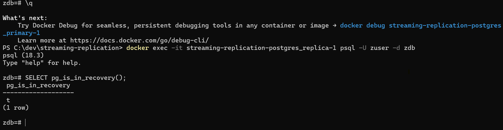

**Percobaan manipulasi data.** Untuk melihat efek replikasi, dibuat tabel di primary dan hasilnya diperiksa di replica.

*Sebelum tabel dibuat*, perintah `\dt` di replica dan di primary sama-sama menampilkan "Did not find any tables."

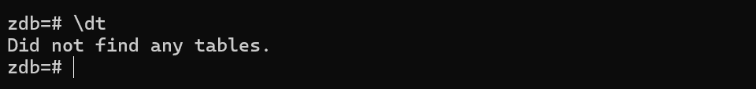

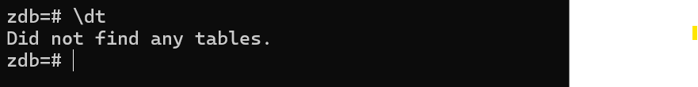

*Di primary*, dibuat tabel `testrep` dan diisi dua baris:

```sql
CREATE TABLE testrep (first INT, second VARCHAR(15));
INSERT INTO testrep (first, second) VALUES (21, 'Test pertama');
INSERT INTO testrep (first, second) VALUES (23, 'Test ke dua');
SELECT * FROM testrep;
```

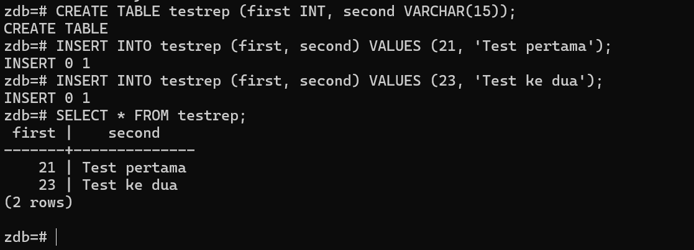

*Di replica*, tabel `testrep` beserta kedua barisnya muncul tanpa pernah dibuat di replica. Ini membuktikan perubahan di primary direplikasi otomatis melalui streaming WAL.

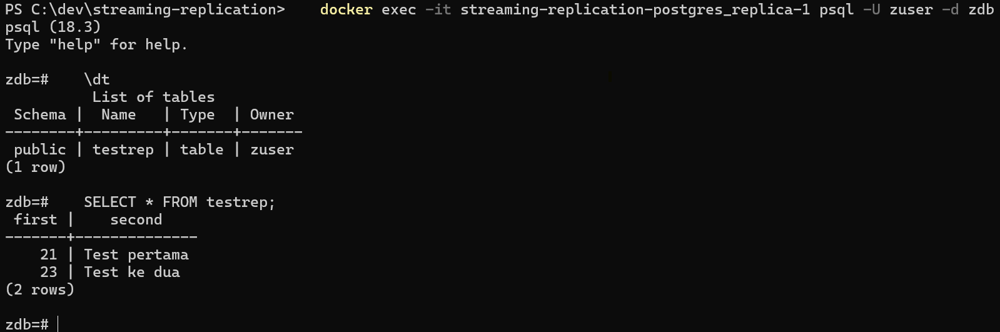

*Uji tulis ke replica.* Perintah `INSERT INTO testrep (first, second) VALUES (99, 'Dari replica');` di replica ditolak dengan error `cannot execute INSERT in a read-only transaction`. Replica berada dalam mode recovery sehingga penulisan hanya dapat dilakukan lewat primary.

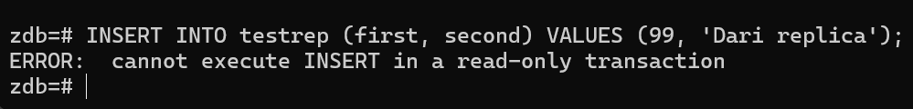

#### 4.1.4 High Availability

Skenario: primary mati, lalu replica dipromosikan menjadi primary baru.

1. **Primary dimatikan** dengan `docker compose stop postgres_primary`. Container primary berstatus *Stopped*, sedangkan replica masih berjalan.

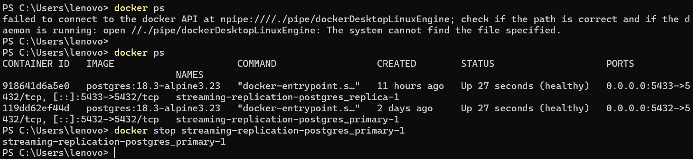

2. **Replica dipromosikan.** Di replica, `SELECT pg_is_in_recovery();` bernilai `t`. Setelah `SELECT pg_promote();` (hasil `t`), pemeriksaan ulang `pg_is_in_recovery()` bernilai `f`. Artinya server tersebut keluar dari mode recovery dan kini berfungsi sebagai primary yang dapat menerima operasi baca dan tulis.

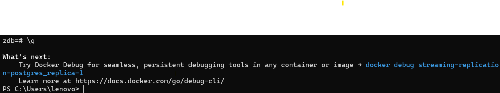

3. **Seluruh container dimatikan** dengan `dcd`, dan `dps` menampilkan daftar kosong.

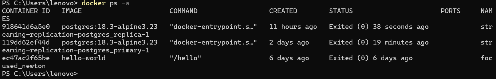

Dengan cara ini layanan database tetap tersedia walaupun primary awal mati. Karena replikasi bersifat asinkron, data yang belum sempat diterima replica saat primary mati berpotensi hilang.

### 4.2 Replikasi Master-Master dengan Apache Ignite 3

Pada bagian ini dibuat cluster Apache Ignite 3.1.0 dengan tiga node (`node1`, `node2`, `node3`) memakai Docker Compose. Port REST administratif node-node tersebut adalah **10300**, **10301**, dan **10302**, sedangkan port koneksi aplikasi adalah **10800** sampai **10802**. File `docker-compose.yml` dan `sql.zip` diambil dari dokumentasi Apache Ignite 3. Pada modul tertulis Ignite 3.0.0 di beberapa perintah, tetapi gambar dan alias memakai 3.1.0, sehingga yang dipakai adalah **3.1.0**.

**Inisialisasi cluster.** Setelah ketiga node berjalan, Ignite CLI dijalankan dan terhubung ke `http://localhost:10300`. Cluster diinisialisasi dengan:

```
cluster init --name=ignite3 --metastorage-group=node1,node2,node3
```

Hasil `cluster status` menunjukkan nama cluster `ignite3`, jumlah node **3**, dan status **active**. Setelah cluster aktif, semua perubahan yang dikerjakan pada satu node direplikasi ke node lain dalam cluster yang sama.

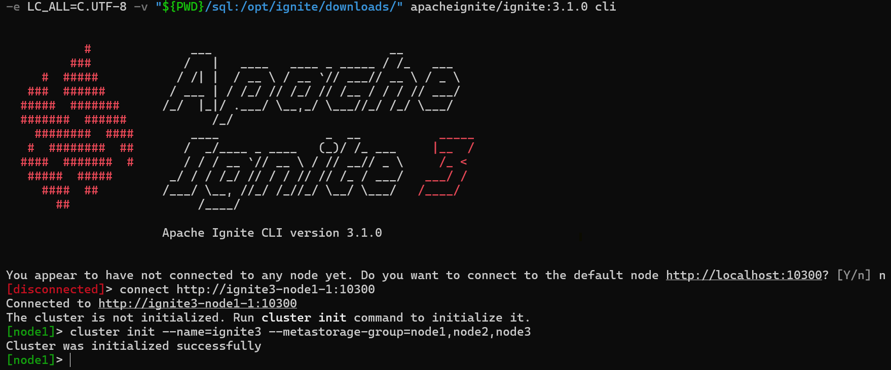

**Menjalankan SQL.** File SQL dari `sql.zip` di-*mount* ke container (`/opt/ignite/sql`) dan dijalankan di node 1 dengan `sql --file=...`. Urutannya: `schema.sql` (membuat skema dan tabel), lalu `current_catalog.sql`, `media_and_genre.sql`, `tracks.sql`, `ee_and_cust.sql`, dan `invoices.sql` (mengisi data).

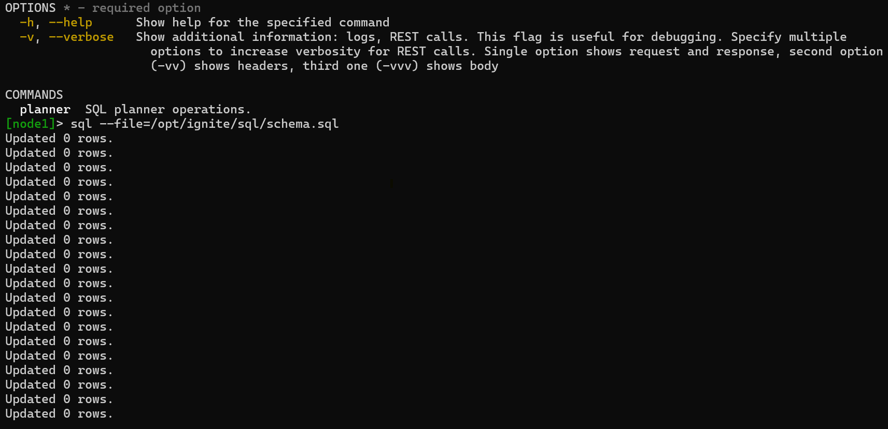

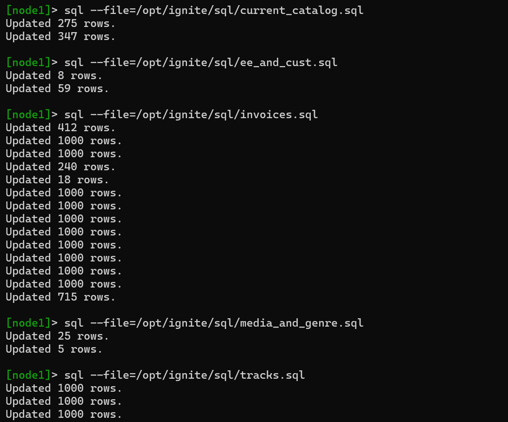

Query `SELECT * FROM system.tables WHERE schema = 'PUBLIC';` menampilkan tabel-tabel yang dibuat (antara lain `ALBUM`, `ARTIST`, `TRACK`, `CUSTOMER`, `EMPLOYEE`, `INVOICE`, `INVOICELINE`, `GENRE`, `MEDIATYPE`, `PLAYLIST`, dan `PLAYLISTTRACK`), masing-masing berada pada zona `CHINOOK` atau `CHINOOKREPLICATED`.

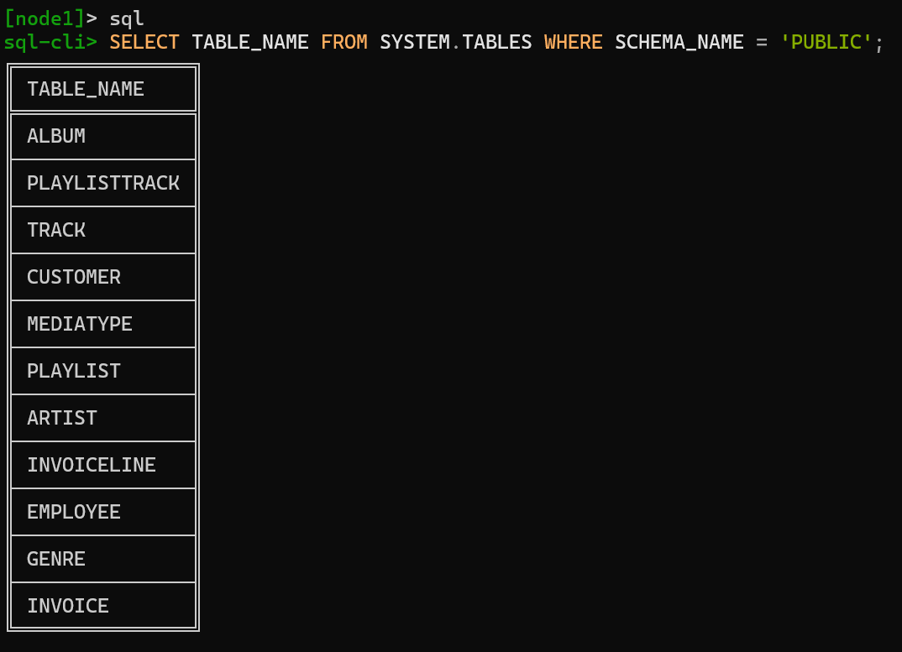

**Pengecekan di node lain.** Data yang dimasukkan lewat node 1 (`localhost:10300`) diperiksa dengan terhubung ke node lain.

- **Node 2 (`localhost:10301`).** `SELECT COUNT(*) FROM Invoice;` menghasilkan **[isi, mis. 412]** baris, dan query ringkasan penjualan bulanan juga menghasilkan data.

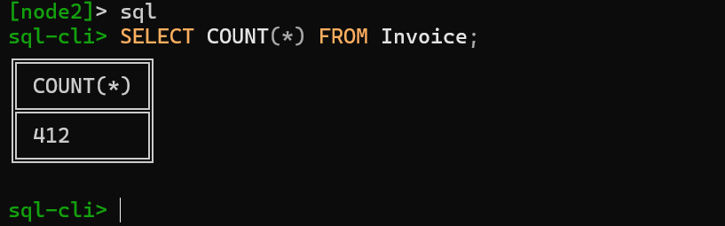

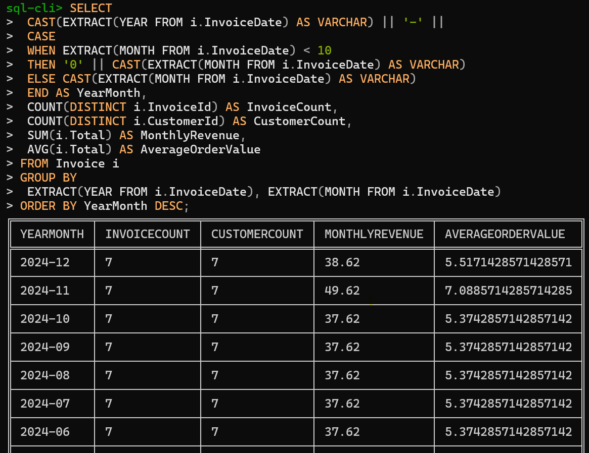

- **Node 3 (`localhost:10302`).** Hasilnya sama dengan node 2.

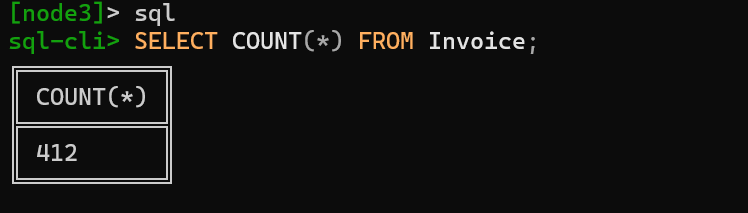

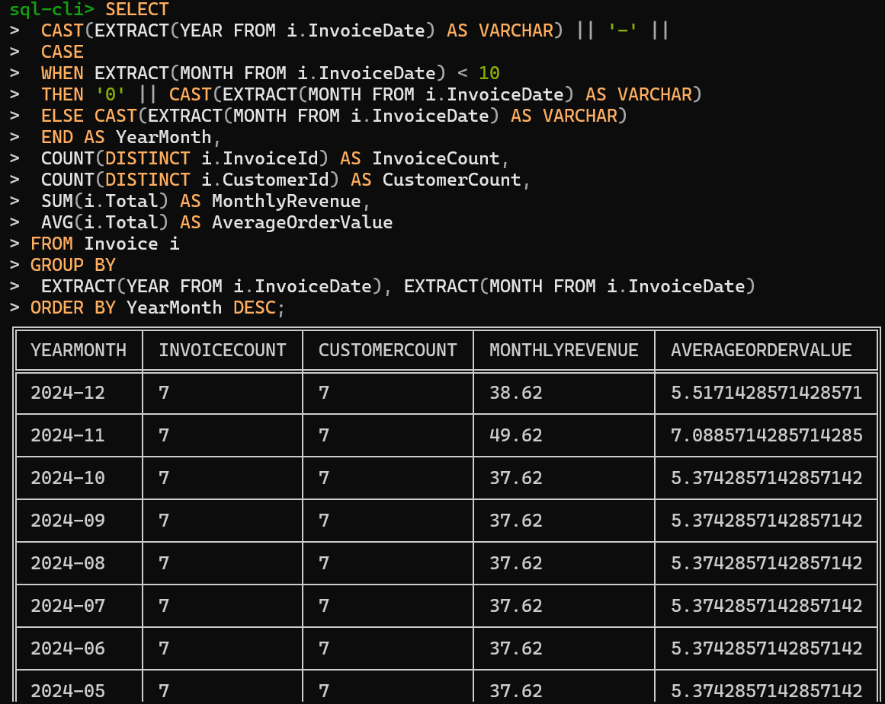

Jumlah invoice dan hasil query analitik di node 2 dan node 3 sama dengan data yang dimasukkan lewat node 1. Ini menunjukkan bahwa seluruh node berisi data yang sama, sehingga replikasi master-master pada cluster Apache Ignite 3.1.0 berfungsi.

Terakhir, seluruh node dimatikan dengan `dcd`.

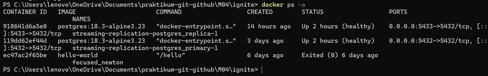

## 5. Kendala dan Solusi

**1. Docker Desktop menampilkan "Virtual Machine Platform is not enabled".** Fitur *Virtual Machine Platform* sudah diaktifkan oleh `wsl --install`, tetapi baru berlaku setelah Windows di-*restart*. Solusinya: restart Windows (bukan hanya menutup Docker Desktop), lalu buka kembali Docker Desktop.

<!-- Jika file screenshot ada, hapus tanda komentar pada baris di bawah.

-->

**2. Skrip `env.ps1` tidak dapat dijalankan** (*running scripts is disabled on this system*). PowerShell memblokir skrip secara default. Solusinya: `Set-ExecutionPolicy -Scope Process Bypass`, yang hanya berlaku di jendela PowerShell yang sedang dipakai.

<!-- Jika file screenshot ada, hapus tanda komentar pada baris di bawah.

-->

**3. Container replica berstatus `unhealthy` setelah Docker dijalankan ulang.** Log replica menampilkan `pg_basebackup: error: directory "/var/lib/postgresql/18/docker" exists but is not empty` yang berulang. Penyebabnya, command replica pada modul selalu menjalankan `pg_basebackup`, padahal folder data sudah berisi hasil backup sebelumnya ketika container menyala kembali (`restart: always`). `pg_basebackup` menolak folder yang tidak kosong, sehingga PostgreSQL replica tidak pernah dijalankan.

Solusinya, command replica diubah agar `pg_basebackup` hanya dijalankan jika file `PG_VERSION` belum ada. Jika data sudah ada, PostgreSQL langsung dijalankan sebagai standby. Setelah perbaikan, log menampilkan `Data directory already exists, skipping pg_basebackup...`, lalu `entering standby mode` dan `started streaming WAL from primary`, dan replica kembali berstatus healthy.

<!-- Jika file screenshot ada, hapus tanda komentar pada baris di bawah.


-->

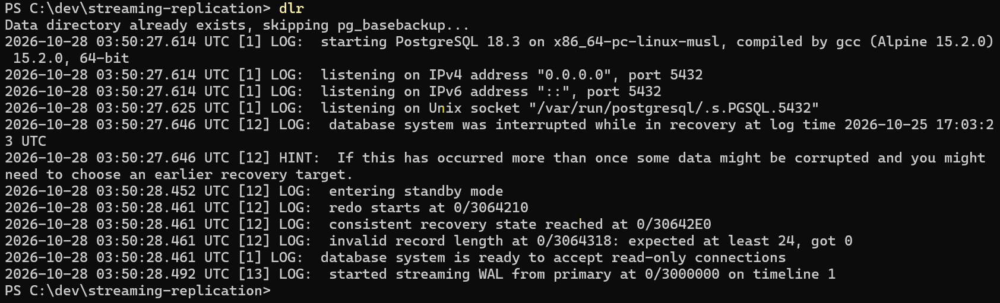

## 6. Kesimpulan

1. Streaming replication PostgreSQL mengalirkan WAL dari primary ke replica secara terus-menerus, dan hasilnya terlihat pada `pg_stat_replication` (`state = streaming`) serta tabel yang dibuat di primary muncul otomatis di replica.
2. Replica berjalan dalam mode recovery sehingga hanya melayani akses baca, dan penulisan langsung ke replica ditolak.
3. Primary yang mati dapat digantikan dengan mempromosikan replica memakai `pg_promote()`. Karena replikasi bersifat asinkron, ada risiko kehilangan data yang belum diterima replica.
4. Pada cluster Apache Ignite 3 dengan tiga node, data yang dimasukkan lewat satu node dapat dibaca dari node lain, sehingga replikasi master-master berfungsi.
5. Penggunaan Docker Compose mempermudah pembuatan lingkungan replikasi, tetapi konfigurasi perlu memperhatikan keadaan container saat dijalankan ulang, seperti terlihat pada kendala `pg_basebackup`.

## 7. Referensi

1. Materi Praktikum Sistem Terdistribusi dan Terdesentralisasi, Modul 04: Konsistensi dan Replikasi pada Sistem Terdistribusi.
2. Eremeykin, "How to set up single primary PostgreSQL replication with Docker Compose". https://medium.com/@eremeykin/how-to-setup-single-primary-postgresql-replication-with-docker-compose-98c48f233bbf
3. Dokumentasi PostgreSQL, *High Availability, Load Balancing, and Replication*. https://www.postgresql.org/docs/current/high-availability.html
4. Dokumentasi Apache Ignite 3. https://ignite.apache.org/docs/ignite3/latest/index
5. Dokumentasi Docker Compose. https://docs.docker.com/compose/