# MODUL 05 — FAULT TOLERANCE
**Nama:** Arsenius Kelvin Jemudin  
**NIM:** 255410015  
**Kelas:** IF-1  
**Program Studi:** Informatika  
**Universitas:** Universitas Teknologi Digital Indonesia  

## A. PENDAHULUAN

Praktikum Modul 05 membahas *fault tolerance* pada sistem terdistribusi. Fault tolerance merupakan kemampuan sistem untuk menangani kegagalan agar layanan tetap dapat digunakan atau dapat kembali berjalan setelah terjadi masalah. Pada praktikum ini, kegiatan dilakukan dengan membuat aplikasi web menggunakan Blacksheep, menjalankan aplikasi melalui Docker dan Nginx, serta menguji beberapa mekanisme untuk mendeteksi dan menangani kegagalan layanan.

Kegiatan praktikum meliputi persiapan lingkungan Python, pembuatan aplikasi web, penerapan load balancing menggunakan Docker Compose dan Nginx, serta pengujian heartbeat, retry, dan circuit breaker. Setiap tahapan dilengkapi dengan hasil pengujian berupa screenshot sebagai bukti pelaksanaan praktikum.

## B. DASAR TEORI

## 1. Fault Tolerance

Fault tolerance merupakan pendekatan untuk menangani kegagalan pada sistem agar dampaknya dapat dikurangi. Dalam sistem terdistribusi, kegagalan dapat terjadi ketika suatu layanan tidak aktif atau tidak dapat diakses. Oleh karena itu, diperlukan mekanisme untuk memeriksa kondisi layanan dan menangani permintaan yang gagal.

## 2. Load Balancing

Load balancing merupakan mekanisme untuk membagikan permintaan ke beberapa instance aplikasi. Pada praktikum ini, Nginx digunakan sebagai proxy, sedangkan Docker Compose digunakan untuk menjalankan dan mengelola layanan aplikasi. Aplikasi Blacksheep dijalankan menggunakan dua instance sesuai dengan konfigurasi praktikum.

## 3. Heartbeat

Heartbeat digunakan untuk memeriksa apakah server dapat dijangkau. Pada praktikum ini, program `check-server.py` digunakan untuk menguji kondisi server ketika aplikasi Blacksheep tidak aktif dan ketika aplikasi sudah berjalan.

## 4. Retry

Retry merupakan mekanisme untuk mencoba kembali suatu permintaan ketika terjadi kegagalan. Pada praktikum ini, program `check-retry.py` digunakan untuk menguji akses ke aplikasi Blacksheep dalam kondisi server tidak aktif dan aktif.

## 5. Circuit Breaker

Circuit breaker merupakan pola desain yang membantu mencegah kegagalan berantai dengan membatasi sementara permintaan ke layanan yang mengalami kegagalan. Pola ini memiliki tiga status utama, yaitu *closed*, *open*, dan *half-open*. Status tersebut digunakan untuk mengatur apakah permintaan dapat diteruskan, ditolak sementara, atau diuji kembali setelah waktu pemulihan.

## C. IMPLEMENTASI

## 1. Persiapan Lingkungan Python

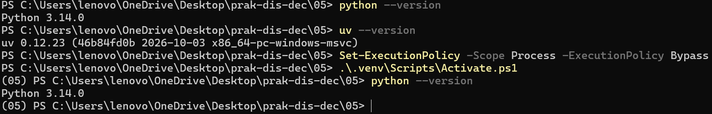

**Pembahasan:**

Pada tahap ini dilakukan pemeriksaan lingkungan Python yang digunakan untuk praktikum. Python diperlukan untuk menjalankan aplikasi dan program pengujian pada Modul 05. Lingkungan virtual juga disiapkan agar paket yang diperlukan dapat dipasang secara terpisah dari lingkungan Python utama. Persiapan ini menjadi langkah awal sebelum melakukan instalasi pustaka dan membuat aplikasi web menggunakan Blacksheep.

## 2. Instalasi Blacksheep

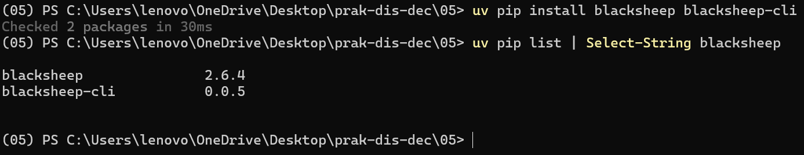

**Pembahasan:**

Pada tahap ini dilakukan instalasi pustaka Blacksheep yang digunakan untuk membangun aplikasi web berbasis Python. Instalasi dilakukan pada lingkungan virtual praktikum agar paket yang dibutuhkan tersedia di lingkungan tersebut. Blacksheep kemudian digunakan untuk membuat aplikasi yang akan dijalankan secara lokal dan digunakan dalam pengujian berikutnya.

## 3. Pembuatan Aplikasi Blacksheep

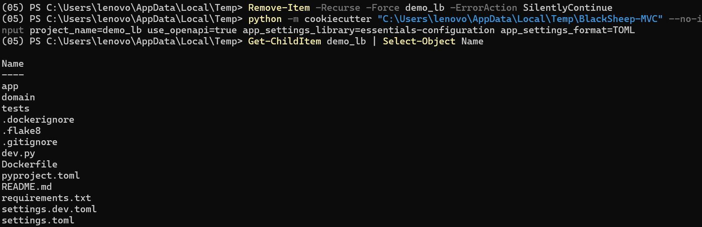

**Pembahasan:**

Pada tahap ini dibuat proyek aplikasi web menggunakan Blacksheep. Pembuatan proyek dilakukan sebagai dasar untuk menjalankan layanan web yang akan digunakan dalam pengujian. Aplikasi tersebut selanjutnya dijalankan pada lingkungan lokal dan digunakan sebagai layanan utama dalam penerapan load balancing serta pengujian deteksi kegagalan.

## 4. Pemeriksaan Struktur File

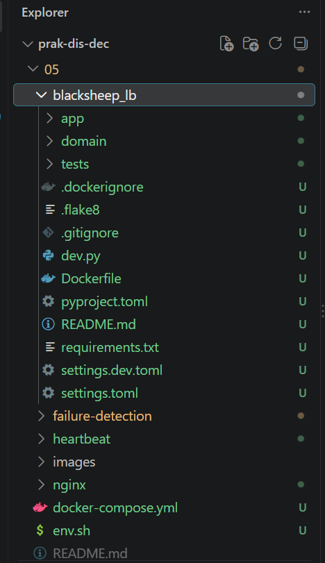

**Pembahasan:**

Screenshot ini menunjukkan struktur file dan direktori yang digunakan dalam praktikum. Pemisahan file ke dalam direktori yang sesuai membantu mempermudah pengelolaan aplikasi, konfigurasi Docker, Nginx, serta program pengujian. Struktur proyek yang teratur juga memudahkan proses menjalankan perintah dari direktori yang benar.

## 5. Menjalankan Aplikasi secara Lokal

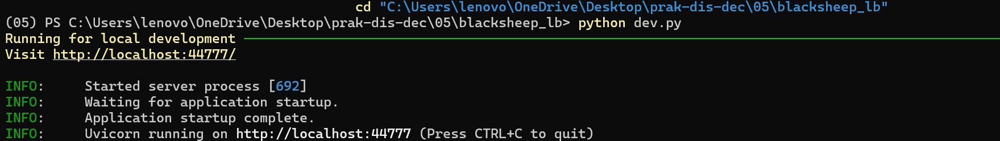

**Pembahasan:**

Pada tahap ini aplikasi Blacksheep dijalankan menggunakan server pengembangan. Aplikasi berjalan pada alamat `http://localhost:44777/`. Alamat tersebut digunakan untuk mengakses aplikasi dari komputer yang sama. Menjalankan aplikasi secara lokal dilakukan terlebih dahulu untuk memastikan layanan dapat berjalan sebelum diterapkan menggunakan Docker dan Nginx.

## 6. Mengakses Aplikasi melalui Browser

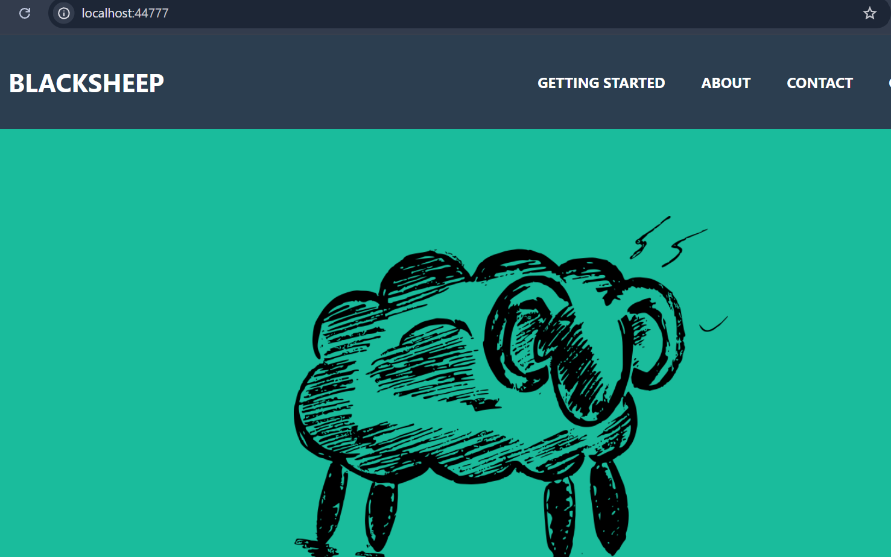

**Pembahasan:**

Screenshot ini memperlihatkan aplikasi Blacksheep yang diakses melalui browser menggunakan alamat `http://localhost:44777/`. Hasil tersebut menunjukkan bahwa aplikasi dapat diakses melalui server pengembangan yang dijalankan sebelumnya. Tahap ini menjadi pemeriksaan awal sebelum aplikasi digunakan dalam pengujian load balancing dan mekanisme penanganan kegagalan.

## 7. Menyiapkan Dockerfile

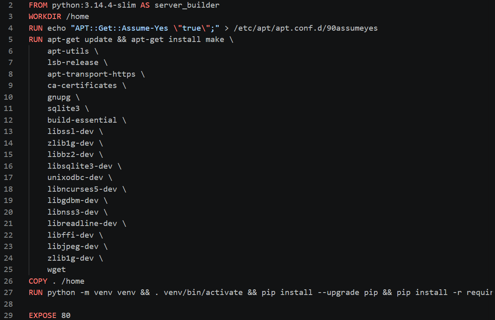

**Pembahasan:**

Pada tahap ini disiapkan Dockerfile untuk membangun image aplikasi Blacksheep. Dockerfile berisi instruksi yang diperlukan untuk menyiapkan lingkungan aplikasi di dalam container. Berdasarkan konfigurasi praktikum, aplikasi dalam container menggunakan port 80, berbeda dari port 44777 yang digunakan ketika aplikasi dijalankan secara lokal. Pengaturan ini perlu diperhatikan agar komunikasi antar layanan melalui Docker Compose dapat berjalan sesuai konfigurasi.

## 8. Memeriksa Versi Docker

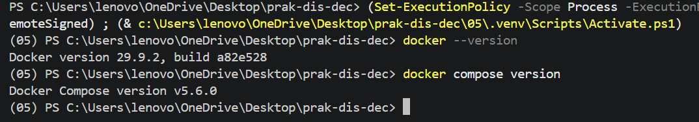

**Pembahasan:**

Pada tahap ini dilakukan pemeriksaan versi Docker yang terpasang pada komputer. Docker digunakan untuk menjalankan aplikasi di dalam container, sedangkan Docker Compose digunakan untuk mengelola beberapa layanan dalam satu konfigurasi. Pemeriksaan versi dilakukan untuk memastikan perangkat yang digunakan telah menyediakan Docker sebelum proses pembangunan dan menjalankan container dilakukan.

## 9. Menyiapkan Konfigurasi Docker Compose

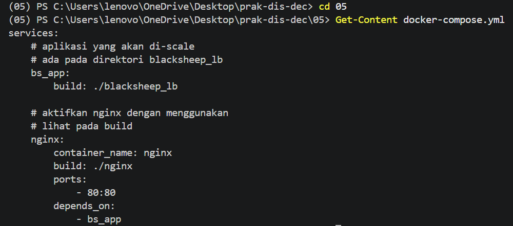

**Pembahasan:**

Pada tahap ini disiapkan file `docker-compose.yml` untuk mengatur layanan yang dibutuhkan dalam praktikum. Konfigurasi tersebut mencakup aplikasi Blacksheep dan layanan Nginx. Docker Compose membantu menjalankan layanan secara terkoordinasi, mengatur port yang digunakan, serta menghubungkan layanan agar dapat berkomunikasi di dalam jaringan Docker.

## 10. Menyiapkan Konfigurasi Nginx

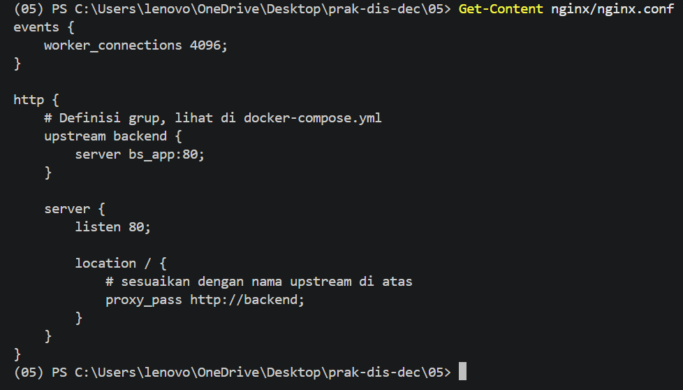

**Pembahasan:**

Screenshot ini menunjukkan konfigurasi Nginx yang digunakan sebagai proxy untuk aplikasi. Nginx menerima permintaan melalui port 80 dan meneruskannya ke layanan backend yang ditentukan pada konfigurasi `upstream`. Dalam praktikum ini, Nginx dihubungkan ke layanan aplikasi Blacksheep melalui Docker Compose. Konfigurasi tersebut menjadi bagian penting dalam penerapan load balancing pada aplikasi.

## 11. Menjalankan Docker Compose — Bagian 1

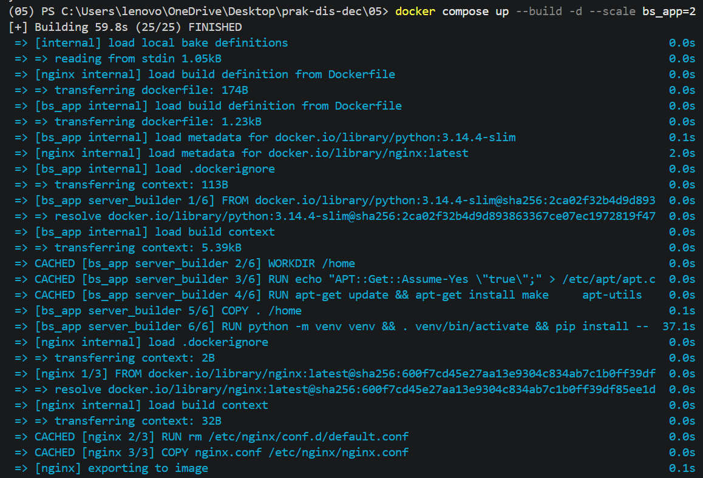

**Pembahasan:**

Pada tahap ini dijalankan perintah Docker Compose untuk membangun image dan menjalankan layanan yang telah dikonfigurasi. Proses pembangunan menyiapkan kebutuhan aplikasi agar dapat dijalankan di dalam container. Tahap ini merupakan bagian awal dari penerapan aplikasi menggunakan Docker sebelum dilakukan pemeriksaan terhadap container yang berjalan.

## 12. Menjalankan Docker Compose — Bagian 2

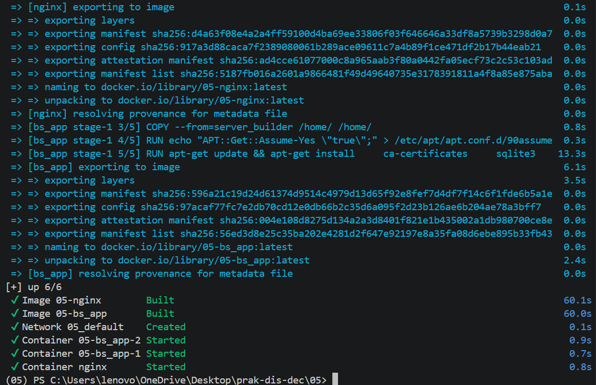

**Pembahasan:**

Screenshot ini memperlihatkan kelanjutan proses pembangunan dan menjalankan layanan menggunakan Docker Compose. Pada praktikum ini, perintah dijalankan dengan pengaturan dua instance aplikasi Blacksheep melalui opsi `--scale bs_app=2`. Kedua instance tersebut disiapkan sebagai layanan aplikasi yang dapat digunakan oleh konfigurasi Nginx. Keberhasilan tahap ini kemudian diperiksa melalui daftar container yang berjalan.

## 13. Memeriksa Container yang Berjalan

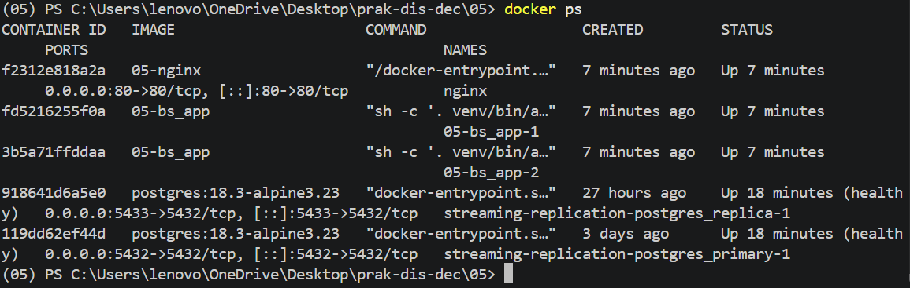

**Pembahasan:**

Pada tahap ini dilakukan pemeriksaan container menggunakan perintah `docker ps`. Hasil pemeriksaan menunjukkan container Nginx dan dua instance aplikasi Blacksheep dalam kondisi berjalan. Hal ini menunjukkan bahwa layanan yang diperlukan telah berhasil dijalankan. Pemeriksaan container juga membantu memastikan bahwa proses penerapan melalui Docker Compose telah berjalan sebelum aplikasi diuji melalui browser.

## 14. Menguji Aplikasi melalui Load Balancing

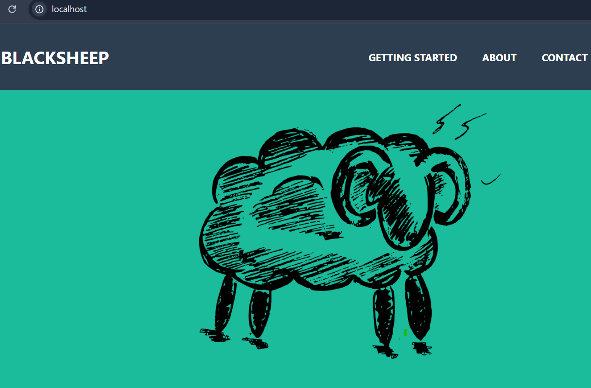

**Pembahasan:**

Pada tahap ini aplikasi diakses melalui browser menggunakan alamat `http://localhost`, yaitu port yang dipublikasikan oleh layanan Nginx. Berbeda dari pengujian aplikasi secara lokal yang menggunakan port 44777, akses ini melewati Nginx yang bertindak sebagai proxy. Screenshot menunjukkan bahwa aplikasi dapat diakses melalui layanan tersebut. Dengan demikian, jalur akses melalui Nginx telah berhasil digunakan dalam penerapan load balancing.

## 15. Memeriksa Log Docker

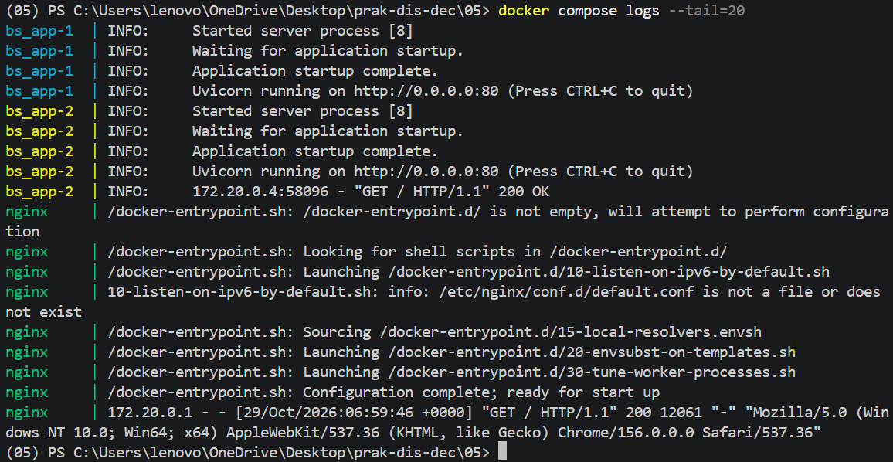

**Pembahasan:**

Pada tahap ini dilakukan pemeriksaan log dari layanan yang dijalankan menggunakan Docker Compose. Log digunakan untuk melihat aktivitas aplikasi dan Nginx selama layanan berjalan. Hasil pengujian sebelumnya menunjukkan adanya permintaan HTTP yang berhasil dengan status `200 OK`. Informasi tersebut membantu memastikan bahwa permintaan yang masuk dapat diproses oleh aplikasi dan mempermudah pemeriksaan apabila terjadi kesalahan.

## 16. Menghentikan Layanan Docker Compose

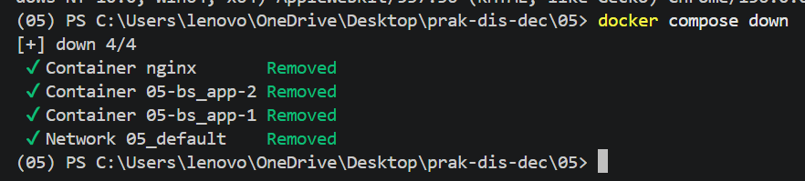

**Pembahasan:**

Pada tahap ini layanan praktikum dihentikan menggunakan perintah `docker compose down`. Perintah tersebut digunakan untuk menghentikan dan menghapus container serta jaringan yang dibuat oleh Docker Compose untuk proyek ini. Tahap ini dilakukan setelah pengujian load balancing selesai, sehingga lingkungan praktikum dapat dibersihkan sebelum beralih ke pengujian heartbeat, retry, dan circuit breaker.

## 17. Pengujian Heartbeat saat Server Tidak Aktif

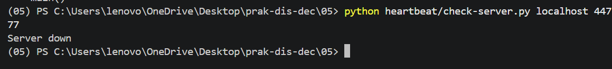

**Pembahasan:**

Pada tahap ini program `heartbeat/check-server.py` dijalankan ketika aplikasi Blacksheep tidak aktif pada port 44777. Hasil pengujian menampilkan pesan `Server down`. Hasil tersebut menunjukkan bahwa program tidak dapat menjangkau server pada alamat dan port yang diperiksa. Pengujian ini memperlihatkan bagaimana heartbeat sederhana digunakan untuk memeriksa kondisi ketersediaan layanan.

## 18. Pengujian Heartbeat saat Server Aktif

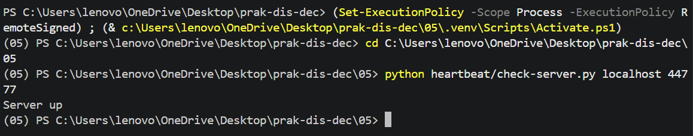

**Pembahasan:**

Pada tahap ini aplikasi Blacksheep dijalankan kembali pada port 44777, kemudian program heartbeat dijalankan untuk memeriksa kondisi server. Hasil pengujian menampilkan pesan `Server up`. Berbeda dari pengujian sebelumnya, program berhasil menjangkau server ketika aplikasi aktif. Perbandingan kedua hasil ini menunjukkan bahwa heartbeat dapat digunakan untuk membedakan kondisi server yang dapat dijangkau dan yang tidak dapat dijangkau.

## 19. Pengujian Retry saat Server Tidak Aktif

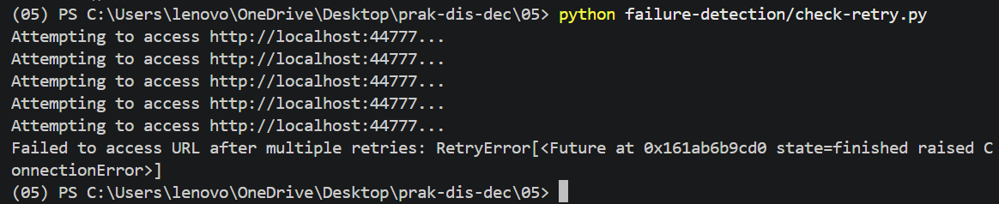

**Pembahasan:**

Pada tahap ini program `failure-detection/check-retry.py` dijalankan ketika aplikasi Blacksheep tidak aktif. Program melakukan beberapa percobaan untuk mengakses alamat `http://localhost:44777`. Karena server tidak dapat dijangkau, percobaan tersebut mengalami kegagalan hingga batas percobaan yang ditentukan tercapai. Hasil ini menunjukkan bahwa mekanisme retry tidak selalu menghasilkan akses yang berhasil, terutama ketika layanan tujuan masih tidak aktif.

## 20. Pengujian Retry saat Server Aktif

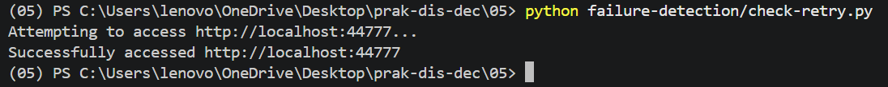

**Pembahasan:**

Pada tahap ini program retry dijalankan ketika aplikasi Blacksheep aktif kembali. Hasil pengujian menampilkan pesan `Successfully accessed http://localhost:44777`. Pesan tersebut menunjukkan bahwa permintaan berhasil ketika layanan dapat dijangkau. Pengujian ini memperlihatkan bahwa mekanisme retry dapat membantu mencoba kembali akses terhadap layanan, sedangkan keberhasilan akhirnya tetap bergantung pada ketersediaan server.

## 21. Pengujian Circuit Breaker saat Server Tidak Aktif

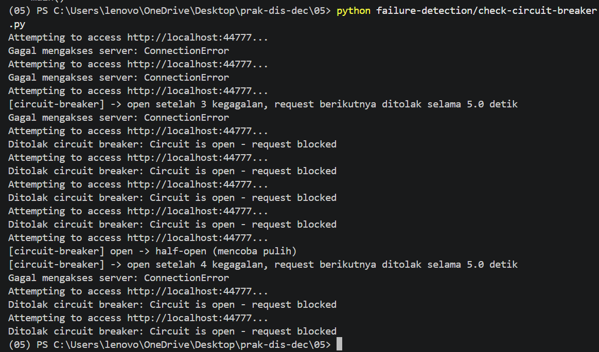

**Pembahasan:**

Pada tahap ini program `failure-detection/check-circuit-breaker.py` dijalankan ketika aplikasi Blacksheep tidak aktif. Permintaan yang dilakukan mengalami kegagalan karena server tidak dapat dijangkau. Setelah mencapai ambang batas tiga kegagalan, circuit breaker beralih ke status *open* dan menolak permintaan berikutnya untuk sementara. Setelah waktu tunggu, circuit breaker mencoba memasuki status *half-open* untuk menguji apakah layanan telah pulih. Karena server masih tidak aktif, percobaan berikutnya tetap gagal dan circuit breaker kembali membuka sirkuit. Hasil ini menunjukkan bagaimana circuit breaker membatasi permintaan ketika layanan terus mengalami kegagalan.

## 22. Pengujian Circuit Breaker saat Server Aktif

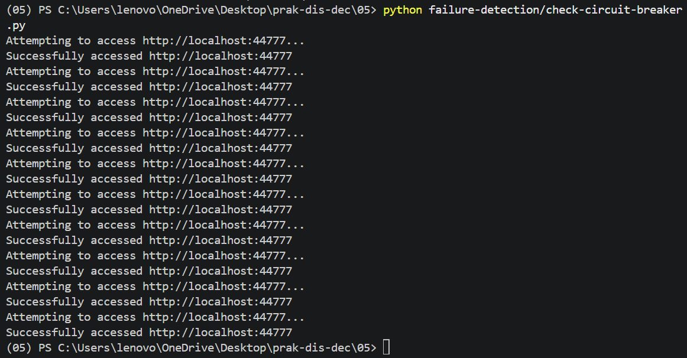

**Pembahasan:**

Pada tahap ini program circuit breaker dijalankan ketika aplikasi Blacksheep aktif kembali. Hasil pengujian memperlihatkan bahwa permintaan berhasil mengakses `http://localhost:44777`. Keberhasilan tersebut menunjukkan bahwa layanan dapat dijangkau dan permintaan dapat diproses. Jika dibandingkan dengan pengujian ketika server tidak aktif, hasil ini memperlihatkan perbedaan respons program terhadap kondisi layanan yang gagal dan kondisi layanan yang dapat diakses.

## D. HASIL DAN PEMBAHASAN

Berdasarkan kegiatan yang dilakukan, aplikasi web Blacksheep berhasil dibuat dan dijalankan pada lingkungan lokal. Aplikasi dapat diakses melalui browser menggunakan port 44777. Setelah itu, Docker Compose digunakan untuk menjalankan layanan aplikasi dan Nginx, termasuk dua instance aplikasi Blacksheep. Pemeriksaan container dan log menunjukkan bahwa layanan berhasil berjalan dan aplikasi dapat diakses melalui Nginx pada port 80.

Pengujian heartbeat menunjukkan perbedaan hasil antara server yang tidak aktif dan server yang aktif. Ketika server tidak aktif, program menampilkan `Server down`, sedangkan ketika server aktif, program menampilkan `Server up`. Hal ini menunjukkan bahwa program dapat memeriksa apakah server dapat dijangkau.

Pada pengujian retry, permintaan gagal ketika server tidak aktif dan berhasil ketika server aktif. Hasil ini memperlihatkan bahwa percobaan ulang dapat membantu menangani kegagalan akses, tetapi tidak menjamin keberhasilan apabila layanan tujuan masih tidak tersedia.

Pada pengujian circuit breaker, program mengalami kegagalan berulang ketika server tidak aktif. Setelah ambang batas kegagalan tercapai, circuit breaker beralih ke status *open* dan kemudian mencoba menguji layanan melalui status *half-open*. Ketika aplikasi aktif kembali, pengujian memperlihatkan bahwa permintaan dapat berhasil diakses. Ketiga pengujian tersebut memberikan pemahaman mengenai perbedaan fungsi heartbeat, retry, dan circuit breaker dalam mendeteksi atau menangani kegagalan layanan.

## E. KESIMPULAN

Berdasarkan praktikum Modul 05, dapat disimpulkan bahwa penerapan fault tolerance pada sistem terdistribusi dapat dilakukan melalui beberapa mekanisme sesuai kebutuhan. Docker Compose dan Nginx digunakan untuk menjalankan aplikasi serta menyediakan jalur akses melalui proxy. Heartbeat digunakan untuk memeriksa ketersediaan server, retry digunakan untuk mencoba kembali permintaan yang gagal, sedangkan circuit breaker membatasi sementara permintaan setelah terjadi kegagalan berulang. Melalui pengujian saat server aktif dan tidak aktif, perbedaan cara kerja ketiga mekanisme tersebut dapat diamati secara langsung.

## F. REFERENSI

Purnomosidi D. P., Bambang. *Modul 5 — Praktikum Sistem Terdistribusi dan Terdesentralisasi*. Program Studi Informatika, Universitas Teknologi Digital Indonesia.