# MODUL 06 — DISTRIBUTED FILE SYSTEM (HDFS)
**Nama:** Arsenius Kelvin Jemudin  
**NIM:** 255410015  
**Kelas:** IF-1  
**Program Studi:** Informatika  
**Universitas:** Universitas Teknologi Digital Indonesia  

## A. PENDAHULUAN

Praktikum Modul 06 membahas *Distributed File System* dengan Apache Hadoop Distributed File System (HDFS). HDFS merupakan sistem berkas terdistribusi yang menyimpan data dalam bentuk blok-blok yang tersebar pada beberapa node, sehingga data dapat disimpan dalam jumlah besar dan tetap tersedia walaupun salah satu node mengalami kegagalan.

Kegiatan praktikum meliputi instalasi Apache Hadoop 3.5.0, verifikasi perangkat pendukung (`pdsh` dan SSH), konfigurasi Hadoop untuk mode *single node*, format NameNode, menjalankan daemon HDFS, pemantauan melalui Web UI, operasi berkas menggunakan perintah `hdfs dfs`, serta penyelesaian tugas berupa pembuatan direktori dan pengunggahan tiga berkas CSV ke HDFS. Praktikum dilaksanakan pada lingkungan WSL 2 (Ubuntu 24.04) dengan JDK 17.

## B. DASAR TEORI

## 1. HDFS

HDFS adalah sistem berkas terdistribusi yang dirancang untuk menyimpan data berukuran besar pada banyak mesin. Berkas yang disimpan dipecah menjadi blok-blok berukuran tetap, kemudian blok tersebut disebarkan ke beberapa DataNode sesuai faktor replikasi yang dikonfigurasi. Dengan cara ini, pembacaan dan penulisan data dapat dilakukan secara paralel, dan kegagalan pada satu node tidak langsung menyebabkan kehilangan data.

## 2. NameNode, DataNode, dan Secondary NameNode

NameNode merupakan pusat metadata HDFS. NameNode menyimpan informasi struktur direktori, nama berkas, serta pemetaan blok ke DataNode, tetapi tidak menyimpan isi berkas. DataNode menyimpan blok data yang sebenarnya dan melaporkan kondisinya kepada NameNode melalui mekanisme *heartbeat*. Secondary NameNode membantu meringankan pekerjaan NameNode dengan melakukan *checkpoint* terhadap berkas edit dan fsimage, sehingga proses pemulihan metadata menjadi lebih singkat.

## 3. YARN dan MapReduce

YARN merupakan lapisan pengelola sumber daya pada Hadoop yang memisahkan pengelolaan sumber daya dari proses komputasi. MapReduce merupakan model pemrosesan data terdistribusi yang berjalan di atas YARN. Pada praktikum ini, konfigurasi YARN dan MapReduce disiapkan agar HDFS siap digunakan untuk pemrosesan data pada modul berikutnya.

## 4. pdsh dan SSH

`pdsh` (*parallel distributed shell*) digunakan untuk menjalankan perintah pada beberapa host sekaligus, sedangkan SSH digunakan sebagai jalur komunikasi antar node. Pada praktikum ini, SSH ke `localhost` dikonfigurasi agar dapat dilakukan tanpa password menggunakan pasangan kunci RSA, sehingga skrip Hadoop dapat menjalankan daemon pada node lokal tanpa diminta kata sandi.

## C. IMPLEMENTASI

## 1. Instalasi dan Verifikasi Apache Hadoop

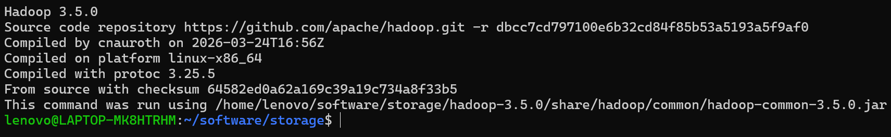

**Pembahasan:**

Pada tahap ini dilakukan verifikasi instalasi Apache Hadoop yang telah diekstraksi pada direktori `$HOME/software/storage/hadoop-3.5.0` dan diakses melalui tautan simbolik `hadoop`. Perintah `hadoop version` menunjukkan versi yang terpasang, yaitu Hadoop 3.5.0, beserta informasi sumber kode dan lokasi berkas yang dijalankan. Hasil tersebut juga memperlihatkan bahwa Hadoop membaca berkas `hadoop-common-3.5.0.jar` dari direktori instalasi, sehingga dapat dipastikan `PATH` dan `JAVA_HOME` telah mengarah ke lokasi yang benar.

## 2. Verifikasi Instalasi pdsh

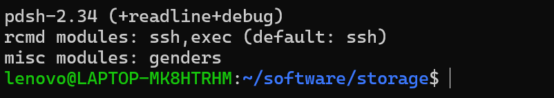

**Pembahasan:**

Pada tahap ini diperiksa instalasi `pdsh` menggunakan perintah `pdsh -V`. Hasil yang ditampilkan menunjukkan versi `pdsh-2.34` dengan modul `ssh` dan `exec`, serta modul `ssh` sebagai mode komunikasi bawaan. Informasi ini penting karena skrip Hadoop menggunakan `pdsh` untuk menjalankan proses pada node yang terdaftar, sehingga modul `ssh` harus tersedia agar daemon dapat dijalankan sesuai konfigurasi.

## 3. Konfigurasi SSH Tanpa Password ke localhost

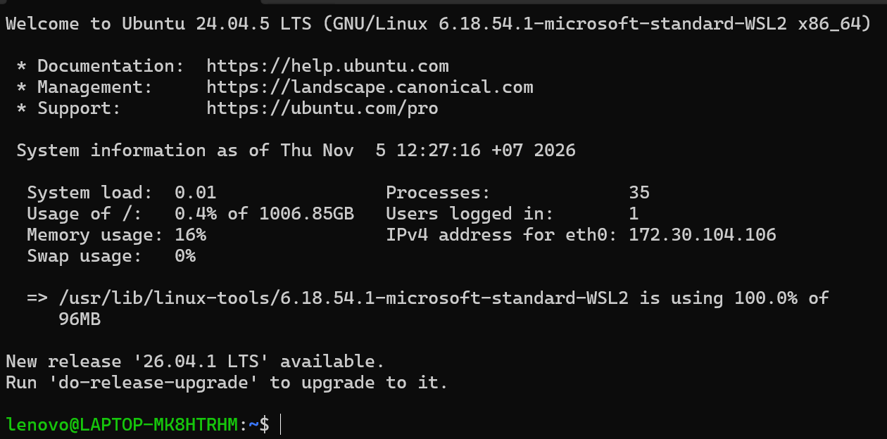

**Pembahasan:**

Pada tahap ini dilakukan uji koneksi SSH ke `localhost` menggunakan perintah `ssh lenovo@localhost`. Koneksi berhasil masuk langsung ke sesi baru tanpa diminta kata sandi, yang ditandai dengan munculnya banner sistem Ubuntu 24.04.5 LTS dan prompt pengguna pada sesi tersebut. Keberhasilan ini menunjukkan bahwa kunci publik sudah terdaftar pada `~/.ssh/authorized_keys` dan file tersebut memiliki izin `0600`, sehingga skrip Hadoop dapat menjalankan daemon tanpa interaksi manual.

## 4. Verifikasi Identitas pada Sesi SSH

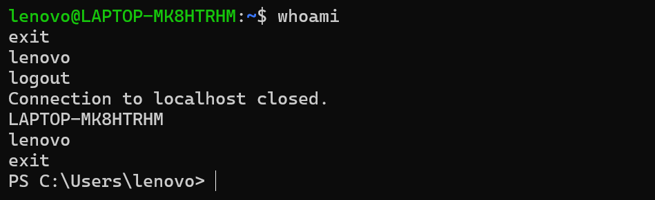

**Pembahasan:**

Pada tahap ini dijalankan perintah `whoami` pada sesi SSH untuk memastikan identitas pengguna yang aktif. Hasil yang muncul adalah `lenovo`, kemudian sesi ditutup menggunakan `exit` dan terminal menampilkan pesan `Connection to localhost closed`. Pemeriksaan identitas ini memastikan bahwa proses HDFS nantinya dijalankan oleh pengguna yang sama dengan pemilik direktori instalasi, sehingga tidak terjadi masalah izin akses pada direktori data Hadoop.

## 5. Konfigurasi core-site.xml dan hdfs-site.xml

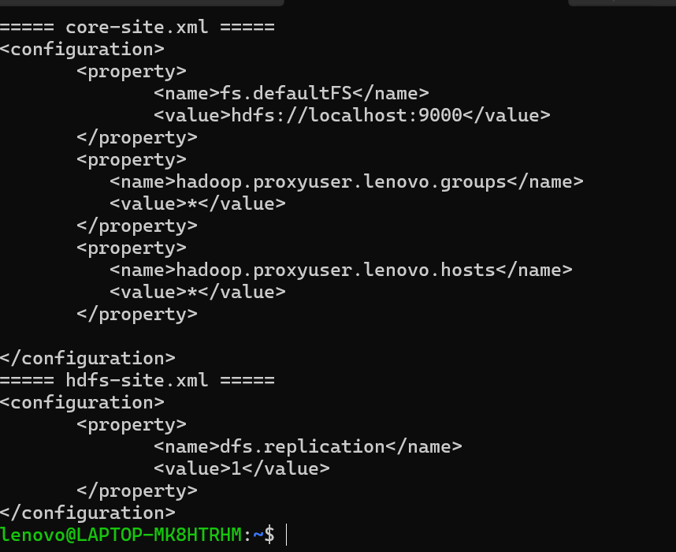

**Pembahasan:**

Pada tahap ini ditampilkan isi dua berkas konfigurasi utama HDFS. Berkas `core-site.xml` berisi properti `fs.defaultFS` dengan nilai `hdfs://localhost:9000` sebagai alamat sistem berkas default, serta properti `hadoop.proxyuser.lenovo.groups` dan `hadoop.proxyuser.lenovo.hosts` yang diberi nilai `*` agar pengguna `lenovo` dapat bertindak sebagai proxy. Berkas `hdfs-site.xml` berisi properti `dfs.replication` dengan nilai `1`, yang berarti setiap blok hanya disimpan pada satu DataNode karena praktikum dijalankan pada satu node.

## 6. Konfigurasi mapred-site.xml dan yarn-site.xml

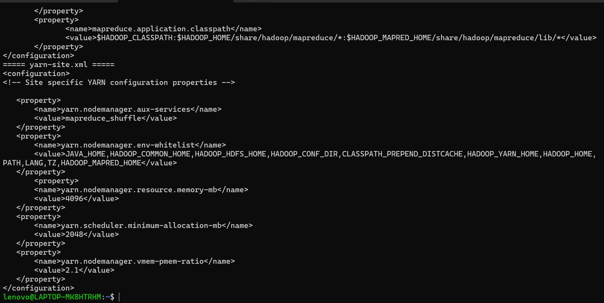

**Pembahasan:**

Pada tahap ini ditampilkan isi berkas `mapred-site.xml` dan `yarn-site.xml`. Berkas `mapred-site.xml` mengatur `mapreduce.framework.name` menjadi `yarn` sehingga pemrosesan MapReduce dijalankan di atas YARN, serta mendefinisikan `mapreduce.application.classpath` yang menunjuk ke pustaka MapReduce. Berkas `yarn-site.xml` mengatur layanan tambahan `mapreduce_shuffle`, daftar variabel lingkungan yang diizinkan, alokasi memori NodeManager sebesar 4096 MB, alokasi minimum scheduler 2048 MB, dan rasio `vmem-pmem` sebesar 2.1.

**Berkas konfigurasi yang digunakan** disimpan pada direktori `config/` agar dapat direproduksi, sedangkan variabel lingkungan untuk shell disimpan pada `env/hadoop.sh`:

```
06/
├── config/
│   ├── core-site.xml
│   ├── hdfs-site.xml
│   ├── mapred-site.xml
│   └── yarn-site.xml
├── env/hadoop.sh
├── images/
└── README.md
```

Berkas `env/hadoop.sh` berisi pengaturan `PATH` ke direktori `bin` dan `sbin` Hadoop, `JAVA_HOME`, serta `HADOOP_HOME`, dan perlu di-*source* pada setiap sesi shell baru sebelum perintah Hadoop dijalankan.

## 7. Format NameNode


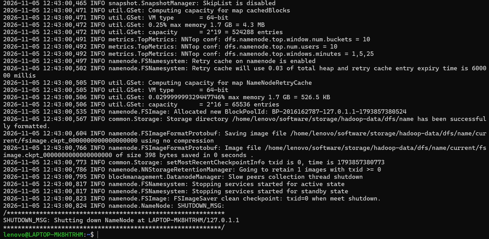

**Pembahasan:**

Pada tahap ini dilakukan inisialisasi sistem berkas HDFS menggunakan perintah `hdfs namenode -format`. Proses tersebut membuat struktur direktori metadata baru dan menampilkan pesan `Storage directory /home/lenovo/software/storage/hadoop-data/dfs/name has been successfully formatted` serta `Allocated new BlockPoolId`. Direktori penyimpanan diarahkan ke `hadoop-data` melalui properti `hadoop.tmp.dir` agar metadata tidak berada pada direktori sementara `/tmp` yang dapat terhapus ketika WSL dimulai ulang. Format hanya dilakukan sekali karena proses pengulangan akan menghapus seluruh metadata HDFS yang sudah ada.

## 8. Menjalankan Daemon HDFS

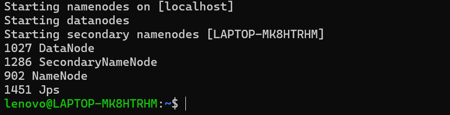

**Pembahasan:**

Pada tahap ini HDFS dijalankan menggunakan perintah `start-dfs.sh`. Skrip tersebut menyalakan NameNode pada `localhost`, DataNode, dan Secondary NameNode pada host `LAPTOP-MK8HTRHM`. Pemeriksaan menggunakan `jps` menunjukkan tiga proses Java yang berjalan, yaitu `NameNode`, `DataNode`, dan `SecondaryNameNode`, di samping proses `Jps` itu sendiri. Munculnya ketiga proses tersebut menandakan bahwa layanan HDFS telah aktif dan siap menerima perintah sistem berkas.

## 9. Pemantauan HDFS melalui Web UI

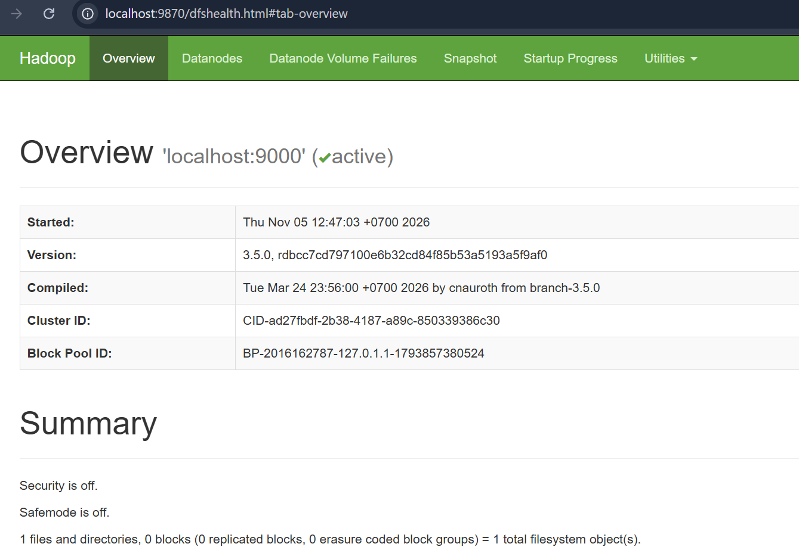

**Pembahasan:**

Pada tahap ini HDFS dipantau melalui antarmuka web pada alamat `http://localhost:9870`. Halaman Overview menampilkan nama sistem berkas `localhost:9000` dengan status `active`, versi Hadoop 3.5.0, waktu mulai NameNode, serta `Cluster ID` dan `Block Pool ID` yang sama dengan nilai pada proses format. Bagian Summary menampilkan `Security is off` dan `Safemode is off`, yang berarti NameNode telah keluar dari mode aman dan siap melayani operasi berkas. Informasi jumlah berkas dan direktori pada halaman ini menjadi acuan untuk memeriksa perubahan setelah operasi HDFS dilakukan.

## 10. Operasi Dasar pada HDFS

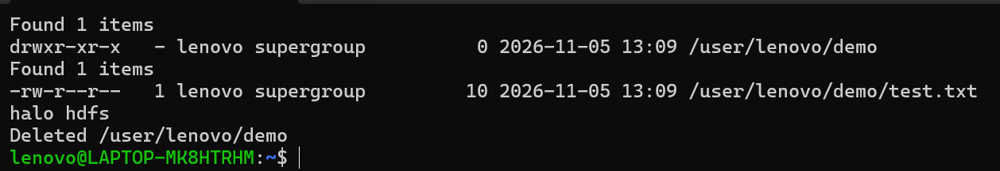

**Pembahasan:**

Pada tahap ini dilakukan operasi dasar HDFS menggunakan perintah `hdfs dfs`. Perintah `-mkdir -p` membuat direktori `/user/lenovo/demo`, `-put` mengunggah berkas `test.txt` dari sistem lokal ke direktori tersebut, dan `-cat` menampilkan isi berkas dengan hasil `halo hdfs`. Setelah itu perintah `-rm -r` menghapus direktori beserta isinya dan ditandai dengan pesan `Deleted /user/lenovo/demo`. Urutan ini memperlihatkan bahwa HDFS menyediakan operasi berkas yang mirip dengan sistem berkas lokal, tetapi dijalankan melalui perintah `hdfs dfs` dan disimpan pada sistem berkas terdistribusi.

## 11. Tugas 1 — Membuat Direktori /user/lenovo/datasets

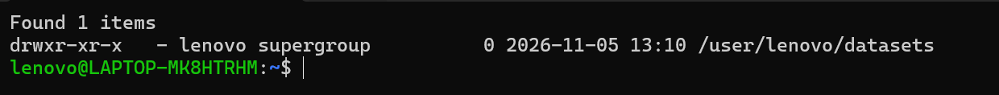

**Pembahasan:**

Pada tahap ini diselesaikan tugas pertama, yaitu membuat direktori `/user/lenovo/datasets` di HDFS menggunakan perintah `hdfs dfs -mkdir -p`. Hasil pemeriksaan dengan `hdfs dfs -ls /user/lenovo` menunjukkan direktori `datasets` dengan pemilik `lenovo` dan grup `supergroup`. Direktori tersebut selanjutnya digunakan sebagai lokasi penyimpanan berkas CSV yang diunduh dari internet pada tugas kedua.

## 12. Tugas 2 — Mengunduh Tiga Berkas CSV

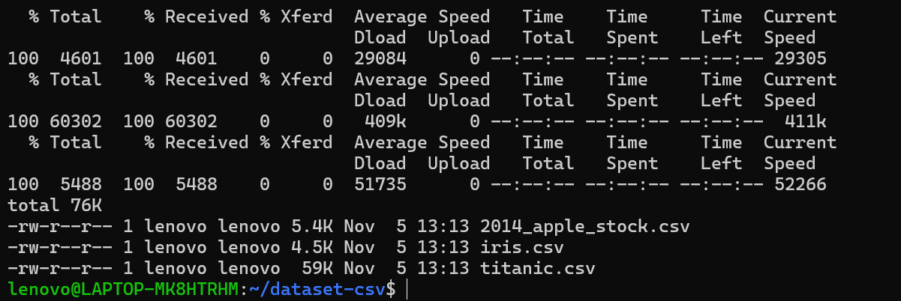

**Pembahasan:**

Pada tahap ini diunduh tiga berkas CSV dari internet menggunakan `curl` ke direktori kerja `~/dataset-csv` pada sistem lokal WSL. Berkas yang diunduh adalah `iris.csv` (4,5 KB), `titanic.csv` (59 KB), dan `2014_apple_stock.csv` (5,4 KB). Ketiga berkas tersebut dipilih karena berukuran kecil sehingga sesuai untuk pengujian penyimpanan pada HDFS *single node*. Pemeriksaan dengan `ls -lh` memastikan berkas berhasil terunduh dan memiliki ukuran yang wajar, bukan halaman kesalahan.

## 13. Tugas 2 — Mengunggah CSV ke HDFS

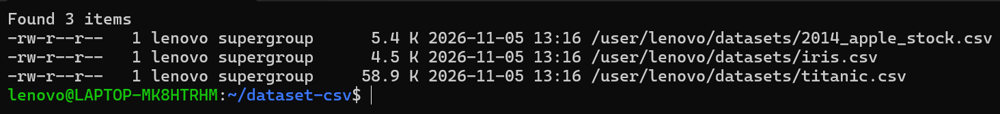

**Pembahasan:**

Pada tahap ini ketiga berkas CSV diunggah ke HDFS menggunakan perintah `hdfs dfs -put` dengan tujuan direktori `/user/lenovo/datasets`. Perintah `-put` tidak menampilkan keluaran ketika berhasil, sehingga keberhasilan proses diverifikasi melalui `hdfs dfs -ls -h`. Hasilnya menunjukkan tiga berkas tersimpan dengan ukuran yang sama seperti berkas asli, yaitu `2014_apple_stock.csv` 5,4 K, `iris.csv` 4,5 K, dan `titanic.csv` 58,9 K, dengan pemilik `lenovo`.

## 14. Verifikasi Berkas pada HDFS

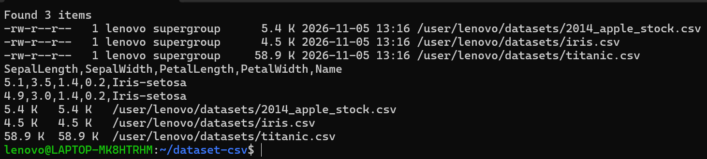

**Pembahasan:**

Pada tahap ini dilakukan verifikasi lanjutan terhadap berkas yang telah diunggah. Perintah `hdfs dfs -cat` pada `iris.csv` menampilkan header `SepalLength,SepalWidth,PetalLength,PetalWidth,Name` beserta beberapa baris data, sehingga dapat dipastikan isi berkas tersimpan utuh di HDFS. Perintah `hdfs dfs -du -h` menunjukkan ruang yang terpakai untuk setiap berkas, dan nilainya sama dengan ukuran berkas pada sistem lokal. Dengan demikian, tugas kedua telah selesai dan data CSV benar-benar tersimpan pada sistem berkas terdistribusi.

## 15. Menghentikan HDFS

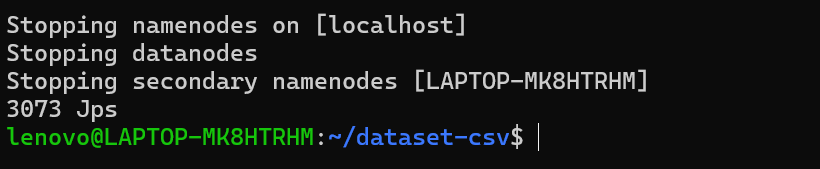

**Pembahasan:**

Pada tahap akhir praktikum, layanan HDFS dihentikan menggunakan perintah `stop-dfs.sh`. Skrip tersebut menghentikan NameNode, DataNode, dan Secondary NameNode sesuai urutan, kemudian pemeriksaan menggunakan `jps` hanya menampilkan proses `Jps` sehingga dapat dipastikan seluruh daemon HDFS telah berhenti. Data yang telah tersimpan tetap berada pada direktori `hadoop-data` dan dapat diakses kembali ketika HDFS dijalankan ulang tanpa perlu melakukan format NameNode.

## D. HASIL DAN PEMBAHASAN

Berdasarkan kegiatan yang dilakukan, Apache Hadoop 3.5.0 berhasil dipasang dan dikonfigurasi pada lingkungan WSL 2 Ubuntu 24.04 dengan JDK 17. Konfigurasi yang diterapkan meliputi alamat sistem berkas `hdfs://localhost:9000`, faktor replikasi `1`, kerangka MapReduce berbasis YARN, serta pengaturan memori NodeManager. Pemasangan `pdsh` dan konfigurasi SSH tanpa password ke `localhost` memastikan skrip Hadoop dapat menjalankan daemon tanpa interaksi manual. Format NameNode menghasilkan `Cluster ID` baru, dan setelah `start-dfs.sh` dijalankan, perintah `jps` menampilkan tiga daemon HDFS dalam keadaan aktif.

Pemantauan melalui Web UI pada port 9870 menunjukkan NameNode dalam status `active` dengan `Safemode is off`, sehingga HDFS siap melayani operasi berkas. Pengujian operasi dasar menggunakan `hdfs dfs` berhasil melakukan pembuatan direktori, pengunggahan, pembacaan, dan penghapusan berkas. Pada penyelesaian tugas, direktori `/user/lenovo/datasets` berhasil dibuat, tiga berkas CSV berhasil diunduh dari internet, diunggah ke HDFS, dan diverifikasi isinya melalui `hdfs dfs -cat` serta `hdfs dfs -du -h`. Setelah seluruh pengujian selesai, HDFS dihentikan dengan `stop-dfs.sh` dan data tetap tersimpan pada direktori data yang bersifat permanen.

Salah satu kendala yang ditemukan adalah hilangnya metadata HDFS ketika WSL dimulai ulang, karena konfigurasi awal menyimpan data pada direktori sementara `/tmp`. Kendala tersebut diatasi dengan menambahkan properti `hadoop.tmp.dir` yang mengarah ke direktori permanen, kemudian melakukan format ulang NameNode sebelum data praktikum diunggah.

## E. KESIMPULAN

Berdasarkan praktikum Modul 06, dapat disimpulkan bahwa HDFS menyediakan sistem berkas terdistribusi yang menyimpan data dalam bentuk blok pada DataNode dengan pengelolaan metadata oleh NameNode. Instalasi dan konfigurasi Apache Hadoop pada mode *single node* memerlukan penyesuaian alamat sistem berkas, faktor replikasi, kerangka pemrosesan, serta dukungan `pdsh` dan SSH tanpa password. Proses format NameNode hanya dilakukan sekali untuk membentuk metadata awal, sedangkan daemon HDFS dijalankan dan dihentikan menggunakan `start-dfs.sh` dan `stop-dfs.sh`. Operasi berkas pada HDFS dapat dilakukan melalui perintah `hdfs dfs`, dan penyimpanan data sebaiknya diarahkan ke direktori permanen agar metadata tidak hilang ketika sistem dimulai ulang.

## F. REFERENSI

Purnomosidi D. P., Bambang. *Modul 6 — Praktikum Sistem Terdistribusi dan Terdesentralisasi*. Program Studi Informatika, Universitas Teknologi Digital Indonesia.
