# Praktikum Minggu 07 — Cloud Computing

**Nama:** Arsenius Kelvin Jemudin  
**NIM:** 255410015  
**Kelas:** IF-1  
**Program Studi:** Informatika  
**Universitas:** Universitas Teknologi Digital Indonesia  
**Lingkungan:** Windows 11 (Docker Desktop dengan WSL 2, distro Ubuntu-24.04)

## A. PENDAHULUAN

Cloud computing adalah model penyediaan sumber daya komputasi (server, penyimpanan, jaringan, *runtime*, hingga aplikasi) sebagai layanan yang diakses melalui jaringan. Pendekatan ini sering disebut *XaaS* (*Everything as a Service*). Konsumen tidak lagi membeli perangkat keras, tetapi menyewa layanan sesuai kebutuhan, sehingga biaya dan usaha pemeliharaan berpindah ke penyedia layanan. Pembagian yang paling umum adalah **SaaS**, **PaaS**, dan **IaaS**.

Salah satu komponen pembentuk layanan tersebut adalah **Containerized App (CA)**, yaitu aplikasi yang dikemas bersama dependensinya sehingga dapat dijalankan oleh *container engine* seperti Docker atau Podman. Pada praktikum ini, aplikasi blog **Flaskr** dari tutorial resmi Flask diubah menjadi CA: pertama dijalankan secara lokal, kemudian dibungkus menjadi image Docker, lalu dibangun ulang dan dijalankan dengan Podman.

Tujuan praktikum:

1. Menjelaskan konsep XaaS beserta contoh vendor dan layanan pada kategori SaaS, PaaS, dan IaaS.
2. Menggambarkan arsitektur XaaS dalam bentuk visualisasi.
3. Menjalankan aplikasi Flask (Flaskr) secara lokal dengan environment Python 3.14.4.
4. Mengubah aplikasi tersebut menjadi *containerized app* menggunakan Docker.
5. Membangun dan menjalankan image yang sama menggunakan Podman sebagai pembanding.

Struktur folder hasil praktikum:

```
07/
├── README.md
└── images/                    (screenshot 01 sampai 16)
```

## B. DASAR TEORI

### B.1 XaaS: SaaS, PaaS, dan IaaS

**SaaS (Software as a Service)** menyediakan aplikasi jadi yang langsung dipakai lewat browser atau API. Konsumen hanya mengelola akun, data, dan pengaturan aplikasi; seluruh infrastruktur, sistem operasi, *runtime*, dan kode aplikasi dikelola penyedia.

**PaaS (Platform as a Service)** menyediakan *platform* untuk menjalankan aplikasi buatan konsumen: sistem operasi, *runtime* bahasa pemrograman, web server, basis data terkelola, serta alat *build* dan *deploy*. Konsumen mengelola kode dan konfigurasi aplikasi, sedangkan penyedia mengelola server dan skalanya.

**IaaS (Infrastructure as a Service)** menyediakan sumber daya infrastruktur mentah berupa mesin virtual, penyimpanan, jaringan, dan *load balancer*. Konsumen mengelola sistem operasi, *middleware*, *runtime*, dan aplikasi di dalamnya.

### B.2 Contoh Vendor dan Layanan (Tugas 0)

| Kategori | Vendor/komunitas | Layanan yang disediakan |
|---|---|---|
| SaaS | **Google Workspace** | Gmail, Google Docs/Sheets/Slides, Google Drive, Google Meet. Semuanya aplikasi siap pakai yang diakses lewat browser; pengguna hanya mengelola akun dan dokumennya. |
| PaaS | **Heroku** | *Runtime* aplikasi (buildpack), basis data terkelola (Heroku Postgres), *add-on* layanan lain, serta mekanisme *deploy* lewat `git push`. Pengembang hanya menyiapkan kode; server, *scaling*, dan *runtime* dikelola Heroku. |
| IaaS | **Amazon Web Services (khususnya Amazon EC2)** | Mesin virtual (*instance*) dengan pilihan CPU/RAM, penyimpanan blok (Amazon EBS), jaringan virtual (VPC), *load balancer*, dan alamat IP elastis. Pengguna mengelola sistem operasi hingga aplikasi di dalam instance. |

Ketiga contoh tersebut menunjukkan pergeseran tanggung jawab: pada SaaS pengguna hampir tidak mengelola apa pun, pada PaaS pengguna mengelola aplikasi, dan pada IaaS pengguna mengelola hampir seluruh tumpukan perangkat lunak di atas infrastruktur.

### B.3 Arsitektur XaaS

Secara umum arsitektur XaaS tersusun berlapis. Lapisan paling bawah adalah infrastruktur penyedia (data center: server fisik, penyimpanan, jaringan, dan hipervisor). Di atasnya IaaS menyediakan mesin virtual, lalu PaaS menyediakan *runtime* dan layanan pendukung, lalu SaaS menyediakan aplikasi jadi yang dipakai pengguna melalui browser, aplikasi mobile, atau API. Semakin ke atas, abstraksinya semakin tinggi dan kendali konsumen semakin kecil; semakin ke bawah, kendali konsumen semakin besar.

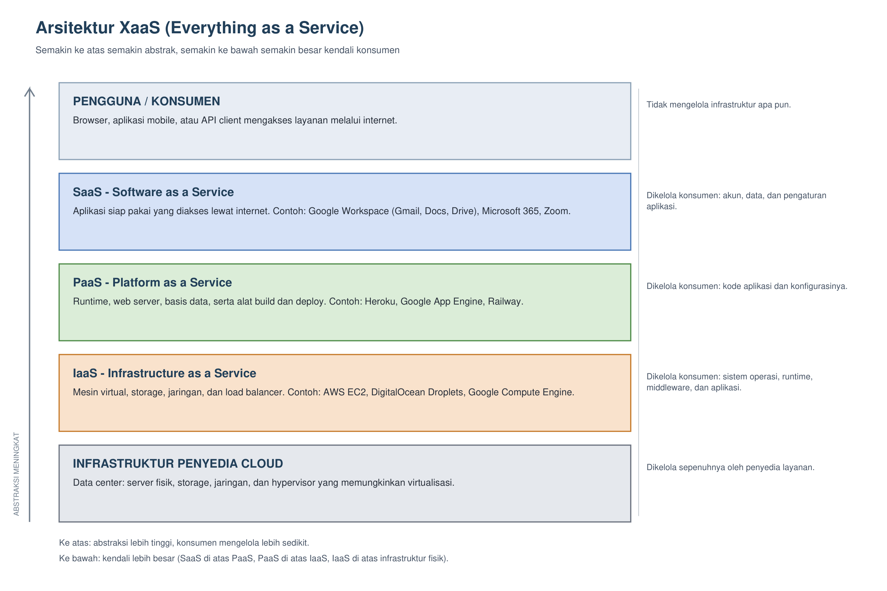

**Pembahasan:** Gambar tersebut memetakan tumpukan layanan dari infrastruktur penyedia sampai pengguna. Kotak paling bawah adalah infrastruktur penyedia cloud (data center dan hipervisor) yang dikelola sepenuhnya oleh penyedia. Di atasnya, IaaS memberi konsumen kendali atas sistem operasi, *runtime*, dan aplikasi di dalam mesin virtual — misalnya Amazon EC2. Lapisan PaaS mengambil alih pengelolaan sistem operasi dan *runtime*, sehingga konsumen fokus pada kode aplikasi — misalnya Heroku. Lapisan SaaS menyajikan aplikasi siap pakai, dan konsumen hanya mengelola data serta pengaturan — misalnya Google Workspace. Panah di sisi kiri menandakan bahwa semakin ke atas abstraksinya semakin tinggi dan kendali konsumen semakin sedikit, sedangkan semakin ke bawah kendali konsumen semakin besar.

### B.4 Containerized App

*Container* adalah unit eksekusi yang mengemas aplikasi beserta *library* dan dependensinya, lalu berbagi kernel dengan host. Berbeda dengan mesin virtual yang memuat sistem operasi lengkap, container hanya membawa sistem berkas aplikasi sehingga lebih ringan dan cepat dijalankan. Istilah yang dipakai pada praktikum ini:

- **Image**: cetakan (*template*) berisi sistem berkas dan metadata untuk membuat container, misalnya `flaskr:1.0.0`.
- **Container**: instance yang sedang berjalan dari sebuah image.
- **Registry**: tempat menyimpan dan mengunduh image, misalnya Docker Hub (`docker.io`).
- **Port mapping**: meneruskan port host ke port di dalam container, misalnya `-p 5001:5000` berarti port 5001 di host diteruskan ke port 5000 aplikasi di container.

**Docker** menjalankan container melalui sebuah daemon (`dockerd`) yang menerima perintah dari client. **Podman** menjalankan container tanpa daemon (*daemonless*) dan secara default berjalan sebagai pengguna biasa (*rootless*). Keduanya memakai format image OCI yang sama, sehingga sebuah `Dockerfile` dapat dipakai untuk membangun image dengan Docker maupun Podman.

### B.5 Aplikasi Flaskr

Flaskr adalah aplikasi blog contoh dari tutorial resmi Flask (`examples/tutorial`, versi 3.1.3). Aplikasi ini memakai *application factory* `create_app()` di dalam paket `flaskr`, *blueprint* untuk autentikasi dan halaman blog, serta perintah CLI `init-db` yang membuat basis data SQLite `flaskr.sqlite` di folder `instance`. Perintah `flask --app flaskr init-db` menjalankan inisialisasi basis data, sedangkan `flask --app flaskr run` menjalankan *development server* di port 5000.

### B.6 uv dan Environment Python

`uv` adalah pengelola paket dan environment Python. Pada praktikum ini `uv venv --python 3.14.4` dipakai untuk membuat *virtual environment* dengan Python 3.14.4, dan `uv pip install -e .` dipakai untuk memasang paket `flaskr` dalam mode *editable* beserta dependensinya (`flask`, `jinja2`, `werkzeug`, `click`, `blinker`, `itsdangerous`, `markupsafe`).

## C. IMPLEMENTASI

### C.1 Menyiapkan Direktori Kerja dan Mengambil Source Code

Praktikum dikerjakan di dalam WSL (Ubuntu-24.04) agar perintah pada modul dapat dijalankan apa adanya. Direktori kerja `~/src` dibuat, lalu repositori Flask di-*clone* dari GitHub.

```
mkdir -p ~/src
cd ~/src
git clone https://github.com/pallets/flask
ls
```

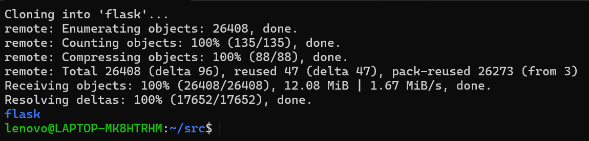

**Pembahasan:** Proses *clone* mengunduh 26.408 objek dengan ukuran 12,08 MiB dan kecepatan rata-rata 1,67 MiB/s, kemudian menyelesaikan 17.652 delta. Hasil `ls` menampilkan satu direktori `flask`, yaitu repositori sumber yang berisi kode Flask beserta contoh aplikasinya. Repositori ini dipakai hanya sebagai sumber direktori `examples/tutorial`, sehingga aplikasi yang akan dijadikan container adalah salinan dari direktori tersebut, bukan seluruh repositori Flask.

### C.2 Menyalin Direktori Tutorial

Direktori `examples/tutorial` disalin ke direktori kerja baru bernama `flask-app`.

```
cd ~/src
cp -R ~/src/flask/examples/tutorial flask-app
ls -la
cd flask-app
ls
```

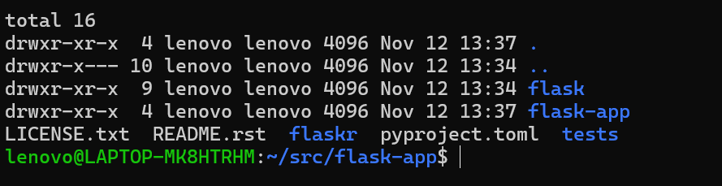

**Pembahasan:** Setelah `cp -R`, `ls -la` menampilkan dua entri direktori, yaitu `flask` (repositori hasil clone) dan `flask-app` (salinan tutorial). Isi `flask-app` adalah `flaskr/`, `tests/`, `pyproject.toml`, `README.rst`, dan `LICENSE.txt`. Salinan ini penting karena semua perubahan berikutnya (pembuatan `Dockerfile` dan inisialisasi basis data) dilakukan di `flask-app`, sehingga repositori `flask` tetap bersih dan dapat dipakai ulang.

### C.3 Membuat Environment Python 3.14.4 dan Memasang Paket

```
cd ~/src/flask-app
uv venv --python 3.14.4
source .venv/bin/activate
python --version
```

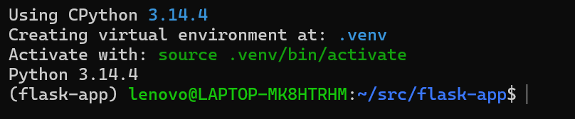

**Pembahasan:** `uv venv --python 3.14.4` mengunduh dan memakai CPython 3.14.4, lalu membuat *virtual environment* di `.venv`. Setelah `source .venv/bin/activate`, prompt terminal diawali `(flask-app)` dan `python --version` menampilkan **Python 3.14.4**. Versi ini sama dengan versi yang dipakai pada image dasar container (`python:3.14`) sehingga hasil di lingkungan lokal dan di dalam container konsisten.

Pemasangan paket aplikasi dilakukan dengan:

```
uv pip install -e .
```

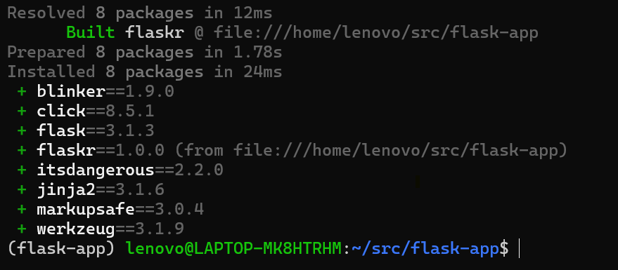

**Pembahasan:** Perintah ini memasang paket `flaskr` dalam mode *editable* (`-e .`) beserta dependensinya. Hasilnya, 8 paket terpasang: `blinker 1.9.0`, `click 8.5.1`, `flask 3.1.3`, `flaskr 1.0.0`, `itsdangerous 2.2.0`, `jinja2 3.1.6`, `markupsafe 3.0.4`, dan `werkzeug 3.1.9`. Mode *editable* membuat perubahan pada kode di `flaskr/` langsung terpakai tanpa perlu memasang ulang.

Catatan kendala: instalasi awal gagal karena koneksi ke `pypi.org` dari WSL selalu berakhir `operation timed out` pada tahap TLS handshake, padahal koneksi ke GitHub dan ke alamat IPv4 PyPI berhasil. Solusi yang dipakai adalah mengarahkan uv ke mirror PyPI melalui variabel `UV_DEFAULT_INDEX`, sehingga perintah instalasi tetap sama dan seluruh paket berhasil dipasang.

### C.4 Menjalankan Aplikasi Secara Lokal

```
flask --app flaskr init-db
flask --app flaskr run --host=0.0.0.0
```

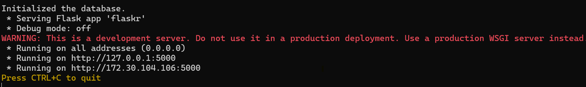

**Pembahasan:** `init-db` menghasilkan pesan `Initialized the database.` yang menandakan berkas SQLite `instance/flaskr.sqlite` berhasil dibuat dari skema pada `schema.sql`. Perintah `run` menyalakan *development server* Flask dan menampilkan `Running on all addresses (0.0.0.0)` serta dua alamat: `127.0.0.1:5000` dan `172.30.104.106:5000` (alamat WSL). Opsi `--host=0.0.0.0` dipakai agar server menerima koneksi dari luar WSL, sehingga dapat dibuka dari browser Windows melalui *localhost forwarding*.

Aplikasi diakses melalui browser pada `http://localhost:5000`.

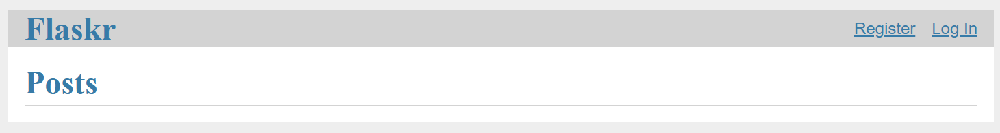

**Pembahasan:** Halaman utama Flaskr tampil dengan judul **Flaskr**, judul halaman **Posts**, serta tautan **Register** dan **Log In** di kanan atas. Daftar *post* masih kosong karena basis data baru diinisialisasi. Tampilan ini membuktikan aplikasi berjalan di lingkungan lokal (bukan container) dan siap diuji fungsinya.

Fungsi registrasi dan login diuji dengan memilih **Register** lalu **Log In**.

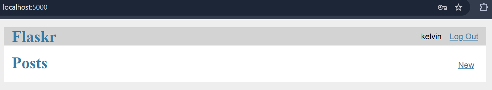

**Pembahasan:** Setelah registrasi dan login sebagai pengguna `kelvin`, pojok kanan atas berubah menjadi nama pengguna `kelvin` dan tautan **Log Out**, serta muncul tautan **New** di samping judul *Posts*. Perubahan tersebut hanya bisa terjadi jika sesi login tersimpan, yang berarti proses registrasi (penyimpanan *password hash* ke tabel `user`) dan autentikasi berjalan dengan benar di atas basis data SQLite yang baru dibuat.

### C.5 Membuat Dockerfile

`Dockerfile` diletakkan di direktori root aplikasi (`~/src/flask-app`).

```
FROM python:3.14

RUN mkdir /app
WORKDIR /app
ADD . /app/
RUN pip install -e .
RUN flask --app flaskr init-db

EXPOSE 5000
CMD ["flask", "--app", "flaskr", "run", "--host=0.0.0.0", "--port=5000"]
```

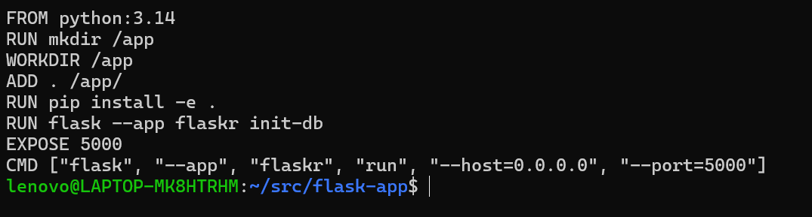

**Pembahasan:** Setiap baris `Dockerfile` memiliki peran sebagai berikut. `FROM python:3.14` memakai image resmi Python 3.14 sebagai lapisan dasar sehingga `pip` dan interpreter sudah tersedia. `RUN mkdir /app` dan `WORKDIR /app` menyiapkan direktori kerja di dalam image. `ADD . /app/` menyalin seluruh isi direktori aplikasi ke dalam image. `RUN pip install -e .` memasang paket `flaskr` beserta dependensinya di dalam image. `RUN flask --app flaskr init-db` menginisialisasi basis data saat *build*, sehingga container yang dijalankan sudah memiliki skema dan siap dipakai. `EXPOSE 5000` mendokumentasikan port yang dipakai aplikasi, dan `CMD` menjalankan server Flask pada `0.0.0.0:5000` agar dapat diakses dari luar container. Karena perintah `init-db` dijalankan di dalam image, basis data SQLite ikut tersimpan di dalam image dan setiap container baru memperoleh salinan basis data yang bersih.

### C.6 Membangun Image dengan Docker

```
docker build -f Dockerfile -t flaskr:1.0.0 .
```

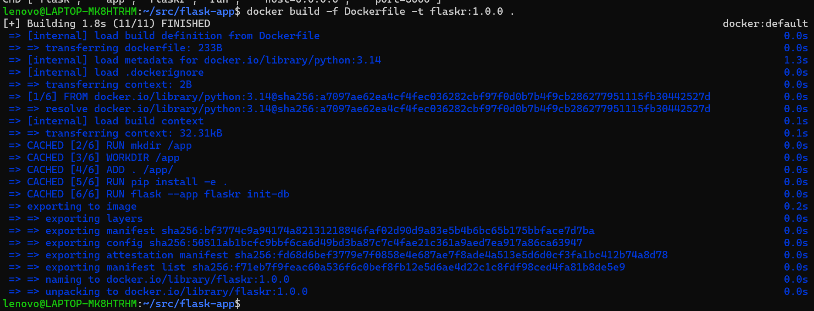

**Pembahasan:** Docker membangun image dari `Dockerfile` dengan BuildKit dan menamainya `flaskr:1.0.0`. Pada hasil tersebut seluruh langkah (load *build definition*, load metadata `python:3.14`, dan langkah 2–6) berstatus `CACHED`, karena image dengan konfigurasi yang sama sudah pernah dibangun sebelumnya sehingga Docker memakai lapisan yang tersimpan di *cache*. Tahap akhir menampilkan `naming to docker.io/library/flaskr:1.0.0` dan `unpacking to docker.io/library/flaskr:1.0.0`, yang menandakan image berhasil disimpan di penyimpanan image lokal Docker Desktop. Titik (`.`) di akhir perintah adalah *build context*, yaitu direktori saat ini yang isinya dikirim ke proses build.

### C.7 Memeriksa Image Hasil Build

```
docker images
```

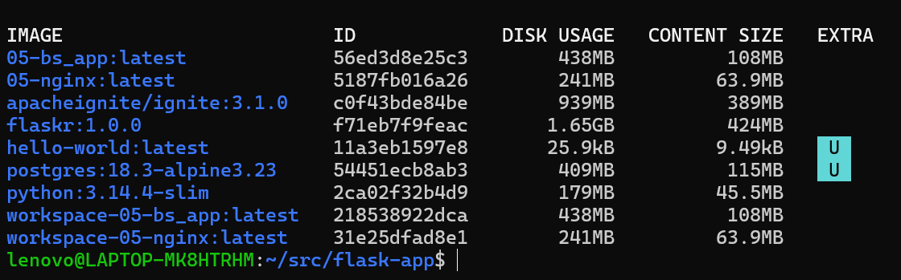

**Pembahasan:** Hasil `docker images` menampilkan `flaskr` dengan tag `1.0.0`, *image ID* `f71eb7f9feac`, *content size* 424 MB, dan *disk usage* 1,65 GB. Selisih antara keduanya terjadi karena lapisan dasar `python:3.14-slim` dipakai bersama image lain (seperti `postgres` dan `apacheignite`), sehingga sebagian besar lapisan tidak dihitung ulang. Image lain pada daftar berasal dari praktikum sebelumnya dan tidak berhubungan dengan praktikum ini.

### C.8 Menjalankan Container Docker

```
docker run -d -p 5001:5000 flaskr:1.0.0
docker ps
```

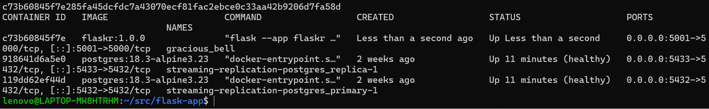

**Pembahasan:** Perintah `docker run -d -p 5001:5000 flaskr:1.0.0` membuat container dari image `flaskr:1.0.0` dan menjalankannya di latar belakang (`-d`). Opsi `-p 5001:5000` memetakan port 5001 pada host ke port 5000 di container. `docker ps` menampilkan container dengan ID `c73b60845f7e`, nama otomatis `gracious_bell`, perintah `flask --app flaskr ...`, status `Up`, dan pemetaan port `0.0.0.0:5001->5000/tcp`. Karena aplikasi berjalan di dalam container, proses Flask lokal tidak diperlukan lagi; seluruh dependensi berasal dari image.

Aplikasi container diakses melalui browser pada `http://localhost:5001`.

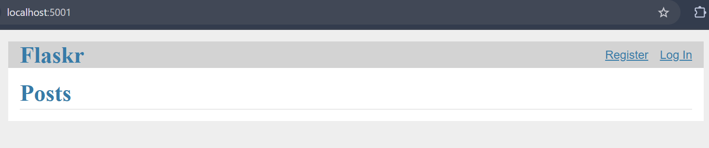

**Pembahasan:** Halaman Flaskr tampil pada `localhost:5001` dengan tautan **Register** dan **Log In**, sama seperti ketika dijalankan lokal. Hal ini membuktikan pemetaan port bekerja: permintaan ke port 5001 di host diteruskan ke port 5000 di dalam container, tempat server Flask berjalan. Basis data yang dipakai adalah basis data yang dibuat saat *build* (`init-db`), sehingga container ini memiliki data pengguna sendiri yang terpisah dari basis data lokal.

### C.9 Membangun Image dengan Podman

Podman tetap memakai `Dockerfile` yang sama karena keduanya memakai format image OCI.

```
podman build -f Dockerfile -t flaskr:1.0.0 .
```

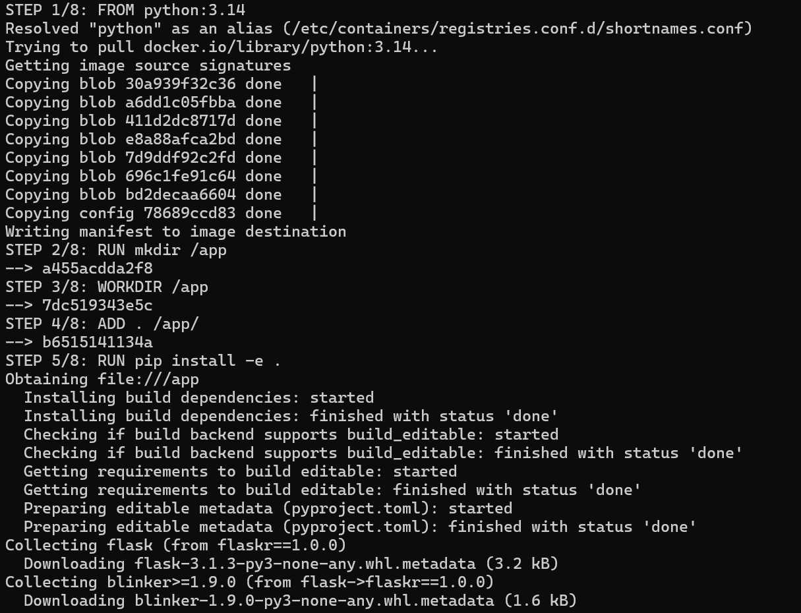

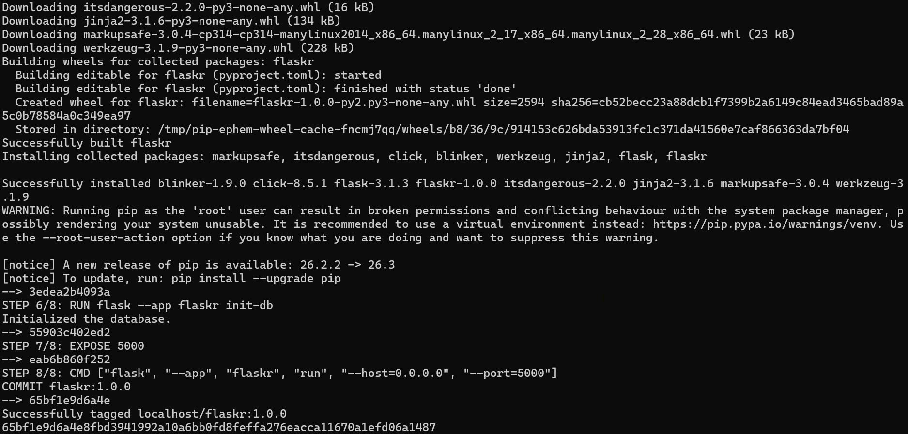

**Pembahasan:** Output Podman memakai format `STEP n/8` yang menampilkan setiap instruksi `Dockerfile`. Pada `STEP 1/8`, Podman menarik image dasar `docker.io/library/python:3.14` (menampilkan `Trying to pull docker.io/library/python:3.14...`, menyalin tujuh *blob*, lalu menulis manifest). `STEP 2/8` sampai `STEP 4/8` membuat `/app`, menetapkan `WORKDIR`, dan menyalin konteks build. Pada `STEP 5/8`, `pip install -e .` memasang `flask 3.1.3` dan dependensinya di dalam image. `STEP 6/8` menjalankan `init-db` dan menghasilkan `Initialized the database.`, sedangkan `STEP 7/8` dan `STEP 8/8` menetapkan `EXPOSE 5000` serta `CMD`. Proses diakhiri `COMMIT flaskr:1.0.0`, `Successfully tagged localhost/flaskr:1.0.0`, dan ID image `65bf1e9d6a4e`. Awalan `localhost/` menunjukkan image disimpan di penyimpanan lokal pengguna, sesuai sifat Podman yang *rootless* dan tidak memakai registry pusat secara default.

### C.10 Memeriksa Image Podman

```
podman images
```

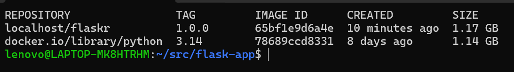

**Pembahasan:** Hasil `podman images` menampilkan dua image: `localhost/flaskr` tag `1.0.0` dengan *image ID* `65bf1e9d6a4e` berukuran 1,17 GB, dan `docker.io/library/python` tag `3.14` dengan ID `78689ccd8331` berukuran 1,14 GB. Podman memakai penyimpanan image sendiri (`~/.local/share/containers/storage`), terpisah dari penyimpanan Docker Desktop, sehingga image yang sama harus dibangun ulang dan ukurannya dilaporkan berbeda (lapisan belum dipadatkan), bukan 424 MB seperti pada Docker.

### C.11 Menjalankan Container Podman

```
podman run -d -p 5002:5000 flaskr:1.0.0
podman ps
```

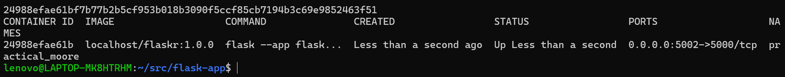

**Pembahasan:** Container dijalankan dari image `localhost/flaskr:1.0.0` dengan pemetaan `-p 5002:5000`. `podman ps` menampilkan container ID `24988efae61b`, nama acak `practical_moore`, status `Up`, dan port `0.0.0.0:5002->5000/tcp`. Port 5002 dipakai agar tidak bertabrakan dengan aplikasi lokal (5000) dan container Docker (5001), sehingga ketiganya dapat berjalan bersamaan sebagai pembanding. Karena Podman berjalan *rootless* di WSL, penerusan port dilakukan oleh proses bantu milik pengguna, bukan oleh daemon sistem.

Aplikasi container Podman diakses melalui browser pada `http://localhost:5002`.

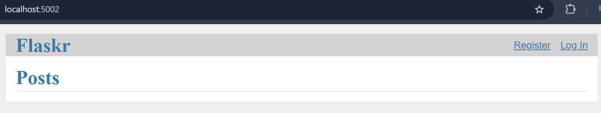

**Pembahasan:** Halaman Flaskr tampil pada `localhost:5002` dengan struktur dan tampilan yang identik dengan dua percobaan sebelumnya. Kesamaan ini menunjukkan bahwa image hasil build Podman dari `Dockerfile` yang sama menghasilkan aplikasi yang sama, dan bahwa pemetaan port 5002 ke 5000 berfungsi. Dengan demikian aplikasi Flaskr telah berhasil dijalankan sebagai *containerized app* pada dua *container engine* berbeda.

## D. HASIL DAN PEMBAHASAN

### D.1 Ringkasan Hasil

| Tahap | Perintah utama | Hasil |
|---|---|---|
| Lokal | `flask --app flaskr run --host=0.0.0.0` | Flaskr berjalan di `localhost:5000`, registrasi dan login berhasil |
| Docker | `docker build -t flaskr:1.0.0 .` | Image `flaskr:1.0.0` (ID `f71eb7f9feac`) |
| Docker | `docker run -d -p 5001:5000 flaskr:1.0.0` | Container `gracious_bell`, `localhost:5001` dapat diakses |
| Podman | `podman build -t flaskr:1.0.0 .` | Image `localhost/flaskr:1.0.0` (ID `65bf1e9d6a4e`) |
| Podman | `podman run -d -p 5002:5000 flaskr:1.0.0` | Container `practical_moore`, `localhost:5002` dapat diakses |

### D.2 Perbandingan Docker dan Podman

| Aspek | Docker | Podman |
|---|---|---|
| Arsitektur | Client–daemon; perintah dikirim ke `dockerd` | *Daemonless*; container dijalankan langsung oleh proses pengguna |
| Hak akses | Umumnya butuh daemon berjalan; di praktikum ini melalui Docker Desktop | *Rootless* secara default |
| Penyimpanan image | Penyimpanan milik Docker Desktop, dipakai bersama semua image | Penyimpanan pengguna (`~/.local/share/containers/storage`) |
| Ukuran image `flaskr:1.0.0` | 424 MB (*content size*) | 1,17 GB (lapisan belum dipadatkan) |
| Format build | `Dockerfile`, output BuildKit `[+] Building ... FINISHED` | `Dockerfile` yang sama, output `STEP n/8 ... COMMIT` |
| Nama image | `flaskr:1.0.0` | `localhost/flaskr:1.0.0` |
| Port yang dipakai | 5001 | 5002 |

Keduanya menghasilkan aplikasi yang berperilaku sama karena memakai format image OCI dan `Dockerfile` yang sama. Perbedaan utama terletak pada cara menjalankan container (daemon vs tanpa daemon) dan lokasi penyimpanan image.

### D.3 Hubungan Praktikum dengan Konsep Cloud Computing

Praktikum ini memperlihatkan inti dari *containerized app* yang menjadi bahan pembentuk layanan PaaS. Di dalam PaaS, penyedia menyiapkan *runtime*, lalu kode aplikasi pengguna dikemas menjadi image dan dijalankan sebagai container. Karena image bersifat *portable*, image yang sama dapat dijalankan di laptop pengembang, di server uji, maupun di penyedia cloud. Hal inilah yang membuat praktik "build once, run anywhere" mungkin dilakukan dan menjadi dasar layanan seperti Heroku atau Google App Engine. Lapisan SaaS di atasnya (misalnya Google Workspace pada bagian B.2) dibangun dari banyak layanan berbasis container seperti ini, dikelola sepenuhnya oleh penyedia.

### D.4 Kendala dan Solusi

1. **Perintah dari terminal yang salah.** Perintah `docker build` dijalankan di PowerShell pada `C:\Users\lenovo`, sehingga muncul `failed to read dockerfile: open Dockerfile: no such file or directory`. Solusinya, pekerjaan dilakukan di terminal Ubuntu (WSL) pada direktori `~/src/flask-app`.

2. **`wsl` tanpa argumen masuk ke distro `docker-desktop`.** Prompt yang muncul `docker-desktop:/tmp/...#` dan `sudo` tidak tersedia. Solusinya, masuk dengan `wsl -d Ubuntu-24.04` sehingga prompt menjadi `lenovo@LAPTOP-MK8HTRHM:~$`.

3. **Password `sudo` terlupa.** Password direset dari PowerShell dengan `wsl -d Ubuntu-24.04 -u root passwd lenovo`, karena WSL mengizinkan masuk sebagai *root* tanpa password.

4. **`uv pip install -e .` gagal menghubungi `pypi.org`.** Pesan yang muncul `client error (Connect)` dan `operation timed out` setelah tiga kali percobaan. Pengujian menunjukkan `curl` ke `pypi.org` berhasil dan koneksi TCP ke alamat IPv4 PyPI terbuka, tetapi *TLS handshake* dari WSL selalu macet, termasuk pada Python `urllib`. Pengaturan prioritas IPv4 pada `/etc/gai.conf` tidak menyelesaikan masalah karena uv memakai resolver sendiri. Solusinya, instalasi diarahkan ke mirror PyPI:
   ```
   export UV_DEFAULT_INDEX=https://mirrors.aliyun.com/pypi/simple
   uv pip install -e .
   ```
   Proses build di dalam container Docker dan Podman tidak terpengaruh karena keduanya memakai jaringan container engine, bukan jaringan WSL, sehingga `RUN pip install -e .` pada `Dockerfile` tetap berjalan normal.

5. **Langkah mematikan `dockerd` pada bagian Podman tidak dapat dilakukan.** Modul meminta `systemctl stop docker` sebelum memakai Podman. Di Windows, Docker dijalankan melalui Docker Desktop di WSL terpisah, sedangkan Podman dijalankan *rootless* di Ubuntu-24.04 dan tidak memakai daemon Docker. Karena keduanya tidak saling bergantung (bahkan memakai penyimpanan image berbeda), Podman tetap dapat membangun dan menjalankan container tanpa mematikan Docker.

6. **Build Docker tampil `CACHED`.** Saat `docker build` dijalankan ulang, seluruh langkah berstatus `CACHED` dan proses hanya butuh 1,8 detik. Ini bukan kesalahan, melainkan fitur *layer cache*: lapisan yang tidak berubah dipakai ulang. Image yang sama juga sudah muncul pada `docker images`.

## E. KESIMPULAN

1. Cloud computing dengan pendekatan XaaS membagi layanan menjadi SaaS (aplikasi siap pakai, misalnya Google Workspace), PaaS (platform untuk menjalankan aplikasi, misalnya Heroku), dan IaaS (infrastruktur berupa mesin virtual dan jaringan, misalnya Amazon EC2). Semakin tinggi lapisan layanan, semakin kecil kendali konsumen atas infrastruktur.
2. Aplikasi Flaskr berhasil dijalankan secara lokal dengan Python 3.14.4 dan *virtual environment* buatan `uv`, serta fungsi registrasi dan login bekerja di atas basis data SQLite hasil `init-db`.
3. Aplikasi yang sama berhasil diubah menjadi *containerized app* dengan `Dockerfile` sederhana yang memasang dependensi dan menginisialisasi basis data saat *build*.
4. Docker dan Podman dapat membangun image dari `Dockerfile` yang sama dan menjalankannya dengan pemetaan port berbeda (5001 dan 5002), sehingga aplikasi dapat diakses dari browser tanpa memasang Python di host.
5. Container memisahkan aplikasi dari lingkungan host. Berkat sifat *portable* image, penerapan container menjadi dasar layanan PaaS dan komponen pembentuk layanan cloud lainnya.
6. Kendala utama pada praktikum ini bersifat lingkungan (jaringan WSL ke PyPI dan pemilihan shell), bukan kesalahan pada aplikasi atau `Dockerfile`; kendala tersebut dapat diatasi dengan mirror PyPI dan penggunaan terminal WSL yang benar.

## F. REFERENSI

1. Materi Praktikum Sistem Terdistribusi dan Terdesentralisasi, Modul 07: Cloud Computing.
2. Dokumentasi Flask, *Tutorial*. https://flask.palletsprojects.com/en/stable/tutorial/
3. Kode sumber tutorial Flask. https://github.com/pallets/flask/tree/3.1.3/examples/tutorial
4. Dokumentasi Docker, *Dockerfile reference*. https://docs.docker.com/reference/dockerfile/
5. Dokumentasi Podman. https://podman.io/docs
6. Dokumentasi uv. https://docs.astral.sh/uv/
7. Google Workspace. https://workspace.google.com/
8. Heroku Dev Center. https://devcenter.heroku.com/
9. Amazon Web Services, *Amazon EC2*. https://aws.amazon.com/ec2/
