# Praktikum Minggu 08 — Arsitektur Microservices untuk Sistem Terdistribusi

**Nama:** Arsenius Kelvin Jemudin  
**NIM:** 255410015  
**Kelas:** IF-1  
**Program Studi:** Informatika  
**Universitas:** Universitas Teknologi Digital Indonesia  
**Lingkungan:** Windows 11 + WSL 2 (Ubuntu-24.04), Python 3.14.4 (uv 0.13.7)

## A. PENDAHULUAN

**Microservices** adalah gaya arsitektur perangkat lunak yang memecah aplikasi menjadi layanan-layanan kecil yang berjalan mandiri dan saling berkomunikasi melalui jaringan. Sisi **frontend** berisi antarmuka pengguna dan menjadi titik interaksi, lalu meminta layanan dari **backend** berupa *service*. Service pada umumnya diekspos sebagai REST API, GraphQL, atau gRPC.

Pada praktikum ini, backend dibuat dengan **FastAPI** (framework web Python) dan **SQLModel** (lapisan ORM di atas SQLAlchemy) yang menyimpan data ke basis data **SQLite**. Modul menyediakan contoh service sederhana dengan endpoint `/sdm/` yang menampilkan data karyawan, dan tugas praktikum meminta tabel baru dengan lima tipe data berbeda beserta endpoint REST untuk menampilkannya.

Tujuan praktikum:

1. Menjelaskan konsep arsitektur microservices dan peran REST API di dalamnya.
2. Menyiapkan environment Python 3.14.4 dan memasang dependensi FastAPI serta SQLModel dengan `uv`.
3. Menjalankan service contoh beserta basis data SQLite yang menyertainya.
4. Mengakses endpoint REST dari browser dan dari *headless tool* (`curl`).
5. Membuat tabel baru, mengisinya dengan script Python, dan mengeksposnya sebagai endpoint REST baru.

Struktur folder hasil praktikum:

```
08/
├── README.md
└── images/                    (screenshot 01 sampai 14)
```

## B. DASAR TEORI

### B.1 Arsitektur Microservices

Pada arsitektur monolit, seluruh fungsi aplikasi berada dalam satu program yang di-*deploy* sekaligus. Pada microservices, fungsi tersebut dipecah menjadi beberapa service yang:

- **Berjalan sebagai proses terpisah** sehingga dapat di-*deploy*, di-*scale*, dan di-*restart* secara mandiri.
- **Berkomunikasi lewat jaringan** memakai kontrak antarmuka yang jelas (biasanya HTTP dengan format JSON).
- **Memiliki data sendiri**; satu service tidak membaca langsung basis data service lain, tetapi meminta melalui API.

Konsekuensinya, service dapat ditulis dengan bahasa atau *framework* berbeda dan dikembangkan oleh tim yang berbeda. Di sisi lain, komunikasi jaringan memunculkan persoalan sistem terdistribusi: latensi, kegagalan koneksi, versi API, dan konsistensi data.

### B.2 REST API

**REST** (*Representational State Transfer*) memakai HTTP dan sumber daya (*resource*) yang diidentifikasi oleh URL. Pola yang dipakai pada praktikum:

| Elemen | Peran |
|---|---|
| Metode `GET` | Mengambil data tanpa mengubahnya |
| Path `/sdm/` | Koleksi sumber daya "SDM" (karyawan) |
| Format JSON | Representasi data yang dipertukarkan |
| Status `200 OK` | Permintaan berhasil |
| Status `404 Not Found` | Path tidak dikenal |

Endpoint praktikum ini bersifat *read-only*; operasi tulis dilakukan langsung ke basis data melalui script Python.

### B.3 FastAPI dan SQLModel

**FastAPI** adalah framework web ASGI untuk Python yang memakai anotasi tipe untuk validasi *request*/*response* dan menghasilkan dokumentasi OpenAPI otomatis. **SQLModel** menggabungkan SQLAlchemy (ORM) dengan Pydantic (validasi), sehingga satu kelas dapat berfungsi sebagai model tabel sekaligus skema respons API.

Pola yang dipakai service contoh:

- `class Sdm(SQLModel, table=True)` — model sekaligus deklarasi tabel.
- `create_engine("sqlite:///departemen-sdm.db")` — koneksi ke berkas SQLite.
- `get_session()` — *dependency* yang menyediakan sesi basis data per *request* dan menutupnya setelah selesai.
- `@app.get("/sdm/", response_model=List[Sdm])` — endpoint yang mengembalikan daftar baris tabel.
- `select(Sdm)` — pernyataan SQLModel untuk membaca seluruh baris.

### B.4 SQLite dan Tipe Data

SQLite menyimpan database dalam satu berkas (`.db`), tidak memerlukan server terpisah, dan mendeklarasikan tipe kolom mengikuti *type affinity* (`INTEGER`, `TEXT`, `REAL`, `BLOB`, `NUMERIC`). Tipe seperti `CHAR(6)` dan `VARCHAR(50)` tetap tercatat pada skema, sedangkan nilai `BOOLEAN` disimpan sebagai `1`/`0`. Sifat ini membuat SQLite mudah dipakai untuk praktikum, tetapi juga berarti penegakan panjang string tidak seketat basis data server.

### B.5 uv

`uv` adalah pengelola paket dan *virtual environment* Python. Pada praktikum ini `uv venv --python 3.14.4` membuat environment dengan CPython 3.14.4, sedangkan `uv pip install -r requirements.txt` memasang paket sesuai versi yang dikunci dosen (di antaranya `fastapi 0.136.1`, `sqlmodel 0.0.38`, `uvicorn 0.46.0`, dan `sqlalchemy 2.0.49`).

## C. IMPLEMENTASI

### C.1 Menyiapkan Direktori Kerja dan Mengekstrak Source Code

Praktikum dikerjakan di terminal **Ubuntu (WSL)**. Arsip `src-08.tar.bz2` berisi `service.py`, `requirements.txt`, `.python-version`, dan `departemen-sdm.db`.

Arsip berformat `.bz2` membutuhkan `bzip2`, yang belum terpasang di distro Ubuntu-24.04 ini. Pada percobaan pertama, `tar -xjf` gagal dengan pesan `tar (child): bzip2: Cannot exec: No such file or directory`, sehingga perintah `cd` berikutnya ikut gagal dan `ls -la` menampilkan folder *home* Windows, bukan folder proyek. Perbaikannya:

```
sudo apt update
sudo apt install -y bzip2
mkdir -p ~/src/m08
tar -xjf /mnt/c/Users/lenovo/Downloads/src-08.tar.bz2 -C ~/src/m08
cd ~/src/m08/src
ls -la
```

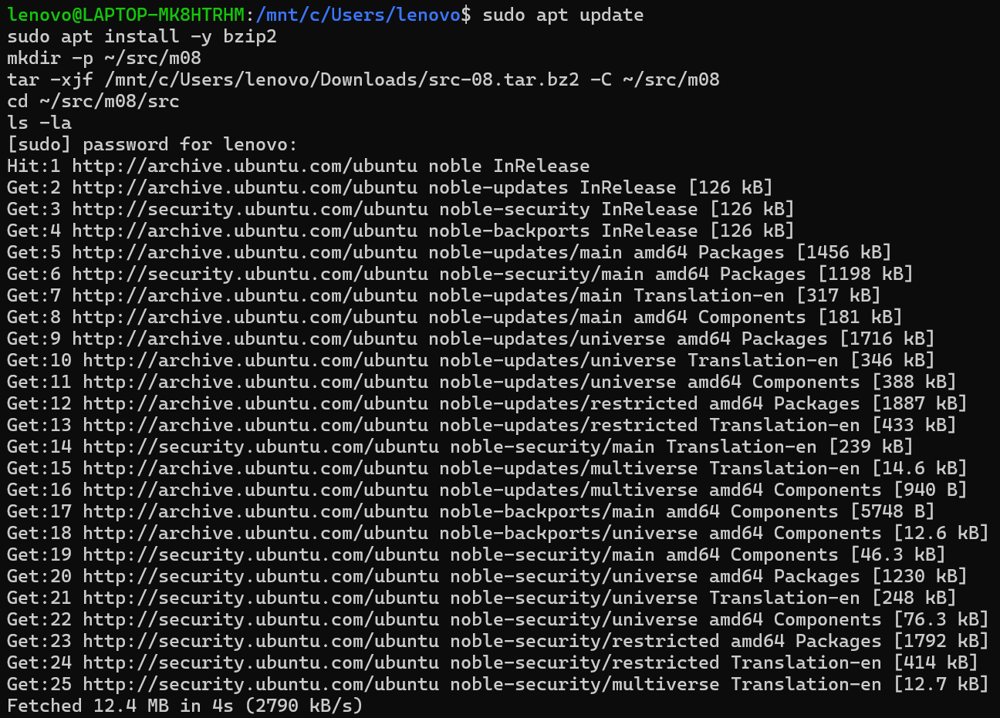

**Pembahasan:** Bagian pertama menampilkan proses pemasangan paket `bzip2` (34,6 kB) hingga baris `Setting up bzip2`. Paket ini menyediakan program dekompresi yang dibutuhkan `tar`, sebab tanpa program tersebut `tar` hanya membaca header arsip lalu berhenti dengan status 2. Pemasangan dilakukan dengan hak *root* melalui `sudo apt install -y`.

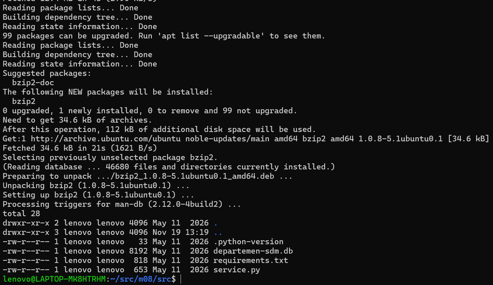

**Pembahasan:** Setelah `bzip2` tersedia, `tar -xjf` berhasil mengekstrak arsip ke `~/src/m08` dan prompt berpindah ke `~/src/m08/src`. Hasil `ls -la` menampilkan empat berkas: `.python-version` (33 byte), `departemen-sdm.db` (8.192 byte), `requirements.txt` (818 byte), dan `service.py` (653 byte). Kehadiran `departemen-sdm.db` menandakan bahwa langkah "buat database" pada modul sudah tersedia dalam bentuk basis data jadi, sehingga praktikum dapat langsung berfokus pada menjalankan service.

### C.2 Membuat Environment Python 3.14.4

Berkas `.python-version` dari dosen berisi path absolut Python milik dosen (`/home/bpdp/.local/bin/python3.14`) sehingga tidak berlaku di komputer ini. Berkas tersebut ditimpa lebih dulu, baru environment dibuat:

```
echo "3.14.4" > .python-version
cat .python-version
uv venv --python 3.14.4
source .venv/bin/activate
```

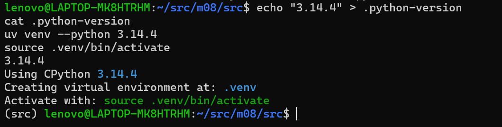

**Pembahasan:** `cat .python-version` menampilkan `3.14.4`, artinya uv akan memakai CPython 3.14.4 yang dikelolanya sendiri (bukan Python sistem 3.12.3). `uv venv --python 3.14.4` menampilkan baris `Using CPython 3.14.4 interpreter at: ...` dan membuat `.venv`. Setelah `source .venv/bin/activate`, prompt diawali `(src)` — nama diambil dari nama direktori proyek — sebagai tanda seluruh perintah `python` dan `pip` memakai interpreter di dalam environment tersebut.

### C.3 Memasang Dependensi

```
export UV_DEFAULT_INDEX=https://mirrors.aliyun.com/pypi/simple
UV_HTTP_TIMEOUT=120 uv pip install -r requirements.txt
```

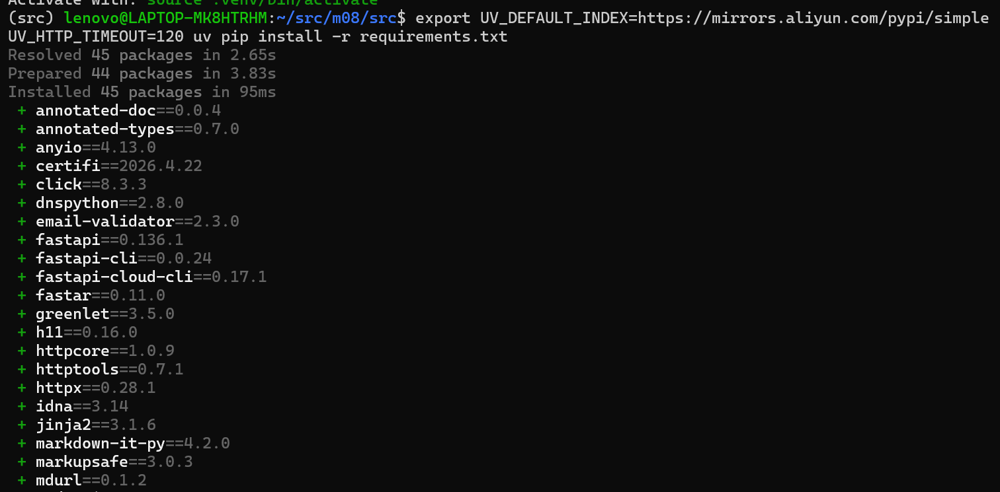

**Pembahasan:** Perintah ini memasang dependensi sesuai versi terkunci pada `requirements.txt`. uv melaporkan `Resolved 45 packages in 2.65s`, `Prepared 44 packages in 3.83s`, dan `Installed 45 packages in 95ms`. Bagian atas daftar memuat paket inti web: `fastapi 0.136.1`, `starlette 1.0.0`, `pydantic 2.13.4`, dan `uvicorn 0.46.0`. Proses hanya berjalan beberapa detik karena paket diambil dari mirror. `UV_DEFAULT_INDEX` diarahkan ke mirror karena koneksi TLS ke `pypi.org` dari WSL distro ini selalu berakhir *timeout* (kendala yang sama dengan praktikum sebelumnya).

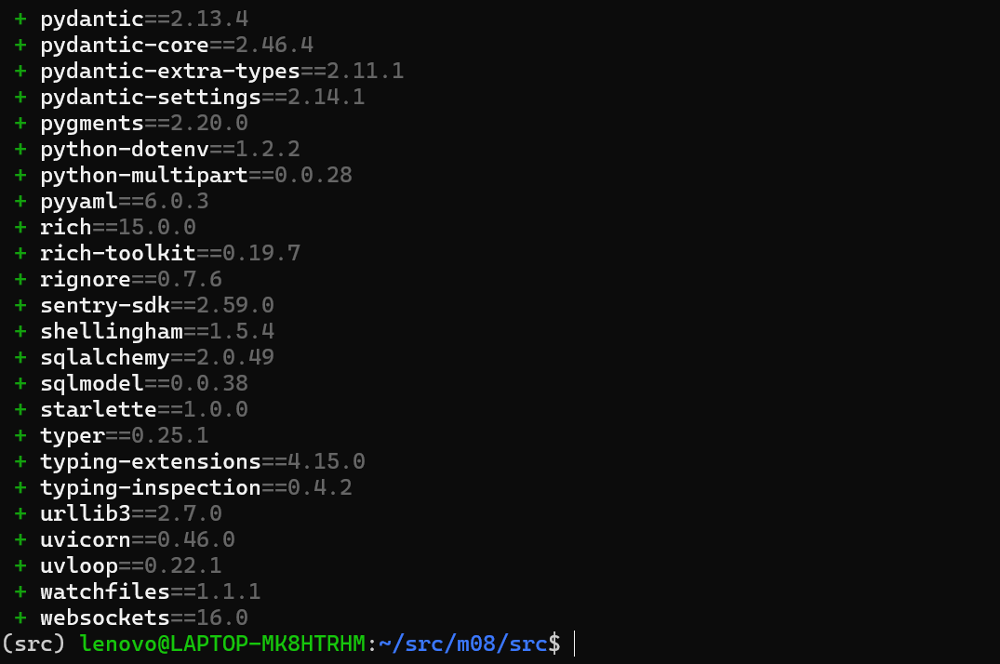

**Pembahasan:** Bagian bawah daftar menampilkan paket pendukung ORM dan *tooling*: `sqlalchemy 2.0.49`, `sqlmodel 0.0.38`, `greenlet 3.5.0`, `typer 0.25.1`, `watchfiles 1.1.1`, dan `websockets 16.0`. `sqlmodel` adalah paket yang dipakai service untuk mendefinisikan tabel; ia bergantung pada `sqlalchemy` sebagai mesin ORM dan `pydantic` untuk validasi data. Setelah prompt kembali `(src)`, seluruh dependensi siap dipakai.

### C.4 Memeriksa SQLite dan Basis Data yang Disertakan

Tool `sqlite3` belum terpasang, sehingga diperiksa dengan:

```
sudo apt install -y sqlite3
sqlite3 --version
sqlite3 departemen-sdm.db ".tables"
sqlite3 departemen-sdm.db ".schema sdm"
sqlite3 departemen-sdm.db "SELECT * FROM sdm;"
```

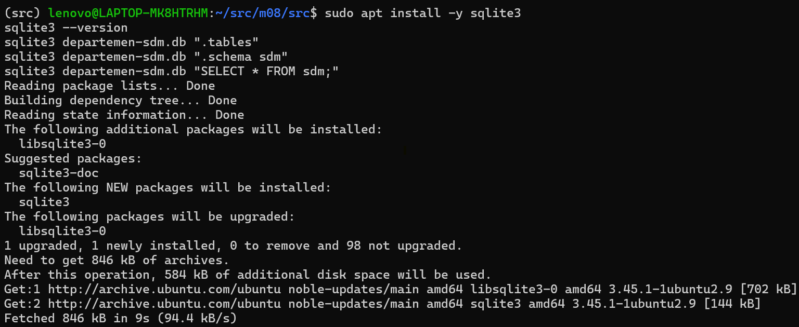

**Pembahasan:** `apt install -y sqlite3` memasang dua paket: `libsqlite3-0` (ditingkatkan) dan `sqlite3` (baru). Versi yang terpasang adalah **3.45.1** (2024-01-30). Versi ini penting karena mendukung fitur SQL modern yang dipakai SQLAlchemy. Instalasi hanya membutuhkan 584 kB ruang tambahan.

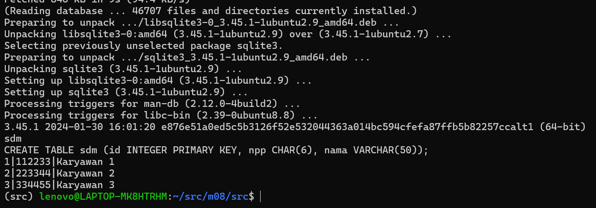

**Pembahasan:** `.tables` menampilkan satu tabel, `sdm`. `.schema sdm` memperlihatkan deklarasi `CREATE TABLE sdm (id INTEGER PRIMARY KEY, npp CHAR(6), nama VARCHAR(50))` — sesuai dengan model `Sdm` pada `service.py` dan memuat tipe INT, CHAR, serta VARCHAR. `SELECT * FROM sdm;` menampilkan tiga baris: `1|112233|Karyawan 1`, `2|223344|Karyawan 2`, dan `3|334455|Karyawan 3`. Data ini nantinya menjadi respons endpoint `/sdm/`.

### C.5 Meninjau Kode Service

```
cat service.py
```

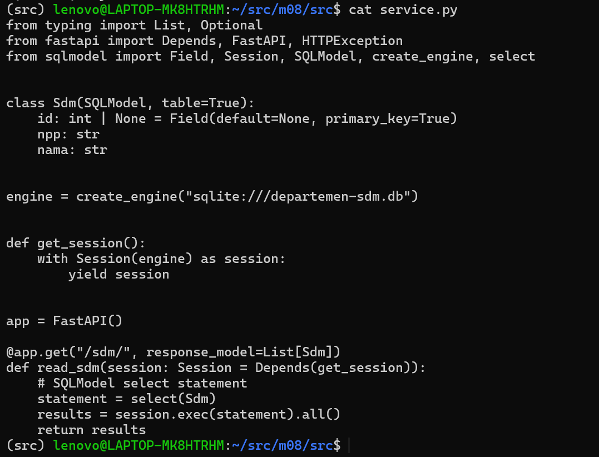

**Pembahasan:** Berkas `service.py` terdiri atas empat bagian. Pertama, definisi model `Sdm` dengan `id` sebagai *primary key* opsional (`int | None`, `default=None` agar SQLite yang menentukan nomor), lalu `npp` dan `nama` sebagai string. Kedua, `engine = create_engine("sqlite:///departemen-sdm.db")` yang menghubungkan ORM ke berkas SQLite di direktori kerja. Ketiga, `get_session()` yang membuka `Session` untuk setiap permintaan dan menutupnya setelah selesai (pola *dependency*). Keempat, endpoint `@app.get("/sdm/", response_model=List[Sdm])` yang menjalankan `select(Sdm)` dan mengembalikan seluruh baris sebagai JSON. Impor `Optional` dan `HTTPException` tidak dipakai pada contoh ini karena berasal dari kerangka contoh dosen.

### C.6 Menjalankan Service

```
uvicorn service:app --host 0.0.0.0 --port 8000
```

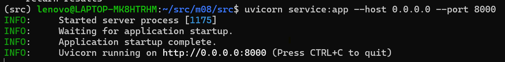

**Pembahasan:** Uvicorn adalah server ASGI yang menjalankan objek `app` dari modul `service`. Baris log `Started server process [1175]`, `Waiting for application startup.`, lalu `Application startup complete.` menunjukkan proses berhasil dijalankan. `Uvicorn running on http://0.0.0.0:8000` berarti server menerima koneksi pada semua antarmuka jaringan. Opsi `--host 0.0.0.0` diperlukan agar permintaan dari browser Windows (melalui *localhost forwarding* WSL 2) dapat diteruskan ke server di dalam WSL. Selama server berjalan, terminal ini tertahan dan tidak dapat dipakai untuk perintah lain.

### C.7 Mengakses Endpoint /sdm/ dari Browser

```
http://localhost:8000/sdm/
```

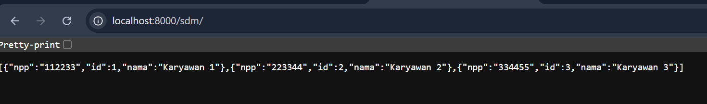

**Pembahasan:** Browser menampilkan JSON berisi tiga objek: `{"npp":"112233","id":1,"nama":"Karyawan 1"}`, `{"npp":"223344","id":2,"nama":"Karyawan 2"}`, dan `{"npp":"334455","id":3,"nama":"Karyawan 3"}`. Respons tersebut berasal dari tabel `sdm` yang diperiksa pada langkah C.4, sehingga membuktikan jalur lengkap berfungsi: HTTP *request* → FastAPI → SQLModel → SQLite → JSON *response*. Halaman tampil sebagai JSON mentah (bukan HTML) karena endpoint memang mengembalikan `application/json`; kotak *Pretty-print* yang muncul adalah fitur bawaan browser untuk memformat JSON.

### C.8 Mengakses Endpoint /sdm/ dengan curl

Karena terminal pertama sedang dipakai uvicorn, pengujian dilakukan dari terminal kedua:

```
cd ~/src/m08/src
curl -s http://localhost:8000/sdm/ | python3 -m json.tool
```

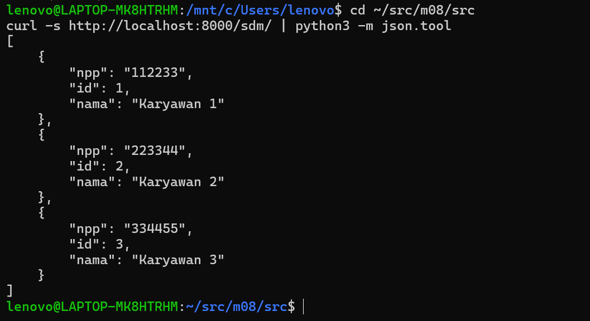

**Pembahasan:** `curl -s` mengambil isi endpoint secara senyap (tanpa bilah kemajuan), lalu `python3 -m json.tool` merapikan JSON agar mudah dibaca. Hasilnya tiga objek berurutan, masing-masing dengan field `npp`, `id`, dan `nama` — sama dengan hasil di browser. Pengujian ini penting karena membuktikan endpoint dapat dipakai program lain (*machine-to-machine*), bukan hanya ditampilkan di peramban; inilah bentuk nyata komunikasi antar-layanan pada arsitektur microservices.

### C.9 Membuat Script Tabel Baru (Tugas)

Tugas meminta tabel baru dengan satu *primary key* dan kolom bertipe INT, CHAR, VARCHAR, BOOLEAN, dan FLOAT, diisi lima data melalui script Python. Tabel yang dibuat bernama `produk` dengan struktur: `id` INT, `kode` CHAR(6), `nama` VARCHAR(50), `tersedia` BOOLEAN, `harga` FLOAT.

```
cat tugas_produk.py
```

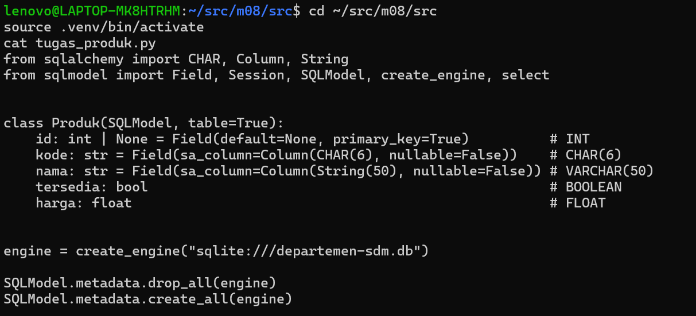

**Pembahasan:** Bagian atas script memuat impor tipe kolom SQLAlchemy (`CHAR`, `Column`, `String`) dan definisi `class Produk(SQLModel, table=True)`. Kolom `kode` memakai `sa_column=Column(CHAR(6), nullable=False)` agar tipenya benar-benar `CHAR(6)` (bukan `VARCHAR`), sedangkan `nama` memakai `String(50)` yang dirender sebagai `VARCHAR(50)`. `tersedia: bool` dan `harga: float` dipetakan otomatis ke BOOLEAN dan FLOAT. Engine diarahkan ke berkas yang sama, `departemen-sdm.db`, sehingga `sdm` dan `produk` berada dalam satu basis data tetapi didefinisikan oleh model yang berbeda.

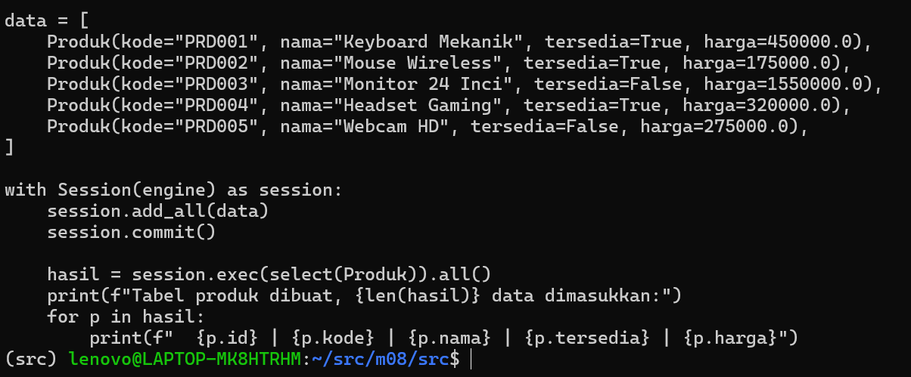

**Pembahasan:** `SQLModel.metadata.drop_all(engine)` diikuti `create_all(engine)` membuat tabel `produk` selalu dalam keadaan baru, sehingga script dapat dijalankan berulang tanpa duplikasi data. Lima objek `Produk` (PRD001–PRD005) berisi kombinasi nilai BOOLEAN `True`/`False` dan FLOAT, lalu disimpan dengan `session.add_all(...)` dan `session.commit()`. Setelah itu script membaca ulang data dengan `select(Produk)` dan mencetak jumlah serta isi baris — fungsi ganda sebagai bukti bahwa data benar-benar tersimpan.

### C.10 Menjalankan Script dan Memasukkan Data

```
python tugas_produk.py
```

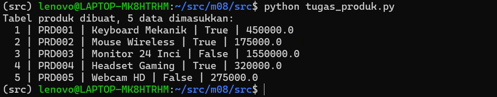

**Pembahasan:** Script mencetak `Tabel produk dibuat, 5 data dimasukkan:` diikuti lima baris data. Kolom Boolean tampil sebagai `True`/`False` di Python, sedangkan nilai harga tampil dengan satu angka desimal (`450000.0`, `175000.0`, dan seterusnya). Hasil ini menunjukkan proses *create table* dan *insert* berhasil, sekaligus memastikan bahwa model Python dan tabel SQLite memiliki struktur yang sama.

### C.11 Memverifikasi Tabel Baru di SQLite

```
sqlite3 departemen-sdm.db ".schema produk"
sqlite3 departemen-sdm.db "SELECT * FROM produk;"
```

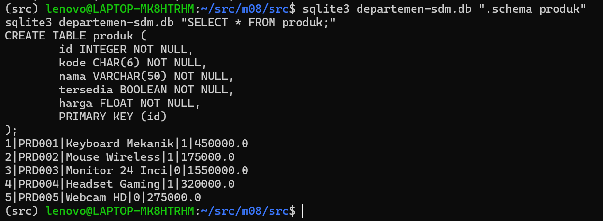

**Pembahasan:** Skema yang tercatat adalah `CREATE TABLE produk (id INTEGER NOT NULL, kode CHAR(6) NOT NULL, nama VARCHAR(50) NOT NULL, tersedia BOOLEAN NOT NULL, harga FLOAT NOT NULL, PRIMARY KEY (id))`. Kelima tipe yang diminta tugas hadir: INTEGER, CHAR(6), VARCHAR(50), BOOLEAN, dan FLOAT, dengan `id` sebagai *primary key*. Pada `SELECT`, nilai BOOLEAN tampil sebagai `1`/`0` karena SQLite menyimpan boolean sebagai integer. Verifikasi melalui `sqlite3` penting karena membaca data langsung dari berkas, tanpa melewati FastAPI, sehingga membuktikan datanya benar-benar persisten.

### C.12 Menambahkan Endpoint REST untuk Tabel Baru

Setelah data tersedia, `service.py` ditambah model `Produk` (definisi yang sama dengan script) dan satu endpoint baru. Karena uvicorn berjalan tanpa opsi *reload*, server dihentikan dengan `Ctrl+C` lalu dijalankan ulang.

```
uvicorn service:app --host 0.0.0.0 --port 8000
cat service.py
```

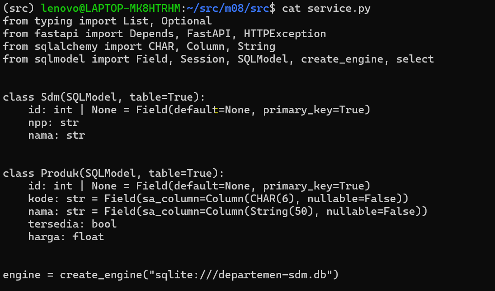

**Pembahasan:** Bagian atas berkas kini memuat dua model: `Sdm` (bawaan modul) dan `Produk` (tambahan tugas). Impor `CHAR`, `Column`, dan `String` dari `sqlalchemy` ditambahkan agar tipe kolom dapat dideklarasikan eksplisit. Model `Produk` memakai anotasi tipe yang sama dengan script sehingga SQLModel memetakannya tepat ke tabel `produk` yang sudah ada; `table=True` membuat SQLModel mengenali tabel tersebut tanpa membuatnya ulang.

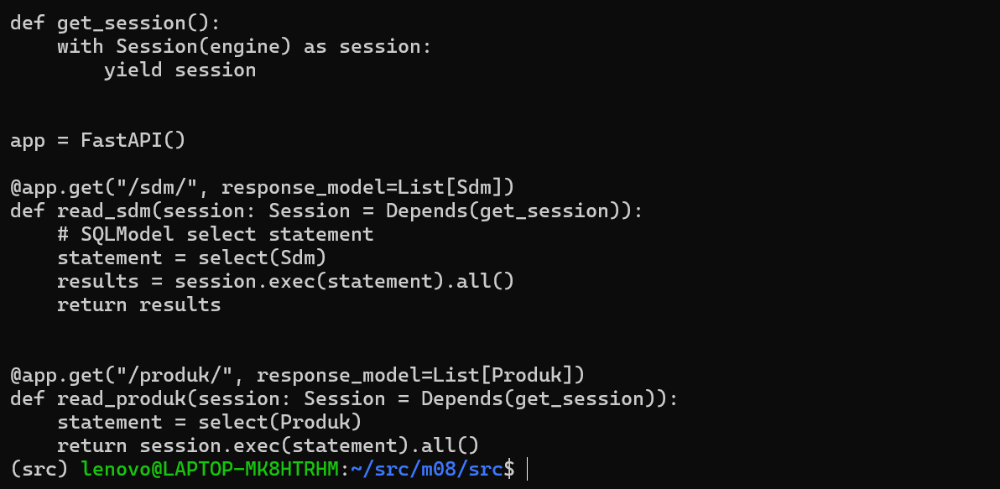

**Pembahasan:** Bagian bawah menampilkan `engine`, `get_session`, kedua endpoint (`/sdm/` dan `/produk/`), serta pola *dependency* sesi yang sama untuk keduanya. Endpoint `/produk/` memakai `response_model=List[Produk]` sehingga setiap baris divalidasi dan diubah menjadi JSON dengan field `id`, `kode`, `nama`, `tersedia`, dan `harga`. Restart diperlukan karena proses uvicorn memuat modul `service` sekali saat start; tanpa restart, endpoint baru belum terdaftar pada aplikasi yang berjalan.

### C.13 Menguji Endpoint Baru dengan curl

```
curl -s http://localhost:8000/produk/ | python3 -m json.tool
```

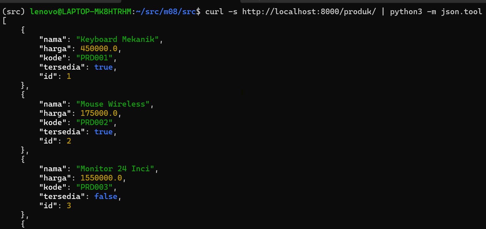

**Pembahasan:** Hasilnya berupa array JSON berisi lima objek. Tiga objek pertama menampilkan `PRD001` (Keyboard Mekanik, tersedia `true`, harga 450000.0), `PRD002` (Mouse Wireless, tersedia `true`, harga 175000.0), dan `PRD003` (Monitor 24 Inci, tersedia `false`, harga 1550000.0). Nilai `true`/`false` pada JSON berasal dari konversi BOOLEAN SQLite (`1`/`0`) oleh Pydantic saat validasi respons.

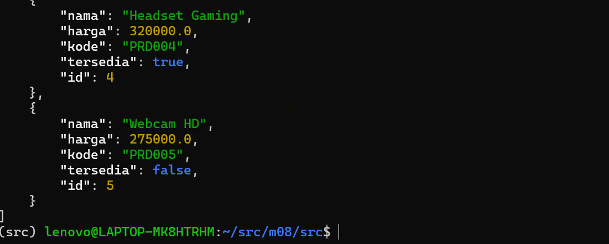

**Pembahasan:** Objek keempat dan kelima menampilkan `PRD004` (Headset Gaming, tersedia `true`, harga 320000.0) dan `PRD005` (Webcam HD, tersedia `false`, harga 275000.0). Kelima baris muncul dalam urutan *primary key* karena `select(Produk)` tanpa klausa `ORDER BY` membaca tabel sesuai urutan penyimpanan SQLite. Dengan demikian seluruh syarat tugas terpenuhi: tabel baru bertipe lengkap, lima data, endpoint REST, dan hasil yang dapat ditampilkan lewat curl.

### C.14 Mengakses Endpoint Baru dari Browser

```
http://localhost:8000/produk/
```

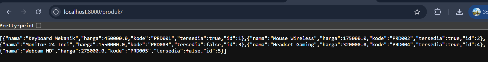

**Pembahasan:** Browser menampilkan JSON lima produk pada `localhost:8000/produk/`, sama dengan hasil curl. Kedua jalur akses (browser dan curl) memakai HTTP request yang identik, sehingga kesamaan hasil membuktikan endpoint bersifat *stateless* dan dapat dilayani siapa pun yang terhubung ke port tersebut. Ini adalah sifat yang diharapkan dari REST API pada arsitektur microservices: satu service melayani banyak klien tanpa menyimpan keadaan per klien.

## D. HASIL DAN PEMBAHASAN

### D.1 Ringkasan Hasil

| Tahap | Perintah utama | Hasil |
|---|---|---|
| Environment | `uv venv --python 3.14.4` | `.venv` dengan CPython 3.14.4, prompt `(src)` |
| Dependensi | `uv pip install -r requirements.txt` | 45 paket terpasang (fastapi 0.136.1, sqlmodel 0.0.38, uvicorn 0.46.0) |
| Basis data | `sqlite3 departemen-sdm.db ...` | Tabel `sdm` bertipe INT/CHAR(6)/VARCHAR(50), 3 baris data |
| Service | `uvicorn service:app --host 0.0.0.0 --port 8000` | Berjalan di `0.0.0.0:8000` |
| Endpoint contoh | `GET /sdm/` | JSON 3 karyawan (browser dan curl) |
| Tugas — tabel | `python tugas_produk.py` | Tabel `produk` (INT, CHAR(6), VARCHAR(50), BOOLEAN, FLOAT), 5 baris |
| Tugas — endpoint | `GET /produk/` | JSON 5 produk (curl dan browser) |

### D.2 Analisis

**Pemisahan data dan antarmuka.** Service hanya membaca basis data; pengisian data dilakukan script terpisah. Pemisahan ini mencerminkan prinsip microservices bahwa data dimiliki oleh service, sementara klien hanya mengakses melalui API. Bila nanti penulisan data perlu dibuka, endpoint `POST` dapat ditambahkan tanpa mengubah cara klien membaca.

**Pemetaan model ke tabel.** Satu kelas SQLModel berperan ganda: definisi tabel sekaligus skema respons. Karena `Produk` di `service.py` dan di `tugas_produk.py` identik, ORM dapat membaca tabel yang dibuat oleh proses lain. Kesalahan kecil pada nama kolom atau tipe akan langsung terlihat sebagai error 500 saat endpoint dipanggil, sehingga konsistensi model menjadi hal yang harus dijaga.

**Bukti kerja arsitektur terdistribusi.** Walaupun berjalan di satu mesin, pola yang dipakai sudah pola sistem terdistribusi: klien (browser/curl) dan service adalah proses berbeda yang berkomunikasi lewat HTTP, memakai kontrak JSON, dan tidak berbagi memori. Untuk memindahkan service ke node lain, cukup mengubah alamat yang dihubungi klien.

### D.3 Kendala dan Solusi

1. **`tar` gagal karena `bzip2` belum terpasang.** Muncul `tar (child): bzip2: Cannot exec: No such file or directory`, lalu `cd` ikut gagal sehingga `ls -la` menampilkan folder *home* Windows. Solusi: `sudo apt install -y bzip2`, kemudian ekstraksi diulang.

2. **`sqlite3` belum tersedia.** Perintah `sqlite3 --version` menjawab `Command 'sqlite3' not found, but can be installed with: sudo apt install sqlite3`. Solusi: `sudo apt install -y sqlite3` (versi 3.45.1).

3. **`.python-version` menunjuk path Python milik dosen.** Berkas bawaan arsip berisi `/home/bpdp/.local/bin/python3.14` yang tidak ada di komputer ini. Solusi: ditimpa dengan `echo "3.14.4" > .python-version` sebelum `uv venv`.

4. **PyPI tidak dapat diakses dari WSL.** Sama seperti praktikum sebelumnya, koneksi TLS ke `pypi.org` berakhir *timeout*. Solusi: `export UV_DEFAULT_INDEX=https://mirrors.aliyun.com/pypi/simple` dan `UV_HTTP_TIMEOUT=120` sebelum instalasi.

5. **Perintah diketik di terminal yang salah.** Perintah `curl` yang diketik di terminal uvicorn tidak dieksekusi (menumpuk sebagai input), dan perintah Linux yang diketik di PowerShell menghasilkan `Cannot find path 'C:\Users\lenovo\src\m08\src'` serta prompt parameter `Uri` karena `curl` di PowerShell adalah alias `Invoke-WebRequest`. Solusi: buka terminal kedua, jalankan `wsl -d Ubuntu-24.04`, lalu ulangi perintah.

6. **`404` untuk `/favicon.ico`.** Log uvicorn mencatat `GET /favicon.ico 404 Not Found`. Ini bukan kesalahan aplikasi: browser otomatis meminta ikon situs yang memang tidak disediakan service, sehingga `GET /sdm/` tetap `200 OK`.

## E. KESIMPULAN

1. Arsitektur microservices memecah aplikasi menjadi service mandiri yang berkomunikasi lewat jaringan dengan kontrak API; pada praktikum ini kontraknya berupa REST API dengan format JSON.
2. FastAPI dan SQLModel memungkinkan satu kelas Python berperan sebagai model tabel SQLite sekaligus skema respons, sehingga service contoh `/sdm/` dapat dijalankan dengan kode yang ringkas.
3. Service contoh beserta basis data `departemen-sdm.db` berhasil dijalankan pada Python 3.14.4 dan diakses dari browser maupun `curl`, dengan respons berupa tiga data karyawan.
4. Tugas berhasil diselesaikan: tabel `produk` dibuat dengan tipe INT, CHAR(6), VARCHAR(50), BOOLEAN, dan FLOAT serta satu *primary key*; lima data dimasukkan melalui script Python; dan endpoint `/produk/` menampilkan seluruh data dalam JSON.
5. Verifikasi dilakukan pada dua lapis — langsung ke SQLite dengan `sqlite3` dan melalui HTTP dengan `curl`/browser — sehingga terbukti data tersimpan benar dan tersaji dengan benar.
6. Kendala yang muncul seluruhnya bersifat lingkungan (paket sistem yang belum terpasang, path Python milik dosen, akses PyPI dari WSL, dan pemilihan terminal), bukan kesalahan pada kode service.

## F. REFERENSI

1. Materi Praktikum Sistem Terdistribusi dan Terdesentralisasi, Modul 08: Arsitektur Microservices untuk Sistem Terdistribusi.
2. Dokumentasi FastAPI. https://fastapi.tiangolo.com/
3. Dokumentasi SQLModel. https://sqlmodel.tiangolo.com/
4. Dokumentasi SQLAlchemy. https://docs.sqlalchemy.org/
5. Dokumentasi Uvicorn. https://www.uvicorn.org/
6. SQLite Documentation. https://www.sqlite.org/docs.html
7. Dokumentasi uv. https://docs.astral.sh/uv/
