# Praktikum Minggu 09 — Arsitektur Microservices untuk Sistem Terdistribusi: GraphQL dan gRPC

**Nama:** Arsenius Kelvin Jemudin  
**NIM:** 255410015  
**Kelas:** IF-1  
**Program Studi:** Informatika  
**Universitas:** Universitas Teknologi Digital Indonesia  
**Lingkungan:** Windows 11 + WSL 2 (Ubuntu-24.04), Python 3.14.10 (uv 0.13.7)

## A. PENDAHULUAN

Pada arsitektur **microservices**, aplikasi dipecah menjadi layanan-layanan kecil yang berjalan sebagai proses terpisah dan saling berkomunikasi lewat jaringan. Sisi **frontend** menjadi titik interaksi pengguna, sedangkan **backend** menyediakan *service*. Modul sebelumnya mengekspos service sebagai **REST API**; modul ini memperkenalkan dua mekanisme lain yang banyak dipakai: **GraphQL** dan **gRPC**.

**GraphQL** adalah spesifikasi *query language* untuk API. Berbeda dari REST yang memiliki banyak URL, GraphQL memakai **satu endpoint** dan klien menentukan sendiri field apa yang ingin diambil. **gRPC** adalah mekanisme *Remote Procedure Call* yang memakai **Protocol Buffers** sebagai format serialisasi biner; klien memanggil method service seolah-olah fungsi lokal, dan kontraknya didefinisikan dalam berkas `.proto` yang dikompilasi menjadi *stub* di kedua sisi.

Praktikum ini memakai kembali basis data `departemen-sdm.db` dari modul 08 (tabel `sdm` dan `produk`). Contoh dari modul memakai tabel `sdm`, lalu tugas meminta tabel `produk` diekspos melalui GraphQL dan gRPC.

Tujuan praktikum:

1. Menjelaskan perbedaan REST API, GraphQL, dan gRPC pada arsitektur microservices.
2. Menyiapkan empat sub-proyek Python (GraphQL server/client, gRPC server/client) dengan *virtual environment* masing-masing.
3. Membangun GraphQL server dengan **Strawberry** dan mengujinya lewat **GraphiQL Explorer** serta client `gql`.
4. Mendefinisikan `service.proto`, mengompilasinya menjadi stub, lalu membangun **gRPC server** dan **gRPC client**.
5. Menyelesaikan tugas: endpoint GraphQL dan service gRPC untuk tabel `produk` beserta contoh client.

Struktur folder hasil praktikum:

```
09/
├── README.md
└── images/                    (screenshot 01 sampai 27, termasuk 03a/03b, 10a/10b, dst.)
```

## B. DASAR TEORI

### B.1 GraphQL

GraphQL memisahkan **skema** (apa yang bisa diminta) dari **query** (apa yang diminta). Skema berisi tipe objek dengan field bertipe, dan setiap field dihubungkan ke sebuah **resolver** — fungsi yang mengambil data dari sumbernya (basis data, service lain, dan sebagainya). Klien mengirim satu query berbentuk pohon:

```graphql
query getSdms {
  sdms {
    id
    npp
    nama
  }
}
```

Responsnya mengikuti bentuk query tersebut, sehingga tidak ada field berlebih (*over-fetching*) dan tidak perlu beberapa *request* untuk data yang saling terkait. Konsekuensinya, query kompleks dapat membebani server, sehingga GraphQL biasanya dilengkapi pembatasan kedalaman query dan *rate limit*. Untuk pengembangan, GraphQL menyediakan **GraphiQL** — halaman eksplorasi yang menampilkan dokumentasi skema dan menyediakan editor query.

### B.2 Strawberry dan `strawberry dev`

**Strawberry** adalah pustaka GraphQL untuk Python yang memakai anotasi tipe. Kelas Python yang diberi dekorator `@strawberry.type` menjadi tipe GraphQL, dan method/atribut bertipe menjadi field. Pada praktikum ini kelas `Sdm` dan `Produk` adalah **sekaligus model SQLModel dan tipe GraphQL**, sehingga tidak perlu mendefinisikan tipe dua kali:

```python
@strawberry.type
class Sdm(SQLModel, table=True):
    id: int | None = Field(default=None, primary_key=True)
    npp: str
    nama: str
```

Field pada `Query` diberi resolver melalui `strawberry.field(resolver=nama_fungsi)`. Pustaka ini juga menyediakan perintah `strawberry dev` yang menjalankan *development server* (uvicorn) pada `0.0.0.0:8000` dan menyajikan GraphiQL di `/graphql`.

### B.3 gRPC dan Protocol Buffers

gRPC memakai **Protocol Buffers** (proto3) sebagai *Interface Definition Language* sekaligus format serialisasi. Berkas `.proto` mendefinisikan `message` (struktur data) dan `service` berisi `rpc` (method jarak jauh):

```proto
message SdmRequest {
    int32 id = 1;
}

service SdmService {
    rpc GetSdm (SdmRequest) returns (SdmResponse);
}
```

Berkas tersebut dikompilasi dengan `grpc_tools.protoc` menjadi dua berkas Python: `*_pb2.py` (kelas message) dan `*_pb2_grpc.py` (*stub* untuk client dan *servicer* untuk server). Karena serialisasinya biner di atas HTTP/2, ukuran pesan lebih kecil dan parsing lebih cepat dibanding JSON, tetapi isinya tidak bisa dibaca langsung oleh manusia seperti REST/GraphQL.

Nomor field (`= 1`, `= 2`, ...) adalah bagian dari kontrak: nomor itu yang dikirim di jaringan, bukan nama field. Menambah field baru dengan nomor baru bersifat kompatibel, sedangkan mengubah nomor field yang sudah dipakai merusak kompatibilitas. Pada respons yang berisi banyak data, proto memakai kata kunci `repeated`, misalnya `repeated SdmMessage records = 1;`.

### B.4 SQLModel dan SQLite

Kedua server membaca berkas SQLite yang sama (`departemen-sdm.db`) melalui SQLModel. Tabel `sdm` berisi `id`, `npp`, `nama`; tabel `produk` berisi `id INTEGER`, `kode CHAR(6)`, `nama VARCHAR(50)`, `tersedia BOOLEAN`, dan `harga FLOAT`. SQLite menyimpan `BOOLEAN` sebagai `1`/`0` dan `FLOAT` sebagai `REAL`, tetapi pustaka klien mengembalikannya sebagai `true`/`false` dan bilangan desimal sesuai tipe di skema.

### B.5 uv, Versi Python, dan Virtual Environment

`uv` mengelola versi Python dan *virtual environment*. Berkas `.python-version` pada direktori induk (`~/src/m09`) dipakai oleh `uv venv` di sub-direktori, sehingga keempat sub-proyek memakai interpreter yang sama. Setiap sub-proyek memiliki `.venv` sendiri karena kebutuhannya berbeda: server GraphQL butuh Strawberry dan SQLModel, client GraphQL cukup `gql`, server gRPC butuh `grpcio-tools` untuk kompilasi, sedangkan client gRPC cukup runtime `grpcio` dan `protobuf`.

## C. IMPLEMENTASI

### C.1 Menetapkan Versi Python 3.14.10

Modul meminta Python 3.14.5, tetapi versi tersebut tidak tersedia pada uv 0.13.7 di komputer ini. Daftar `uv python list` hanya menawarkan 3.14.4 (sudah terpasang) dan 3.14.10 (dapat diunduh), sehingga dipakai **3.14.10** — versi rilis stabil terbaru pada seri 3.14.

```
cd ~/src/m09
uv python pin cpython-3.14.10-linux-x86_64-gnu --managed-python
cat .python-version
```

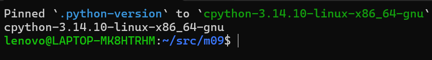

**Pembahasan:** Perintah `uv python pin` menuliskan `cpython-3.14.10-linux-x86_64-gnu` ke `.python-version` dan mencetak `Pinned .python-version to cpython-3.14.10-linux-x86_64-gnu`. Berkas ini diletakkan di `~/src/m09` (induk keempat sub-proyek) agar seluruh `uv venv` di bawahnya memakai interpreter yang sama. `cat .python-version` membuktikan isinya. Percobaan pertama sempat mengetik `wsl -d Ubuntu-24.04` di dalam WSL sehingga muncul `Command 'wsl' not found`; perintah itu hanya berlaku di Windows, dan setelah layar dibersihkan hasil akhirnya berupa tiga baris bersih seperti pada gambar.

### C.2 Struktur Proyek dan Basis Data yang Dipakai Ulang

Modul mengasumsikan tersedianya arsip `src-09` berisi `graphql/{server,client}` dan `grpc/{server,client}`. Arsip tersebut tidak tersedia di komputer ini, sehingga strukturnya disusun mengikuti *listing* kode pada modul-09.pdf, lalu `departemen-sdm.db` dari modul 08 disalin ke kedua direktori server.

```
find src -type f | sort
cat src/graphql/server/requirements.txt src/graphql/client/requirements.txt \
    src/grpc/server/requirements.txt src/grpc/client/requirements.txt
sqlite3 src/graphql/server/departemen-sdm.db ".tables"
```

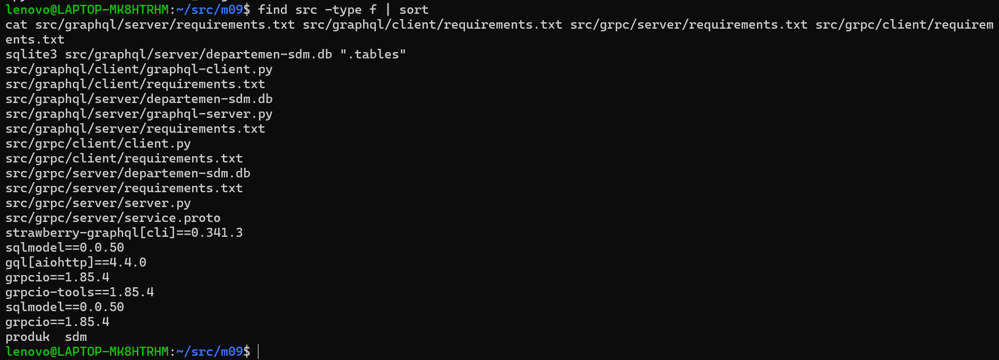

**Pembahasan:** `find` menampilkan sebelas berkas: `graphql-server.py`, `graphql-client.py`, `service.proto`, `server.py`, `client.py`, empat `requirements.txt`, dan dua salinan `departemen-sdm.db`. Empat `requirements.txt` menunjukkan pembagian dependensi: `strawberry-graphql[cli]==0.341.3` + `sqlmodel==0.0.50` untuk server GraphQL, `gql[aiohttp]==4.4.0` untuk client GraphQL, `grpcio` + `grpcio-tools` + `sqlmodel` untuk server gRPC, dan `grpcio` untuk client gRPC. Perintah `sqlite3 ... ".tables"` membalas `produk  sdm`, membuktikan basis data dari modul 08 sudah berisi kedua tabel yang dibutuhkan (GraphQL dan gRPC membaca berkas yang sama).

### C.3 Environment dan Dependensi GraphQL Server

```
cd ~/src/m09/src/graphql/server
uv venv
source .venv/bin/activate
export UV_DEFAULT_INDEX=https://mirrors.aliyun.com/pypi/simple
export UV_HTTP_TIMEOUT=180
uv pip install -r requirements.txt
```

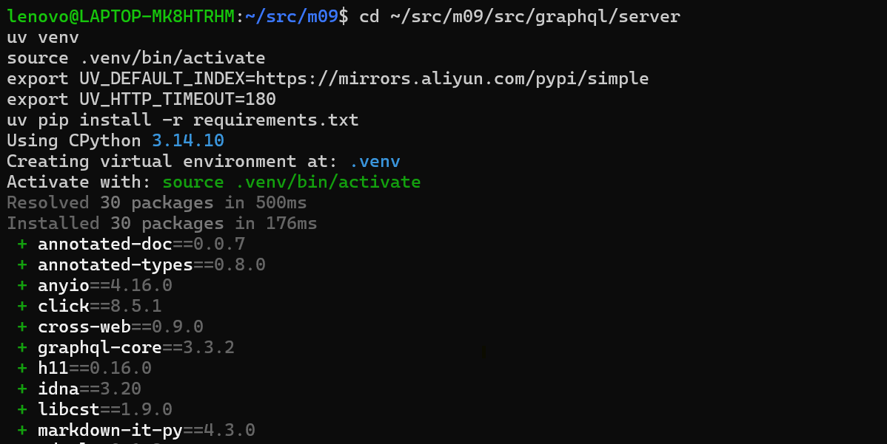

**Pembahasan:** `uv venv` mencetak `Using CPython 3.14.10` — versi diambil dari `.python-version` pada direktori induk, bukan Python sistem 3.12.3 — lalu membuat `.venv` dan memberi petunjuk `source .venv/bin/activate`. Setelah aktivasi, prompt diawali `(server)`. Ekspor `UV_DEFAULT_INDEX` diperlukan karena koneksi ke PyPI dari WSL ini gagal *timeout*; `UV_HTTP_TIMEOUT` memperbesar batas waktu unduhan. `uv pip install` menyelesaikan 30 paket, termasuk `strawberry-graphql`, `sqlmodel`, `sqlalchemy`, `uvicorn`, dan `typer` (bagian awal daftar terlihat pada gambar ini).

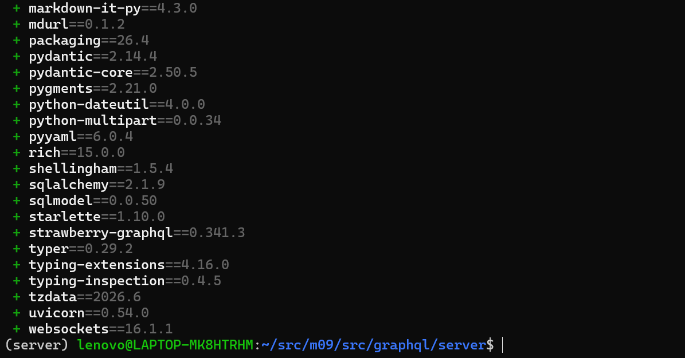

**Pembahasan:** Bagian kedua memuat sisa daftar paket hingga `websockets==16.1.1` dengan ringkasan `Installed 30 packages in 176ms`. Kehadiran `typer`, `uvicorn`, dan `websockets` berasal dari *extra* `[cli]` pada `strawberry-graphql` — tanpa extra tersebut perintah `strawberry dev` tidak tersedia karena modul CLI-nya tidak ikut terpasang.

### C.4 Environment dan Dependensi GraphQL Client

```
deactivate
cd ~/src/m09/src/graphql/client
uv venv
source .venv/bin/activate
uv pip install -r requirements.txt
```

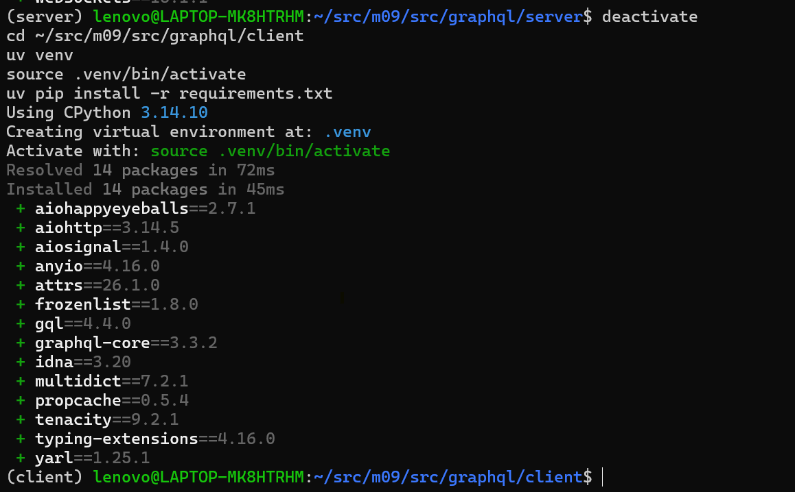

**Pembahasan:** `deactivate` melepas environment `(server)` sebelum pindah direktori, sesuai peringatan modul agar tidak memasang paket ke environment yang salah. Hasilnya 14 paket: `gql==4.4.0`, `aiohttp` beserta dependensinya (`aiohappyeyeballs`, `aiosignal`, `frozenlist`, `multidict`, `yarl`), `graphql-core`, `anyio`, `attrs`, dan `tenacity`. Client tidak membutuhkan SQLModel maupun Strawberry karena hanya mengirim query HTTP ke server; setelah aktivasi prompt menjadi `(client)`.

### C.5 Environment dan Dependensi gRPC Server

```
deactivate
cd ~/src/m09/src/grpc/server
uv venv
source .venv/bin/activate
uv pip install -r requirements.txt
```

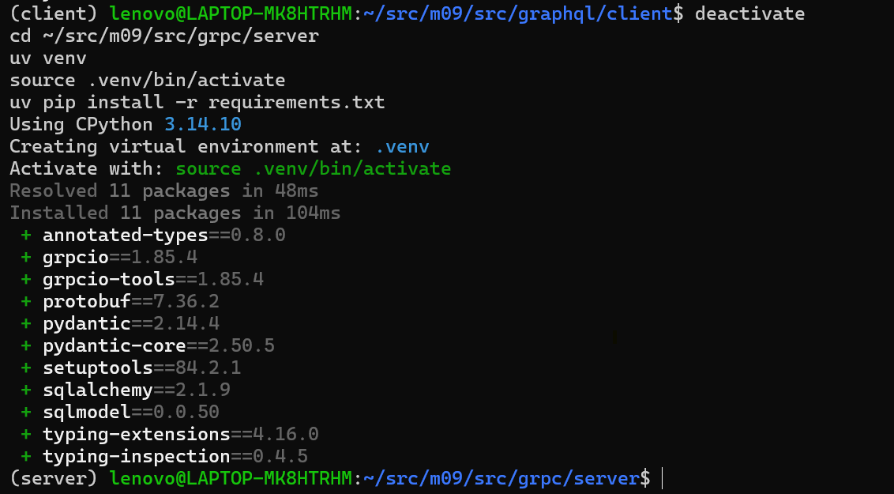

**Pembahasan:** Sebelas paket terpasang: `grpcio==1.85.4`, `grpcio-tools==1.85.4`, `protobuf==7.36.2`, `sqlmodel==0.0.50` beserta `sqlalchemy`, `pydantic`, dan `pydantic-core`. `grpcio-tools` penting karena membawa `protoc` versi Python yang dipakai untuk mengompilasi berkas `.proto`; `protobuf` adalah *runtime* yang dibutuhkan berkas hasil kompilasi. Direktori ini juga memuat `departemen-sdm.db` sehingga server dapat langsung membaca tabel `sdm`.

### C.6 Environment dan Dependensi gRPC Client

```
deactivate
cd ~/src/m09/src/grpc/client
uv venv
source .venv/bin/activate
uv pip install -r requirements.txt
```

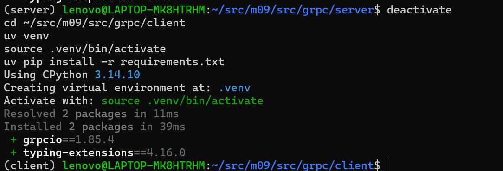

**Pembahasan:** Requirements client pada awalnya hanya berisi `grpcio==1.85.4`, sehingga hanya dua paket terpasang (`grpcio` dan `typing-extensions`). Ternyata stub hasil kompilasi juga membutuhkan runtime `protobuf`; kekurangan ini muncul sebagai error saat client dijalankan dan diperbaiki pada langkah C.16, sehingga `requirements.txt` client akhirnya berisi `grpcio` dan `protobuf`.

### C.7 Kode GraphQL Server

```
cat graphql-server.py
```

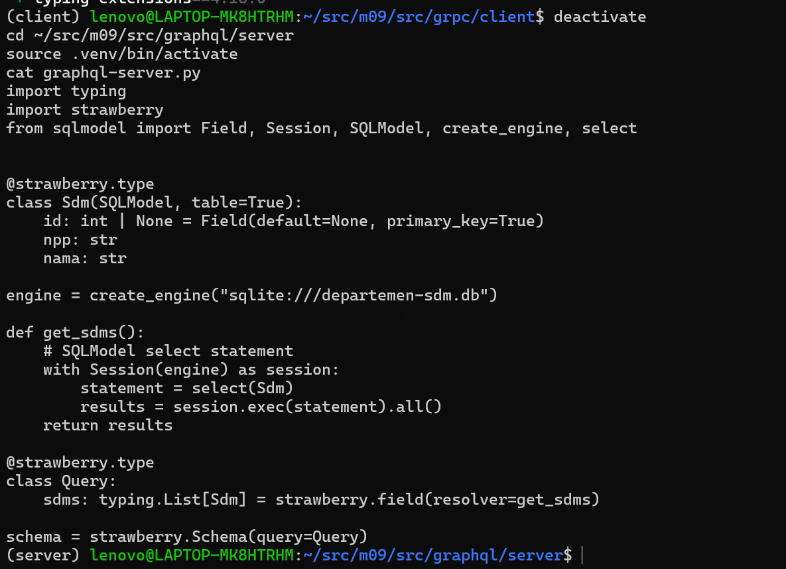

**Pembahasan:** Berkas 27 baris ini memuat tiga bagian: (1) `@strawberry.type class Sdm(SQLModel, table=True)` yang berperan ganda sebagai model tabel dan tipe GraphQL, (2) `engine` SQLAlchemy ke `sqlite:///departemen-sdm.db` beserta resolver `get_sdms()` yang membaca seluruh baris dengan `select(Sdm)`, dan (3) `class Query` dengan field `sdms: typing.List[Sdm]` yang dihubungkan ke resolver lewat `strawberry.field(resolver=get_sdms)`, ditutup dengan `strawberry.Schema(query=Query)`. Perhatikan bahwa koneksi memakai path relatif, sehingga server harus dijalankan dari direktori yang berisi berkas basis data.

### C.8 Menjalankan GraphQL Server

```
strawberry dev graphql-server
```

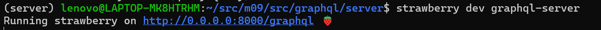

**Pembahasan:** `strawberry dev` mengimpor berkas `graphql-server.py`, membangun skema, lalu menjalankan uvicorn dan mencetak `Running strawberry on http://0.0.0.0:8000/graphql 🍓`. Karena *host*-nya `0.0.0.0`, server dapat diakses dari browser Windows melalui `localhost:8000` (WSL 2 meneruskan port ke Windows). Perintah ini memblokir terminal — terminal tersebut menjadi "terminal server" dan tidak boleh dipakai mengetik perintah lain, karena input hanya akan menumpuk dan baru dieksekusi setelah server dihentikan.

### C.9 Query dari GraphQL Explorer

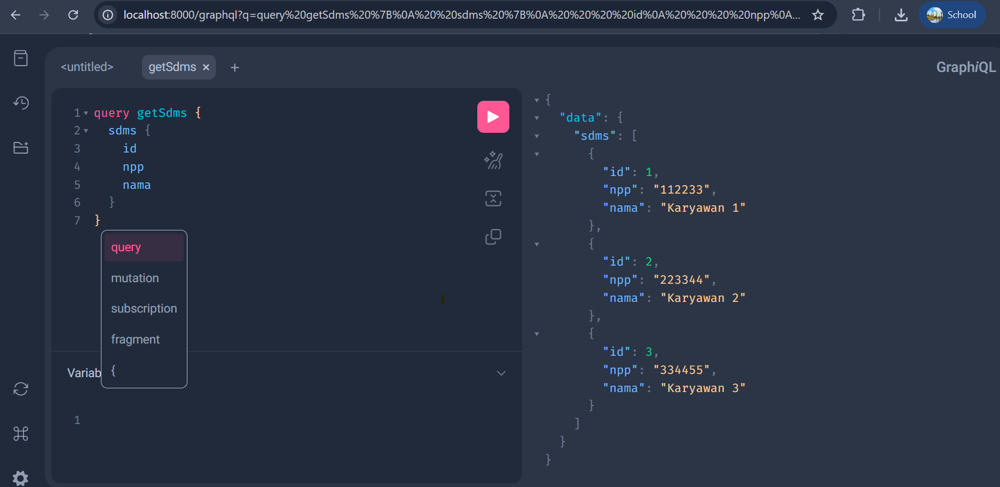

**Pembahasan:** Halaman `http://localhost:8000/graphql` menampilkan GraphiQL: editor di kiri, hasil di kanan. Query `getSdms` meminta field `id`, `npp`, dan `nama` dari `sdms`, lalu Ctrl+Enter menjalankannya. Respons `{"data": {"sdms": [...]}}` berisi tiga karyawan (`112233 Karyawan 1`, `223344 Karyawan 2`, `334455 Karyawan 3`) — sama dengan isi tabel `sdm`. Terlihat bahwa bentuk respons persis mengikuti bentuk query, ciri khas GraphQL dibanding REST yang bentuk responsnya ditentukan server. Percobaan pertama sempat menampilkan `Not Found` karena halaman dibuka sebelum server selesai berjalan dan URL terpotong menjadi `/graphq`; setelah server siap dan URL ditulis lengkap, halaman GraphiQL muncul normal.

### C.10 Kode GraphQL Client

```
cat graphql-client.py
```

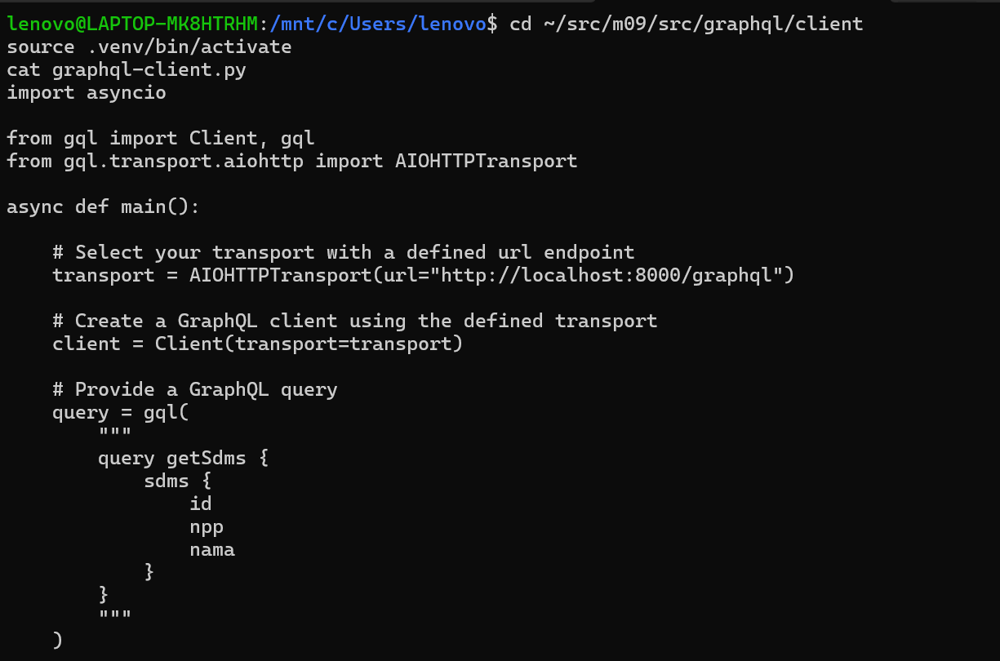

**Pembahasan:** Bagian pertama memuat import `asyncio`, `Client` dan `gql` dari pustaka `gql`, serta `AIOHTTPTransport` untuk transport HTTP asinkron. `AIOHTTPTransport(url="http://localhost:8000/graphql")` menunjuk endpoint GraphQL, lalu `Client(transport=transport)` membungkus transport tersebut. Query ditulis sebagai string GraphQL di dalam `gql("""...""")` dengan nama operasi `getSdms` dan field yang sama seperti pada Explorer.

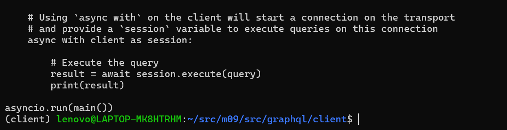

**Pembahasan:** Bagian kedua menunjukkan pola `async with client as session:` — blok ini membuka koneksi, menyediakan variabel `session`, lalu menutupnya otomatis. `await session.execute(query)` mengirim query dan mengembalikan hasil sebagai `dict` Python, yang dicetak dengan `print(result)`. Berkas diakhiri `asyncio.run(main())` sebagai titik masuk program.

### C.11 Menjalankan GraphQL Client

```
python graphql-client.py
```

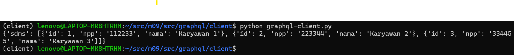

**Pembahasan:** Output satu baris `{'sdms': [{'id': 1, 'npp': '112233', 'nama': 'Karyawan 1'}, {'id': 2, ...}, {'id': 3, ...}]}` berisi tiga karyawan — identik dengan hasil di Explorer. Ini membuktikan client `gql` dan GraphiQL mengakses endpoint yang sama; perbedaannya hanya pada alat, bukan protokol. Karena client berjalan di terminal kedua, server GraphQL di terminal pertama tetap melayani permintaan.

### C.12 Berkas `service.proto`

```
cat service.proto
```

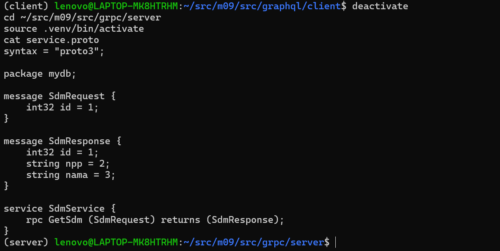

**Pembahasan:** Berkas 19 baris ini mendefinisikan `syntax = "proto3"` dan `package mydb`. Terdapat dua message: `SdmRequest` dengan satu field `int32 id = 1`, dan `SdmResponse` dengan `int32 id`, `string npp`, dan `string nama`. Service `SdmService` memiliki satu rpc `GetSdm` yang menerima `SdmRequest` dan mengembalikan `SdmResponse`. Nomor field (`= 1`, `= 2`, `= 3`) adalah identitas field di jaringan, sehingga harus sama pada server dan client.

### C.13 Kompilasi `service.proto`

```
python -m grpc_tools.protoc -I. --python_out=. --grpc_python_out=. service.proto
ls -la service_pb2*
```

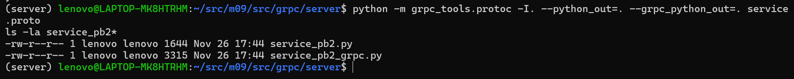

**Pembahasan:** Perintah `protoc` menghasilkan dua berkas: `service_pb2.py` (1.644 byte, kelas message hasil serialisasi) dan `service_pb2_grpc.py` (3.315 byte, kelas `SdmServiceStub` dan `SdmServiceServicer`). Opsi `-I.` menetapkan direktori pencarian `import` ke direktori saat ini, sedangkan `--python_out=.` dan `--grpc_python_out=.` menaruh hasil di direktori yang sama. Kedua berkas ini adalah hasil generasi dan tidak boleh diedit manual — perubahan dilakukan pada `service.proto` lalu dikompilasi ulang.

### C.14 Kode gRPC Server

```
cat server.py
```

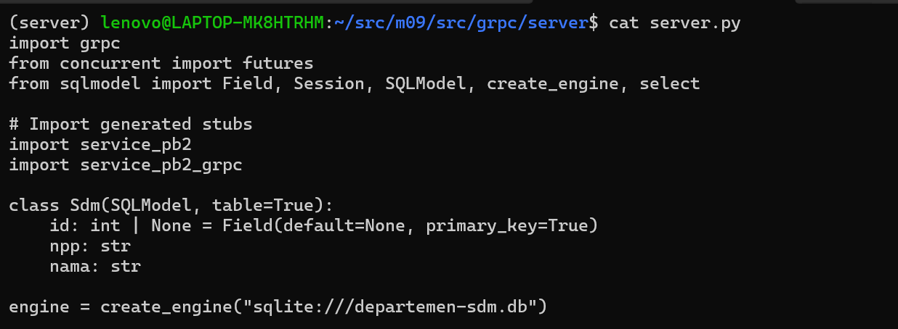

**Pembahasan:** Bagian pertama memuat import `grpc`, `futures` dari `concurrent`, SQLModel, serta stub hasil kompilasi (`service_pb2` dan `service_pb2_grpc`). Model `Sdm` dan `engine` sama seperti pada server GraphQL, memperlihatkan bahwa kedua mekanisme API dapat memakai model dan basis data yang identik. Berkas yang di-*cat* adalah versi utuh `server.py`, sehingga pembagian dua layar di sini hanya untuk keterbacaan.

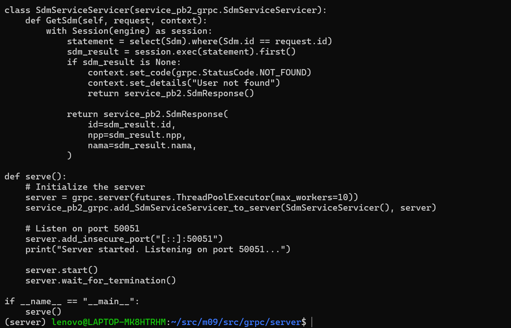

**Pembahasan:** Bagian kedua memuat kelas `SdmServiceServicer` yang mewarisi `service_pb2_grpc.SdmServiceServicer` dan mengimplementasikan `GetSdm`: query `select(Sdm).where(Sdm.id == request.id)`, ambil baris pertama dengan `.first()`, lalu bila `None` set `grpc.StatusCode.NOT_FOUND` dengan detail `"User not found"`; bila ada, kembalikan `service_pb2.SdmResponse(id=..., npp=..., nama=...)` — objek inilah yang diserialisasi menjadi biner oleh protobuf. Fungsi `serve()` membuat `grpc.server` dengan `ThreadPoolExecutor(max_workers=10)`, mendaftarkan servicer memakai `add_SdmServiceServicer_to_server`, membuka port 50051 dengan `add_insecure_port("[::]:50051")` (tanpa TLS, sesuai praktikum), lalu `server.start()` dan `wait_for_termination()`.

### C.15 Menjalankan gRPC Server

```
python server.py
```

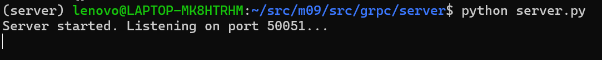

**Pembahasan:** Server mencetak `Server started. Listening on port 50051...` dan tetap berjalan (terminal terkunci). Berbeda dari Strawberry yang mencetak log HTTP, gRPC server tidak menampilkan apa pun saat menerima permintaan, sehingga bukti keberhasilan harus dilihat dari sisi client. Server ini dapat hidup bersamaan dengan GraphQL server karena memakai port berbeda (50051 vs 8000).

### C.16 Kode dan Eksekusi gRPC Client

```
cat client.py
```

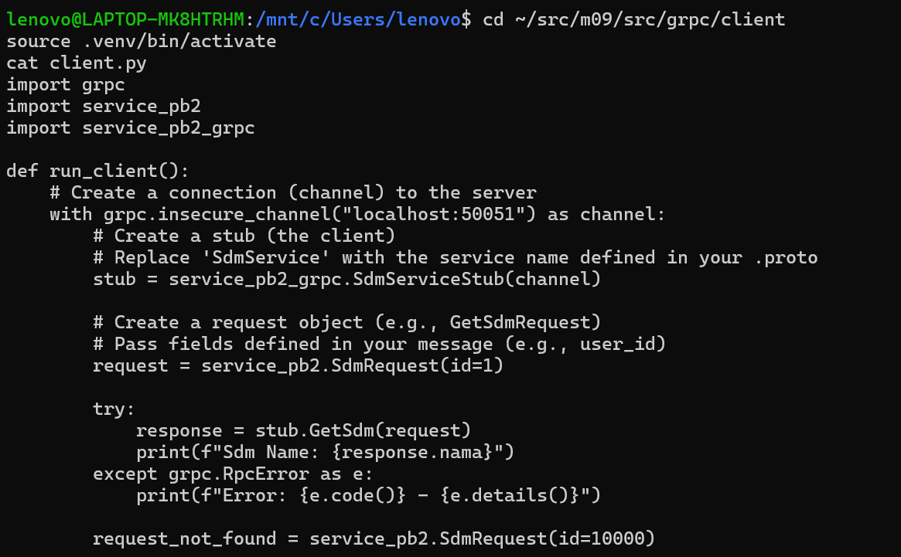

**Pembahasan:** Bagian pertama membuat koneksi dengan `grpc.insecure_channel("localhost:50051")` — pasangan dari `add_insecure_port` di server — lalu membentuk stub `service_pb2_grpc.SdmServiceStub(channel)`. `service_pb2.SdmRequest(id=1)` adalah objek permintaan yang akan diserialisasi. Pemanggilan `stub.GetSdm(request)` terasa seperti memanggil method lokal, padahal permintaan dikirim lewat jaringan.

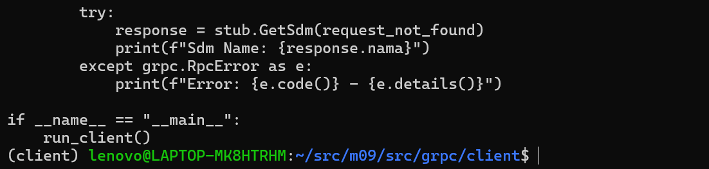

**Pembahasan:** Bagian kedua memuat dua blok `try/except grpc.RpcError`. Blok pertama meminta id 1 (ada) dan mencetak `Sdm Name: ...`; blok kedua meminta id 10000 (tidak ada) dan mencetak `Error: {e.code()} - {e.details()}`. Status error tidak dilempar sebagai exception HTTP, melainkan sebagai `grpc.RpcError` berisi `StatusCode` dan detail — inilah cara gRPC menyampaikan kegagalan terstruktur.

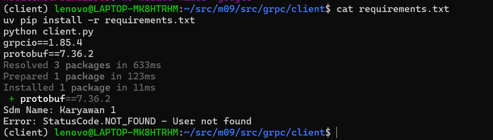

**Pembahasan:** Gambar ini mencatat dua kendala sekaligus solusinya. `python client.py` pertama kali gagal dengan `ModuleNotFoundError: No module named 'service_pb2'` karena stub hasil kompilasi hanya dibuat di direktori server; solusinya menyalin `service_pb2.py` dan `service_pb2_grpc.py` ke direktori client, sesuai catatan modul bahwa hasil kompilasi server dan client harus sama. Percobaan berikutnya gagal lagi dengan `ModuleNotFoundError: No module named 'google'` karena runtime `protobuf` belum terpasang di environment client; `requirements.txt` client diperbaiki menjadi `grpcio` + `protobuf`, lalu dipasang. Setelah itu output akhirnya benar: `Sdm Name: Karyawan 1` dan `Error: StatusCode.NOT_FOUND - User not found`.

### C.17 Tugas 1 — Endpoint GraphQL untuk Tabel `produk`

Server GraphQL diperluas dengan tipe `Produk` dan field `produk` pada `Query`, sehingga satu endpoint `/graphql` melayani dua tabel.

```
cat graphql-server.py
```

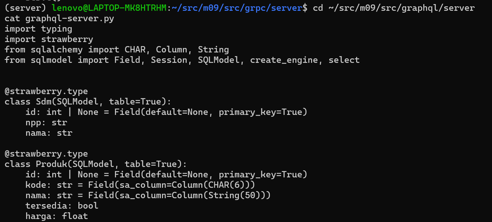

**Pembahasan:** Bagian pertama menambahkan import `CHAR`, `Column`, dan `String` dari SQLAlchemy. Kelas `Produk` memakai `sa_column=Column(CHAR(6))` untuk `kode` dan `Column(String(50))` untuk `nama`, sehingga tipe kolom mengikuti tabel yang dibuat pada modul 08; `tersedia: bool` dan `harga: float` langsung dipetakan menjadi field GraphQL bertipe `Boolean` dan `Float`. Dekorator `@strawberry.type` membuat kelas yang sama berfungsi sebagai model SQLModel dan tipe GraphQL.

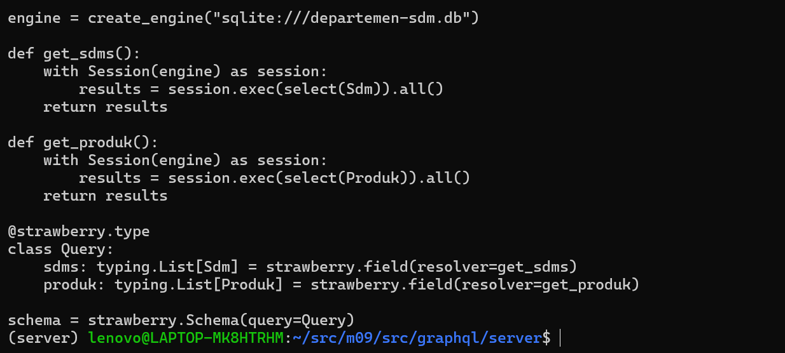

**Pembahasan:** Bagian kedua menambahkan resolver `get_produk()` yang membaca seluruh baris tabel `produk`, lalu `Query` memiliki dua field: `sdms` dan `produk`, masing-masing terhubung ke resolver-nya. Berkas tetap diakhiri `strawberry.Schema(query=Query)`. Karena `strawberry dev` tidak memakai *auto-reload*, server lama harus dihentikan (Ctrl+C) dan dijalankan ulang agar skema baru aktif — jika tidak, query `produk` akan dijawab `Cannot query field 'produk' on type 'Query'`.

### C.18 Query `produk` dari GraphQL Explorer

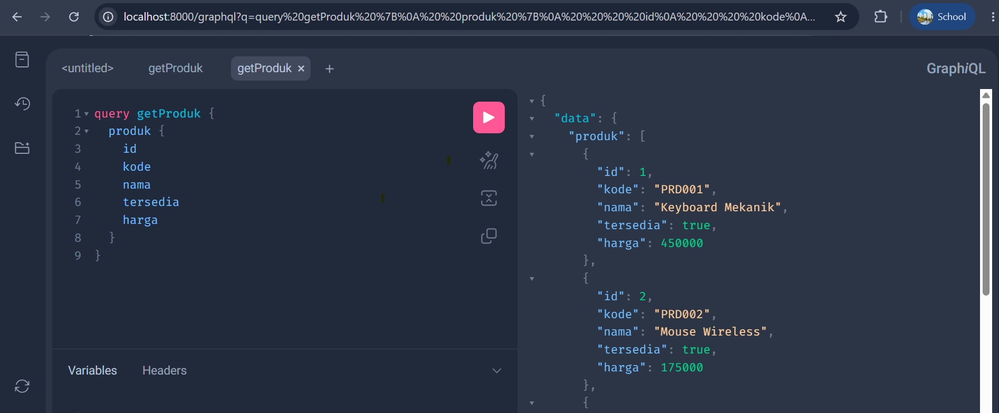

**Pembahasan:** Query `getProduk` meminta kelima field tabel `produk`. Hasil di sisi kanan diawali `"data": {"produk": [` dengan produk pertama `id: 1, kode: "PRD001", nama: "Keyboard Mekanik", tersedia: true, harga: 450000`, lalu `PRD002 Mouse Wireless` (`tersedia: true`, `harga: 175000`). Nilai `tersedia` tampil sebagai `true`/`false` meskipun SQLite menyimpannya sebagai 1/0 — konversi dilakukan oleh SQLModel dan Strawberry sesuai tipe `bool`.

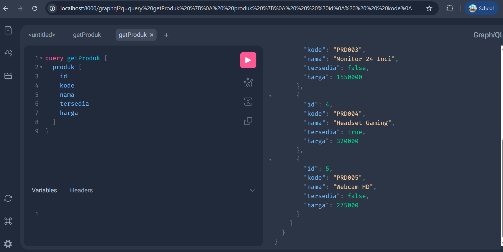

**Pembahasan:** Bagian lanjutan menampilkan `PRD003 Monitor 24 Inci` (`tersedia: false`, `harga: 1550000`), `PRD004 Headset Gaming` (`true`, `320000`), dan `PRD005 Webcam HD` (`false`, `275000`). Kelima data dari tugas modul 08 terbaca lengkap melalui GraphQL. Dua screenshot diperlukan semata-mata karena panjang respons melebihi satu layar, bukan karena query dipecah.

### C.19 Client GraphQL untuk Tabel `produk`

```
cat graphql-client-produk.py
```

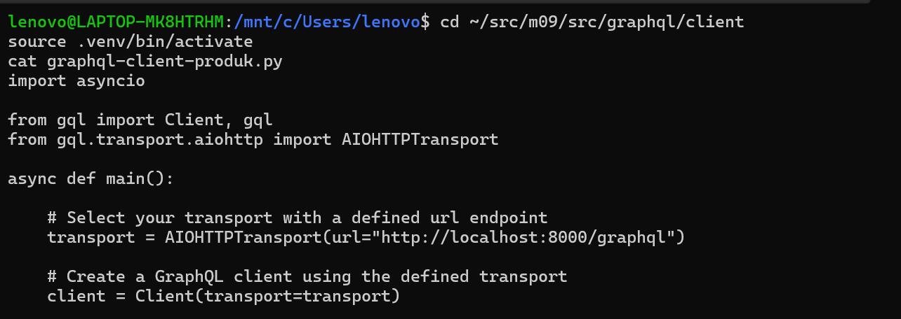

**Pembahasan:** Struktur client sama dengan contoh `sdm`: transport `AIOHTTPTransport` ke `http://localhost:8000/graphql`, lalu query `getProduk` yang meminta `id`, `kode`, `nama`, `tersedia`, dan `harga`. Perbedaan hanya pada nama operasi dan field yang diminta, menunjukkan bahwa satu endpoint GraphQL dapat melayani banyak kebutuhan tanpa menambah URL.

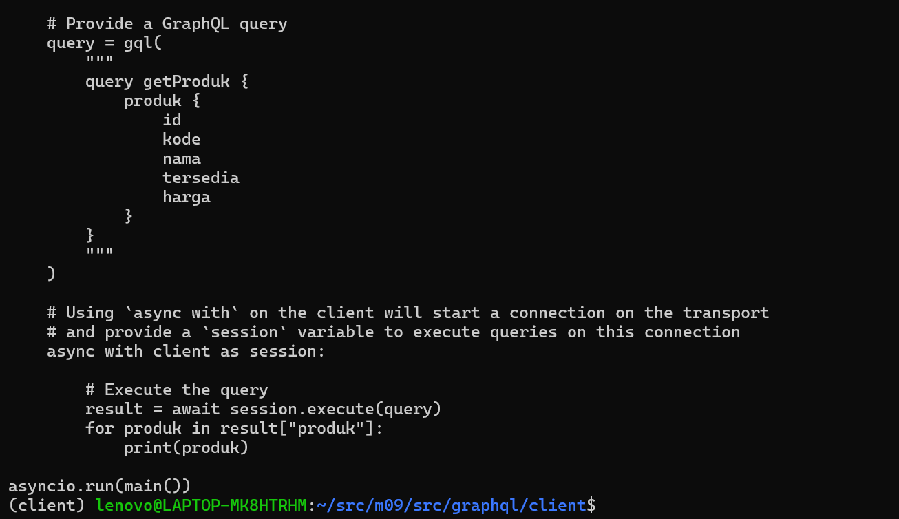

**Pembahasan:** Bagian kedua mengganti `print(result)` dengan perulangan `for produk in result["produk"]: print(produk)`. Hasil query tetap berupa `dict`, tetapi karena yang ingin ditunjukkan adalah daftar produk, tiap elemen list dicetak per baris agar mudah dibaca. Nama field pada query harus sama dengan nama field pada skema server; field yang tidak ada akan ditolak sebelum resolver dijalankan.

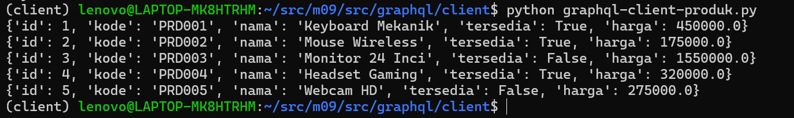

**Pembahasan:** Output lima baris dict membuktikan seluruh data `produk` terbaca lewat client: `PRD001 Keyboard Mekanik` (`True`, `450000.0`), `PRD002 Mouse Wireless` (`True`, `175000.0`), `PRD003 Monitor 24 Inci` (`False`, `1550000.0`), `PRD004 Headset Gaming` (`True`, `320000.0`), dan `PRD005 Webcam HD` (`False`, `275000.0`). Nilai `harga` bertipe float sehingga tercetak dengan `.0`, sesuai tipe FLOAT pada skema SQLite. Dengan demikian Tugas 1 selesai: endpoint GraphQL untuk tabel `produk` beserta contoh akses client yang mengambil semua data.

### C.20 Tugas 2 — Berkas `produk.proto`

```
cat produk.proto
```

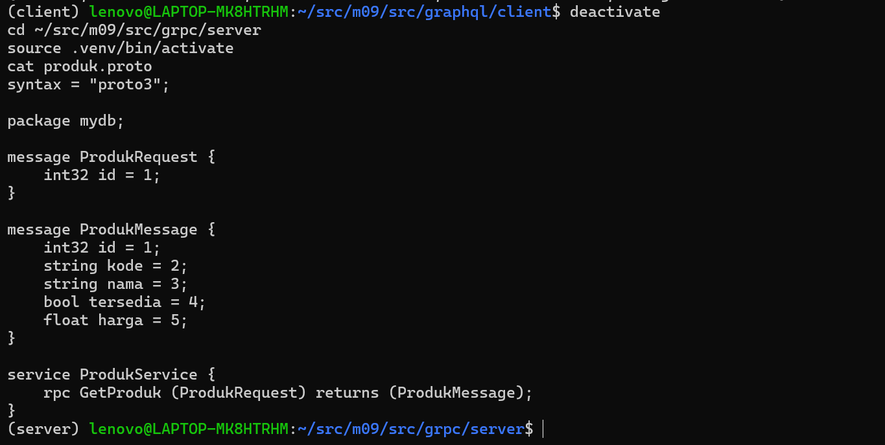

**Pembahasan:** Berkas proto untuk tabel `produk` mendefinisikan `ProdukRequest` (`int32 id`) dan `ProdukMessage` dengan lima field sesuai tipe tabel: `int32 id = 1`, `string kode = 2`, `string nama = 3`, `bool tersedia = 4`, dan `float harga = 5`. Service `ProdukService` memiliki rpc `GetProduk` yang menerima `ProdukRequest` dan mengembalikan `ProdukMessage`. Pemetaan tipe mengikuti aturan protobuf: `INTEGER` → `int32`, `CHAR`/`VARCHAR` → `string`, `BOOLEAN` → `bool`, `FLOAT` → `float`.

### C.21 Kompilasi `produk.proto`

```
python -m grpc_tools.protoc -I. --python_out=. --grpc_python_out=. produk.proto
ls -la produk_pb2*
cp produk_pb2.py produk_pb2_grpc.py ~/src/m09/src/grpc/client/
```

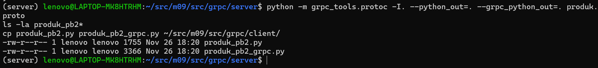

**Pembahasan:** Kompilasi menghasilkan `produk_pb2.py` (1.755 byte) dan `produk_pb2_grpc.py` (3.366 byte), lebih besar dari stub `sdm` karena message-nya memiliki lebih banyak field. Berbeda dari percobaan contoh di C.16 yang baru menyalin stub setelah client gagal, kali ini penyalinan ke direktori client dilakukan langsung setelah kompilasi agar `client_produk.py` dapat mengimpor `produk_pb2` sejak awal. Bila `produk.proto` diubah, kedua berkas harus dikompilasi ulang dan disalin ulang ke client agar kontraknya tetap sama.

### C.22 Kode gRPC Server untuk Tabel `produk`

```
cat server_produk.py
```

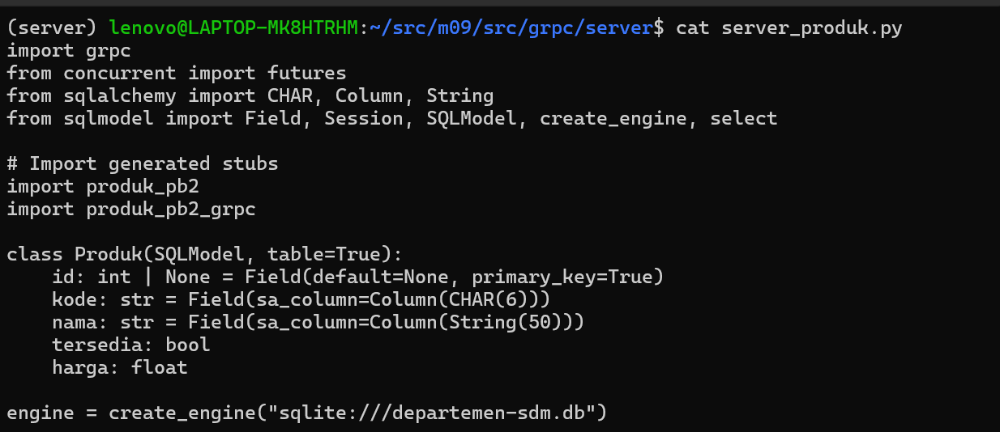

**Pembahasan:** Bagian pertama memuat import `grpc`, `futures`, `CHAR`/`Column`/`String` dari SQLAlchemy, SQLModel, serta stub `produk_pb2` dan `produk_pb2_grpc`. Model `Produk` memakai `sa_column` untuk `CHAR(6)` dan `VARCHAR(50)`, sedangkan `tersedia: bool` dan `harga: float` dipetakan langsung. `engine` menunjuk berkas basis data yang sama dengan server `sdm` dan GraphQL.

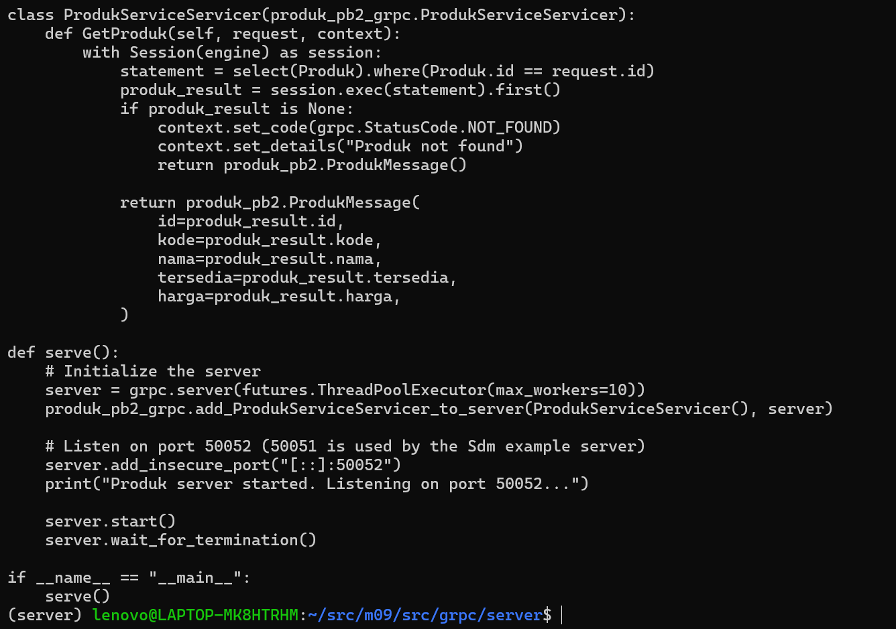

**Pembahasan:** Bagian kedua memuat kelas `ProdukServiceServicer` yang mengimplementasikan `GetProduk`: mencari baris berdasarkan `request.id`, dan bila tidak ditemukan menetapkan `grpc.StatusCode.NOT_FOUND` dengan detail `"Produk not found"`; bila ditemukan, mengembalikan `produk_pb2.ProdukMessage` berisi kelima field, termasuk `bool` dan `float` yang dikirim sebagai tipe protobuf asli. `serve()` mendaftarkan servicer pada `produk_pb2_grpc.add_ProdukServiceServicer_to_server` dan membuka **port 50052**, bukan 50051, karena server contoh `sdm` masih berjalan di port tersebut. Dua service gRPC yang berbeda pada satu mesin harus memakai port berbeda — analog dengan dua proses service pada arsitektur microservices.

### C.23 Menjalankan gRPC Server `produk`

```
python server_produk.py
```

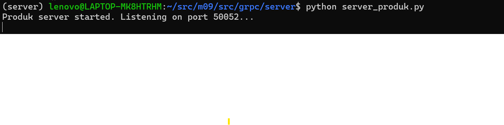

**Pembahasan:** Server mencetak `Produk server started. Listening on port 50052...` dan tetap berjalan di terminalnya sendiri. Saat gambar diambil, server `sdm` di port 50051 juga masih aktif, sehingga dapat ditunjukkan bahwa dua service gRPC hidup berdampingan. Keduanya membaca basis data SQLite yang sama, tetapi mengekspos kontrak yang berbeda (`SdmService` dan `ProdukService`).

### C.24 Kode gRPC Client untuk Tabel `produk`

```
cat client_produk.py
```

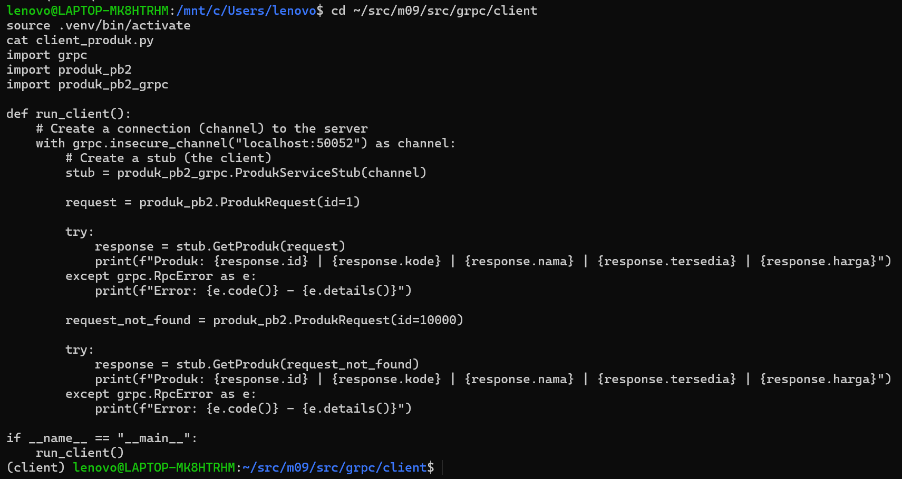

**Pembahasan:** Client membuka `grpc.insecure_channel("localhost:50052")` dan membentuk `ProdukServiceStub`. Permintaan pertama `ProdukRequest(id=1)` mencetak kelima field dengan pemisah `|`, sedangkan permintaan kedua memakai `id=10000` untuk memancing status `NOT_FOUND`. Pola `try/except grpc.RpcError` sama seperti client `sdm`, hanya berbeda stub dan message.

### C.25 Menjalankan gRPC Client `produk`

```
python client_produk.py
```

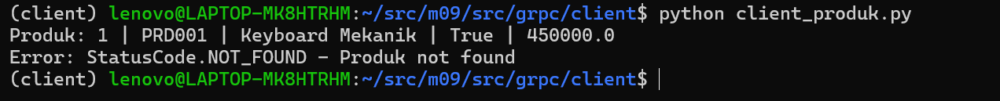

**Pembahasan:** Output `Produk: 1 | PRD001 | Keyboard Mekanik | True | 450000.0` menunjukkan seluruh field terbaca: `kode` dan `nama` sebagai string, `tersedia` sebagai `True` (bool), dan `harga` sebagai `450000.0` (float). Baris kedua `Error: StatusCode.NOT_FOUND - Produk not found` membuktikan penanganan data yang tidak ada berjalan sesuai rancangan, dengan kode status dan detail yang dikirim server. Dengan demikian Tugas 2 selesai: `produk.proto` didefinisikan, dikompilasi, server dijalankan, dan client mengambil salah satu data.

## D. HASIL DAN PEMBAHASAN

### D.1 Ringkasan Hasil

| Tahap | Perintah utama | Hasil | Bukti |
|---|---|---|---|
| Pin Python | `uv python pin cpython-3.14.10...` | `.python-version` = 3.14.10 | 01 |
| Struktur + DB | `find`, `sqlite3 .tables` | 11 berkas, tabel `produk sdm` | 02 |
| Dependensi | `uv pip install -r requirements.txt` | 30 / 14 / 11 / 2 paket | 03a–06 |
| GraphQL server | `strawberry dev graphql-server` | GraphiQL di :8000 | 07–09 |
| GraphQL client | `python graphql-client.py` | 3 karyawan | 10–11 |
| Proto contoh | `protoc service.proto` | `service_pb2*.py` | 12–13 |
| gRPC server | `python server.py` | listen :50051 | 14–15 |
| gRPC client | `python client.py` | 1 data + NOT_FOUND | 16–17 |
| Tugas 1 | query `getProduk` | 5 produk | 18–21 |
| Tugas 2 | `produk.proto`, server :50052 | 1 produk + NOT_FOUND | 22–27 |

### D.2 Analisis

**Satu endpoint, banyak bentuk respons.** GraphQL memakai satu URL (`/graphql`) untuk semua data. Bentuk respons ditentukan query: meminta `sdms { id nama }` menghasilkan dua field, sedangkan `produk { id kode nama tersedia harga }` menghasilkan lima field. Pada REST, bentuk respons ditentukan server sehingga klien sering menerima field yang tidak perlu. Konsekuensinya, GraphQL lebih fleksibel bagi klien tetapi menyulitkan *caching* HTTP biasa dan membuka ruang query mahal, sehingga di produksi perlu pembatasan kedalaman query.

**Kontrak biner pada gRPC.** Berkas `.proto` berperan sebagai kontrak tunggal: server dan client mengimpornya lewat stub hasil kompilasi. Praktik ini terbukti ketika stub belum disalin ke client (`ModuleNotFoundError: service_pb2`) dan ketika runtime protobuf belum terpasang (`ModuleNotFoundError: google`) — dua kegagalan yang menunjukkan bahwa stub dan runtime adalah dua hal berbeda. Keuntungannya, pesan lebih ringkas dan tipe field terjamin oleh skema; kerugiannya, perubahan proto menuntut kompilasi ulang di kedua sisi dan isi pesan tidak dapat dibaca langsung seperti JSON.

**Dua service berdampingan.** Selama praktikum, tiga proses berjalan bersamaan: GraphQL server di 8000, gRPC `sdm` di 50051, dan gRPC `produk` di 50052. Ketiganya membaca berkas `departemen-sdm.db` yang sama, tetapi masing-masing mengekspos antarmuka berbeda. Inilah inti microservices: data dan logika dapat dipakai bersama melalui API, sementara tiap service dapat dijalankan, dihentikan, atau dipindahkan ke node lain secara mandiri — cukup mengubah alamat yang dihubungi klien.

**Pemetaan tipe lintas lapisan.** Satu nilai melewati beberapa representasi: SQLite menyimpan `tersedia` sebagai 1/0 dan `harga` sebagai REAL; SQLModel memetakannya menjadi `bool` dan `float`; GraphQL dan protobuf menampilkannya sebagai `Boolean`/`bool` dan `Float`/`float`. Hasil akhir di klien konsisten (`true`/`True`, `450000.0`), membuktikan pemetaan tipe berjalan benar. Tipe kolom `CHAR(6)` dan `VARCHAR(50)` tetap dipertahankan lewat `sa_column` agar skema tidak berubah saat model dipakai di dua server.

**Perbedaan penyampaian error.** gRPC mengirim status terstruktur (`StatusCode.NOT_FOUND` + detail) yang diterima klien sebagai `grpc.RpcError`, sedangkan GraphQL mengembalikan `data` bernilai `null` disertai daftar `errors` (terlihat saat field `produk` diminta sebelum server di-restart). Keduanya sama-sama memberi informasi kegagalan, tetapi bentuknya mengikuti filosofi protokol masing-masing.

### D.3 Kendala dan Solusi

1. **Python 3.14.5 tidak tersedia.** Modul meminta `cpython-3.14.5-linux-x86_64-gnu`, tetapi uv 0.13.7 hanya menawarkan 3.14.4 dan 3.14.10. Solusi: memakai **3.14.10**, versi stabil terbaru seri 3.14, dan mendokumentasikan perbedaan ini.

2. **Arsip `src-09` tidak tersedia.** Hanya ada `src-08.tar.bz2`, sedangkan modul mengasumsikan folder `src` berisi `graphql` dan `grpc`. Solusi: struktur dan seluruh kode disusun ulang mengikuti *listing* pada modul-09.pdf, lalu `departemen-sdm.db` dari modul 08 disalin ke kedua direktori server.

3. **`wsl -d Ubuntu-24.04` diketik di dalam WSL.** Muncul `Command 'wsl' not found, but can be installed with: sudo apt install wsl`. Perintah `wsl` hanya ada di sisi Windows. Solusi: di dalam WSL cukup `cd ~/src/m09`; untuk membuka shell baru gunakan `wsl -d Ubuntu-24.04` dari PowerShell.

4. **Halaman `Not Found` saat membuka Explorer.** Browser menampilkan `Not Found` karena halaman dibuka sebelum server siap dan URL terpotong menjadi `/graphq`. Solusi: pastikan terminal server sudah mencetak `Running strawberry on ...` lalu buka `http://localhost:8000/graphql` lengkap.

5. **Perintah diketik di terminal server yang terkunci.** Saat `strawberry dev` berjalan, perintah `deactivate`, `cd`, dan `cat` yang diketik di terminal yang sama hanya menumpuk dan tidak dieksekusi. Solusi: buka tab kedua (Ctrl+Shift+T → `wsl -d Ubuntu-24.04`) untuk client, dan biarkan terminal server tetap berjalan.

6. **Perintah tertempel di kolom pencarian browser.** `strawberry dev graphql-server` sempat masuk ke Yahoo Search karena fokus berada di jendela browser. Solusi: kembali ke jendela terminal dan ketik di sana.

7. **`ModuleNotFoundError: No module named 'service_pb2'`.** Stub hasil kompilasi hanya ada di direktori `grpc/server`. Sesuai catatan modul, hasil kompilasi untuk server dan client harus sama. Solusi: `cp service_pb2.py service_pb2_grpc.py` ke `grpc/client`.

8. **`ModuleNotFoundError: No module named 'google'`.** Runtime `protobuf` belum terpasang di environment client karena `requirements.txt` hanya memuat `grpcio`. Solusi: menambahkan `protobuf==7.36.2`, `uv pip install -r requirements.txt`, lalu client berjalan normal.

9. **`ERR_CONNECTION_REFUSED` setelah menghentikan server GraphQL.** Server dihentikan (Ctrl+C) untuk melihat kode baru, tetapi belum dijalankan ulang. Solusi: jalankan kembali `strawberry dev graphql-server`; perubahan kode tidak aktif tanpa restart karena dev server tidak memakai *auto-reload*.

## E. KESIMPULAN

1. GraphQL dan gRPC adalah dua alternatif mekanisme service selain REST: GraphQL menyatukan semua data pada satu endpoint dengan bentuk respons ditentukan klien, sedangkan gRPC memanggil method jarak jauh dengan serialisasi biner berdasarkan kontrak `.proto`.
2. Strawberry memungkinkan satu kelas SQLModel berperan sekaligus sebagai model tabel dan tipe GraphQL, sehingga endpoint `sdms` dapat dibangun hanya dengan deklarasi tipe, resolver, dan `Schema`.
3. GraphQL server berjalan di port 8000 dan dapat diuji dari GraphiQL Explorer maupun client `gql`; keduanya menghasilkan tiga data karyawan yang identik.
4. gRPC membutuhkan kompilasi `service.proto` menjadi `service_pb2.py` dan `service_pb2_grpc.py`; stub tersebut harus tersedia di server dan client, serta membutuhkan runtime `protobuf` di sisi client.
5. Tugas 1 selesai: tabel `produk` diekspos sebagai field `produk` pada skema GraphQL dan client berhasil mengambil kelima data (`PRD001`–`PRD005`) lengkap dengan tipe `Boolean` dan `Float`.
6. Tugas 2 selesai: `produk.proto` mendefinisikan kelima field beserta tipenya, server gRPC di port 50052 melayani `GetProduk`, dan client berhasil mengambil satu data (`PRD001`) serta menerima `NOT_FOUND` untuk id yang tidak ada.
7. Kendala yang muncul bersifat lingkungan dan konfigurasi (versi Python yang tidak tersedia, arsip sumber yang tidak ada, pemilihan terminal, stub dan runtime yang belum lengkap), bukan kesalahan logika pada kode service.

## F. REFERENSI

1. Materi Praktikum Sistem Terdistribusi dan Terdesentralisasi, Modul 09: Arsitektur Microservices untuk Sistem Terdistribusi — GraphQL dan gRPC.
2. Dokumentasi Strawberry GraphQL. https://strawberry.rocks/
3. Dokumentasi gql (GraphQL client for Python). https://github.com/graphql-python/gql
4. Dokumentasi gRPC. https://grpc.io/docs/
5. Protocol Buffers Documentation. https://protobuf.dev/
6. Dokumentasi SQLModel. https://sqlmodel.tiangolo.com/
7. SQLite Documentation. https://www.sqlite.org/docs.html
8. Dokumentasi uv. https://docs.astral.sh/uv/
